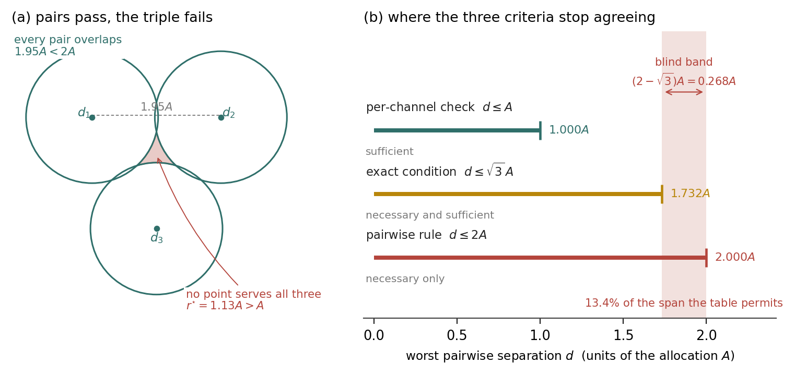
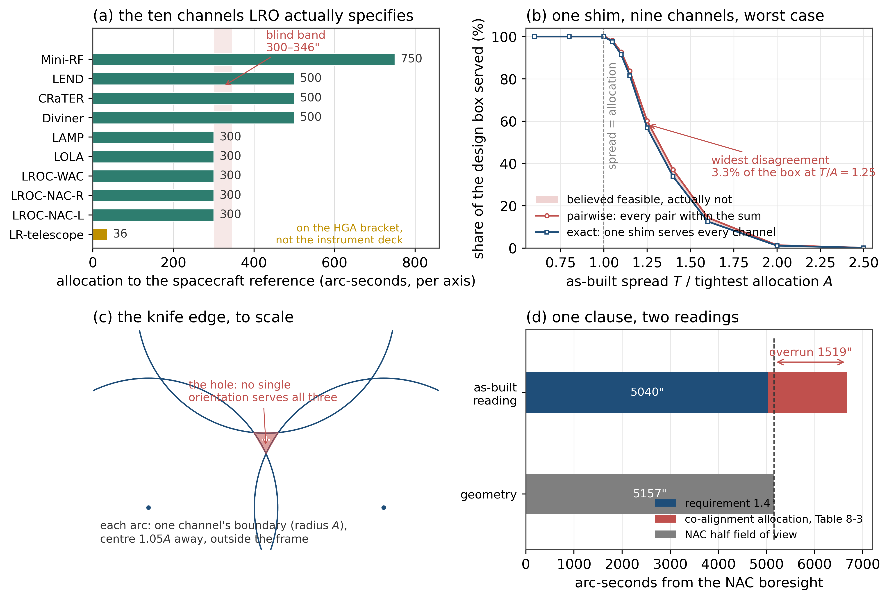

# When is a pairwise boresight tolerance table sufficient?

**A sharp bound, an unobservable regime, and a replay on a public ten-channel specification**

*Manuscript draft · 31 October 2026 · target: Precision Engineering (Technical Note), alternative: Optical Engineering*

---

## Abstract

Multi-channel payloads are usually given angular alignment budgets one channel at a time, and a common shortcut is to require that every *pair* of channels be alignable within the sum of their two allocations. This paper separates what that rule guarantees from what it is used to guarantee.

**The rule is precisely the two-channel condition.** For two channels it is necessary and sufficient. For three or more it remains necessary but is implied by the per-channel check whenever the latter passes, so on conforming as-built data it is a tautology: it cannot disagree with anything, and no amount of conforming data can test it.

**Where it is used as a sufficient condition — to derive allocations — its optimism has a sharp constant.** With equal allocation $A$, a common orientation exists whenever the worst pairwise separation does not exceed $\sqrt{3}A$, whereas the pairwise rule admits $2A$. The blind band is $(2-\sqrt{3})A$, i.e. $13.4\%$ of the span the table permits, and it is attained by three channels in an equilateral configuration. The ratio is Jung's constant, not a new theorem.

**A replay on a public ten-channel alignment specification** (NASA LRO `431-SPEC-000113` Rev A) reproduces the single place where the document performs its own addition (a $1''$ margin on a two-camera pair), returns *undecided* for one field-of-view clause with a $1519''$ spread between two readings of the same sentence, recovers the document's mechanical partitioning from the numbers alone, and measures the disagreement: $0$ of $1200$ builds at the $3\sigma$ convention the document declares, rising to $3.3\%$ of the design box only when the as-built spread reaches $1.05$–$1.6$ times the tightest allocation.

The rule is therefore not wrong where such tables are written; it is **unobservable** there, and the regime where it is observable is one where the build has already violated the table. A three-question screen, computable from the table alone, separates the two regimes — and returns “not at risk” for the specification replayed here, which is consistent with the null result it predicts.

**Keywords**: boresight alignment; tolerance allocation; feasibility certificate; spherical caps; minimal enclosing circle; multi-instrument payload

---

## 1. Introduction

A camera, a laser rangefinder, a radar and a star tracker on one spacecraft share a mechanical reference. Each has an angular allocation: “aligned to the spacecraft reference to within 300 arc-seconds per axis”. The allocations are set during design and checked during assembly, and both activities are usually organised **pairwise**. The design rule is that the sum of two allocations must cover the worst relative misalignment the two channels can accumulate; the conformity rule is that every pair of as-built deviations must lie within the sum of their allocations.

The geometry behind this is elementary and old. Each channel's allocation is a disk (on the tangent plane) or a cap (on the sphere), and a single common orientation exists if and only if all of them intersect. That the pairwise non-intersection of convex sets does not imply the non-intersection of the whole family is Helly's theorem, in the plane since 1923; that a set of diameter $d$ in the plane fits in a circle of radius $d/\sqrt{3}$ is Jung's theorem, from 1901. Neither is in question here, and this paper claims neither.

What is worth writing down is narrower and, we think, more useful:

- **A statement of exactly what the pairwise rule is.** It is the $n=2$ feasibility condition, transplanted to $n\ge3$. Section 2.2 shows that on conforming data it is implied by the per-channel check, so it is not an independent test at all — a fact that explains a great deal of field experience.
- **The sharp constant of its optimism.** Section 2.3 gives the exact band in which the rule and the geometry disagree, shows it is attained, and identifies it as Jung's constant. The number is $13.4\%$ *of the tolerance span*, not $13.4\%$ of designs, and the distinction matters enormously for how the result should be read.
- **A measured replay.** Section 4 runs the criteria on a public document with ten real channels and real allocations. The document is not a straw man: it is careful, it is internally consistent, and it happens to be right in the one place it does arithmetic. The replay's value is that it produces a null result with a *reason*, and the reason generalises.
- **A screen.** Section 6 turns the reason into three questions that can be answered from the table itself, without any measurement. Applied to the replayed specification, the screen says “not at risk” on all three counts — before any of the measurement was done.

The contribution is therefore in the analysis of a widely used decision rule and in the measurement of how much the rule can matter, not in new geometry. Section 7 states what the paper does not show, including the one thing that would most change its conclusion.

## 2. The decision problem

### 2.1 Model

Let $n$ channels share one mounting interface. Channel $i$ has an as-built angular deviation $d_i\in\mathbb{R}^2$ from its nominal direction, expressed in the tangent plane at the common boresight, and an allocation $A_i$ (half-cone, per axis). A single shim of the interface displaces every channel by the same vector $x$; the residual of channel $i$ is $d_i-x$. The interface is adequate if

$$
\exists\,x\in\mathbb{R}^2:\quad \lVert d_i-x\rVert\le A_i \quad\text{for all } i=1,\dots,n .
\tag{1}
$$

Geometrically: the disks $D_i=D(d_i,A_i)$ have a common point.

Two remarks on the model, both of which bound the claims.

*Small angles.* The largest allocation in the replayed specification is $750''=0.208^\circ$, so the tangent-plane replacement of the sphere distorts distances by $O(\theta^2)\lesssim1.4\times10^{-5}$ in relative terms. We nevertheless cross-checked the planar solver against an independent spherical-cap solver on 300 random four-channel instances; the two disagreed on none.

*One interface is a counterfactual.* The replayed document aligns each instrument on its own cube, so no shared interface exists on that spacecraft. The replay asks what the document does not ask — what one interface would do — and uses the two places where the document's own arithmetic can be checked as validation, not as a claim about the flight article. This is deliberate: see Section 7.

### 2.2 Three criteria, and what each one is

Three tests appear in practice, and their logical relations are not symmetric.

| Test | Condition | Status |
|---|---|---|
| Per-channel | $\lVert d_i\rVert\le A_i$ for all $i$ | sufficient ($x=0$) |
| Pairwise | $\lVert d_i-d_j\rVert\le A_i+A_j$ for all $i\neq j$ | necessary |
| Exact | (1) | necessary and sufficient |

**Proposition 1 (the pairwise test is not an independent test).** If $\lVert d_i\rVert\le A_i$ for every $i$, then $\lVert d_i-d_j\rVert\le A_i+A_j$ for every pair.

*Proof.* Triangle inequality. $\square$

This is trivial, and that is the point. Whenever the per-channel check passes, the pairwise check passes too, and $x=0$ already satisfies (1) — no shim is needed and no geometry is involved. **On conforming data the pairwise test has no discriminating power whatsoever.** Its only informative use is the one nobody advertises: when at least one channel is *outside* its allocation and the question becomes whether a shim can still rescue the build. That is the rework question, and it is the regime measured in Section 4.4.

**Proposition 2 (two channels).** For $n=2$, the pairwise condition is necessary and sufficient: two disks intersect if and only if the distance between their centres does not exceed the sum of their radii.

Proposition 2 explains an empirical pattern that will matter later. Wherever a document writes a *sum*, it is almost always writing it for a pair — two cameras that must be co-aligned, a telescope that must fall inside another instrument's field of view. In exactly those places the shortcut is exact.

### 2.3 How much the rule can over-promise

Consider equal allocations $A_i=A$ and let $d=\max_{i,j}\lVert d_i-d_j\rVert$ be the worst pairwise separation. The pairwise rule accepts $d\le2A$. What does the geometry accept?

**Proposition 3 (sharp band).** Let $r^\star$ be the radius of the smallest disk containing all $d_i$, and set $\rho=r^\star/(d/2)$. Then

1. a common point exists if and only if $r^\star\le A$;
2. $\rho=1$ whenever the minimal disk is pinned by a diameter pair; otherwise $\rho>1$;
3. $\rho\le2/\sqrt{3}$ for every planar configuration, with equality for three points in an equilateral triangle.

*Proof.* (1) is the definition of $r^\star$. (2): $r^\star\ge d/2$ always, with equality exactly when the two farthest points are antipodal on the minimal circle. (3) is Jung's theorem in the plane, $r^\star\le d/\sqrt{3}$. $\square$

Consequently the pairwise rule is exact for two channels ($\rho=1$) and can be optimistic by at most $2/\sqrt{3}=1.1547$ for three or more. With equal allocations the disagreement region is

$$
\sqrt{3}\,A<d\le 2A,
\qquad (2-\sqrt{3})A=0.268\,A,
\qquad \frac{2-\sqrt{3}}{2}=1-\frac{\sqrt{3}}{2}=13.4\% .
\tag{2}
$$

That is: the table permits $13.4\%$ more spread than the geometry does, measured against the span the table permits; equivalently the band is $26.8\%$ of the allocation itself. Both numbers describe the same strip, and quoting one without the other is how the figure gets misread. For reference, with $A=300''$ the strip is $519.6''$–$600''$, i.e. $80.4''$ wide.

The band is non-empty in the strong sense: for every $d$ in it there are configurations that are feasible (three nearly collinear channels, whose minimal circle is the diameter circle, $r^\star=d/2\le A$ for all $d\le2A$) and configurations that are not (the equilateral triple, $r^\star=d/\sqrt{3}>A$). Feasibility is therefore not a function of $d$ alone, which is why no scalar summary of a table — not the largest pair, not the mean — can decide (1).

*Figure 1. (a) Three channels with equal allocation $A$ whose as-built deviations form an equilateral triangle of side $1.95A$: every pair overlaps ($1.95A<2A$) and no common orientation exists ($r^\star=1.13A>A$). (b) The three criteria on one axis; the shaded band is where the pairwise rule admits configurations that the geometry rejects.*

**Ring families.** For $n$ equally spaced channels on a circle, $\rho_n=1/\sin(\lfloor n/2\rfloor\pi/n)$: exactly $1$ for even $n$ (an antipodal pair pins the disk) and $1/\cos(\pi/2n)$ for odd $n$, peaking at $2/\sqrt{3}$ for $n=3$ and decaying to $1$ as $n$ grows: $1.1547,\ 1.0515,\ 1.0257,\ 1.0154$ for $n=3,5,7,9$. The worst case is thus *three* channels, not many — a counter-intuitive but useful fact for screening.

**Scale invariance.** Both thresholds in (2) are proportional to $A$, so the *fraction* is independent of the tolerance magnitude. A payload with $0.5^\circ$ allocations and one with $30^\circ$ allocations have identical disagreement geometry; only the absolute width changes. Whatever this failure is, it is not a small-angle or a numerical artifact.

### 2.4 Exact decision, witnesses, and what a certificate adds

The minimal enclosing disk is determined by two or three of the points, so (1) can be decided exactly by enumerating candidates — the $d_i$ themselves, and the pairwise circle intersections — and testing each against all constraints: $O(n^3)$, no solver, no tolerance parameter. Two by-products are more useful than the verdict:

- the **support set** (the two or three channels that pin the answer) answers “which channels would have to move”;
- the **minimal infeasible subset** (IIS), obtained by deletion, answers “which channels cannot share an interface”. By Helly's theorem in the plane, $|IIS|\le3$.

A three-valued verdict — feasible / infeasible / undecided — is only needed once non-convex constraints such as keep-out cones are added, and then the undecided branch must carry the unsearched area rather than a shrug. For the pure allocation problem of (1) the enumeration is complete, and a binary answer plus a witness is sufficient.

## 3. A public specification

`431-SPEC-000113` Rev A (NASA/GSFC, 2007) states, per instrument, an alignment allocation relative to the spacecraft reference, as a half-cone in arc-seconds per axis, at a stated confidence (“3 sigma or worst case”). Ten channels are specified: five at $300''$ (the two LROC narrow-angle cameras, the wide-angle camera, LOLA and LAMP), three at $500''$ (Diviner, CRaTER, LEND), Mini-RF at $750''$, and the laser-ranging telescope at $36''$.

Three of the four columns needed for a full replay are public: the nominal geometry, the allocation, and the reference frame. The fourth — the as-built deviation of each channel — is not, and will not be. We therefore treat the as-built spread $T$ as the free parameter and sweep it, reporting where the criteria separate rather than asserting a value we do not have. This is the only honest use of a public document here: it constrains the allocations, not the build.

## 4. Replay

### 4.1 The one place the document does arithmetic

Table 9-3 of the specification allocates $102''$ to the relative alignment of the two narrow-angle cameras against a requirement of $103''$ ($500\,\mu$rad) — a margin of $1''$. Two channels, so by Proposition 2 the pairwise rule is exact, and our solver reproduces the $102''$ capacity and the $1''$ margin with $\rho=1.000$.

This is not a coincidence to be passed over. The document's only pairwise addition is in the one case where pairwise addition is exact. The same arithmetic applied to three channels would over-state the capacity by $13.4\%$ — and the document contains no three-channel sum.

### 4.2 A clause with two readings

Section 8.4.2 requires LOLA's field of view to fall within $1.4^\circ=5040''$ of a narrow-angle camera's boresight; Table 8-3 allocates $1636''$ of co-alignment. The half field of view of a NAC is $0.05\,\mathrm{rad}/2=1.4324^\circ=5157''$.

Two readings are grammatically available. Under the first, $1.4^\circ$ bounds the *nominal* placement and the allocation is spent inside it, which is comfortable. Under the second, $1.4^\circ$ bounds the *as-built* placement, in which case the allocation exceeds the geometric room by $5040+1636-5157=1519''$ and the clause cannot be met. The document does not say which.

The output here is *undecided*, with the spread between the readings quantified. This is not fault-finding: a clause that will be signed off should not depend on which reading the reviewer adopts, and the value of the third verdict is that it makes the ambiguity a number rather than a footnote.

### 4.3 A partition recovered from the numbers

Take an as-built spread $T=220''$ (uniform in a disk, the worst-case convention) for the ten channels. The nine instruments on the deck, treated as one interface, are feasible with $140.3''$ of slack. Add the laser-ranging telescope — allocated $36''$, six times tighter than anything else — and the family becomes infeasible, with a deficit of $34.1''$; the minimal infeasible subset is $\{$LAMP, laser-ranging telescope$\}$, and loosening one allocation by $0.96''$ restores feasibility.

The specification's own Section 12.0 states that the laser-ranging optic is mounted on the HGA bracket, not on the instrument deck. The tool recovered the document's mechanical partitioning from ten numbers, without being told the partitioning. This is the practical content of the IIS: it is not a diagnostic about arithmetic, it is a statement about structure.

### 4.4 How large the gap is

Two sweeps, both on the nine deck instruments with their real, unequal allocations.

**Rescue regime.** As-built spread $T$ uniform in the design box, expressed as a multiple of the tightest allocation $A_{\min}=300''$. The pairwise rule and the exact test agree at $T/A_{\min}\le1$ (both $1.000$: with every channel inside its allocation, no shim is needed) and agree again above $1.6$ (both near zero). Between them the rule over-states the chance that one shim saves the build. The table gives the detail.

| $T/A_{\min}$ | 1.00 | 1.05 | 1.10 | 1.15 | 1.25 | 1.40 | 1.60 | 2.00 |
|---|---|---|---|---|---|---|---|---|
| pairwise says a shim exists | 1.000 | 0.982 | 0.926 | 0.837 | **0.602** | 0.370 | 0.144 | 0.014 |
| one actually exists | 1.000 | 0.976 | 0.915 | 0.815 | **0.569** | 0.338 | 0.126 | 0.011 |
| builds the table misses | 0.000 | 0.006 | 0.011 | 0.022 | **0.033** | 0.032 | 0.018 | 0.002 |

The peak is $3.3$ percentage points of the design box at $T/A_{\min}=1.25$, where the rule promises a rescue in $60.2\%$ of builds and geometry allows $56.9\%$ — a $5.8\%$ relative over-statement.

**Production regime.** The document declares its allocations at $3\sigma$. With Gaussian as-built errors and allocations scaled so that $A_{\min}=k\sigma$:

| $A_{\min}/\sigma$ | 1.2 | 1.6 | 2.0 | 2.4 | 3.0 |
|---|---|---|---|---|---|
| pairwise | 0.1692 | 0.5742 | 0.8692 | 0.9758 | 0.9983 |
| exact | 0.1575 | 0.5583 | 0.8600 | 0.9750 | 0.9983 |
| missed | 0.0117 | 0.0158 | 0.0092 | 0.0008 | **0.0000** |

At the specification's own convention — allocations at three standard deviations — the two criteria agree in $1200$ of $1200$ draws. The defect lives entirely below $A_{\min}/\sigma\approx2.4$, that is, in designs whose allocations have been squeezed to two standard deviations or less.

*Figure 2. Replay on the ten-channel specification. (a) The ten allocations, with the blind band of (2) marked at $300''$; the $36''$ laser-ranging telescope is mounted on the HGA bracket, not the instrument deck. (b) Share of the design box for which one shim exists: pairwise estimate against exact, nine deck instruments, worst-case convention. (c) The knife edge at $T=1.05A$: three boundary arcs of radius $A$ whose centres sit outside the frame. (d) The field-of-view clause of Section 4.2: requirement plus allocation exceeds the half field of view by $1519''$.*

## 5. Why the gap is invisible where the tables are written

Three features of this class of document, none of them accidents, keep the discrepancy from ever being observed.

**The clauses are pairwise.** Where a specification writes a sum, it writes it for two instruments (two cameras; one instrument inside another's field of view). Proposition 2 makes the shortcut exact there. Three instruments sharing one orientation is exactly the case the document does not contain.

**The confidence convention is generous.** Allocations at $3\sigma$ against an as-built spread of order $1\sigma$ leave a factor of three between the two sides of the inequality. The failure requires the allocation to be comparable to the spread, and the convention forbids that by construction.

**The allocations are heterogeneous.** A factor of twenty separates $36''$ from $750''$. A loose channel absorbs the common component of the spread for everyone, and Proposition 3's $\rho$ collapses toward $1$ as soon as one channel is slack.

The conclusion is uncomfortable but clean: the measured $0/1200$ is **not evidence that the pairwise rule is correct**. It is evidence about the regime. A necessary condition that is universally used, never contradicted, and still not sufficient is not a contradiction in the record — the record simply cannot see the contradiction, because a build that would expose it has already failed its per-channel check, and such builds are documented as non-conformances rather than as tolerance-analysis errors.

This is, we think, the transferable methodological point: **the frequency with which a criterion is contradicted is not a measure of its validity when the criterion is only tested where it is trivially true.**

## 6. A screen

The three features of Section 5 can be tested from the table itself, before any measurement and without any geometry:

1. **Is the tightest allocation at least $2.5\sigma$?** If yes, the coupling term is buried under the confidence convention.
2. **Are there at most four channels on one interface?** If not, $\rho$ collapses: $1.1547$ at three channels, $1.0515$ at five, $1.0154$ at nine.
3. **Do the allocations span less than a factor of two?** If one channel is loose, it absorbs the common spread.

Applied to the replayed specification: $3\sigma$ (fails question 1), ten channels (fails question 2), a factor of twenty in allocation (fails question 3). The screen says “not at risk” on all three counts — which is precisely what the $1200$-draw measurement then found. A screen that predicts its own null result is a weak test of the screen, but it is the right shape: it tells a reviewer in five minutes whether the geometry is worth computing at all, and it tells the analyst when a $0$ is informative and when it is empty.

## 7. Limitations

**No as-built column.** Every number in Section 4.4 is a function of a swept parameter, not of a measurement. The design of the sweep (uniform in a disk, and Gaussian at declared confidence) is a convention, and the $3.3\%$ is a share of a *box*, not a frequency in a population of builds.

**One interface is counterfactual for this document.** LRO aligns each instrument separately. The validation in Section 4.1 is a check of the method against the document's arithmetic, not evidence that the flight article used a shared interface.

**Rigid, isothermal, order-free.** Thermal gradients, fastener preload and tightening sequence, adhesive cure shrinkage and structural flexibility all move channels relative to one another, none of them are in (1). The model answers a geometric question and should be advertised as such.

**The screen's thresholds are calibrated, not derived.** $2.5\sigma$, four channels and a factor of two come from the sweeps in this paper. They are reasonable and they are not laws.

**No failure is claimed.** We are not asserting that any programme has suffered a misalignment attributable to this rule. The claim is narrower: the rule's guarantee is weaker than its use, the shortfall has a constant, and the shortfall is invisible under the conventions that such tables are written in.

**What would change the conclusion.** One column of as-built deviations from a build in which the per-channel check passed and the assembly nevertheless required rework, together with the criterion the review actually applied. That single record would convert the bound of Section 2.3 from a possibility into a rate. Nothing else in this paper is as decisive, and no public document contains it.

## 8. Conclusion

The pairwise sum rule is the two-channel feasibility condition applied to $n$ channels. It is exact at $n=2$, redundant at $n\ge3$ whenever the per-channel check passes, and optimistic by at most Jung's constant — $13.4\%$ of the tolerance span, or $0.268A$ in absolute width — when it is used to set allocations. On a public ten-channel specification it reproduces the document's one piece of arithmetic to the arc-second, exposes one clause as undecidable with a $1519''$ spread, recovers a mechanical partition from numbers alone, and disagrees with the exact test in none of $1200$ builds at the declared confidence, rising to $3.3$ percentage points only when the as-built spread reaches $1.05$–$1.6$ times the tightest allocation.

The rule is not wrong. It is unobservable where it is used, and it is used everywhere. Three questions answerable from the table itself say which regime a given design is in.

---

## Data and code availability

- Allocations, with clause numbers and verbatim quotes: `analysis/data/lro_alignment_allocations.csv`.
- Solver (planar enumeration, cross-checked against an independent spherical-cap solver, 0 disagreements in 300 random instances): `src/rpy_polar_synth/p3_replay.py`.
- Sweeps: `run_p3_replay.py`. Figures: `plot_p3_replay.py`, `plot_paper_fig1.py`.
- Outputs: `outputs_p3/lro_channels.csv`, `rescue_curve.csv`, `production_view.csv`, `summary.json`.

## References

[1] H. Jung, “Ueber die kleinste Kugel, die eine räumliche Figur einschliesst”, *Journal für die reine und angewandte Mathematik* **123** (1901) 241–257.

[2] E. Helly, “Über Mengen konvexer Körper mit gemeinschaftlichen Punkten”, *Jahresbericht der Deutschen Mathematiker-Vereinigung* **32** (1923) 175–176.

[3] E. Welzl, “Smallest enclosing disks (balls and ellipsoids)”, in *New Results and New Trends in Computer Science*, Lecture Notes in Computer Science **555**, Springer (1991) 359–370.

[4] K. L. Clarkson, “Las Vegas algorithms for linear and integer programming when the dimension is small”, *Journal of the ACM* **42**(2) (1995) 488–499.

[5] R. T. Rockafellar, *Convex Analysis*, Princeton University Press (1970).

[6] Yu. Nesterov, A. Nemirovski, *Interior-Point Polynomial Algorithms in Convex Programming*, SIAM (1994).

[7] NASA Goddard Space Flight Center, *LRO Pointing and Alignment Specification*, 431-SPEC-000113 Rev A, 6 April 2007.

[8] ASME Y14.5-2018, *Dimensioning and Tolerancing*, American Society of Mechanical Engineers (2018).
