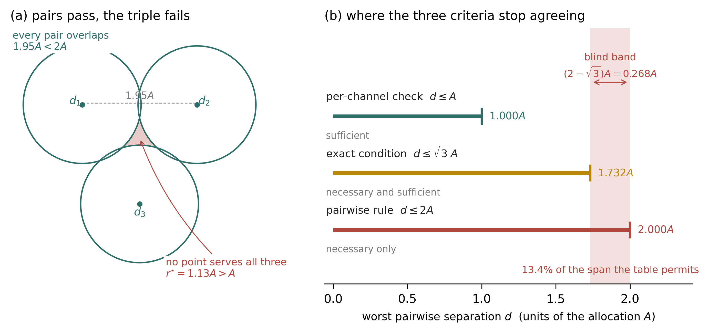
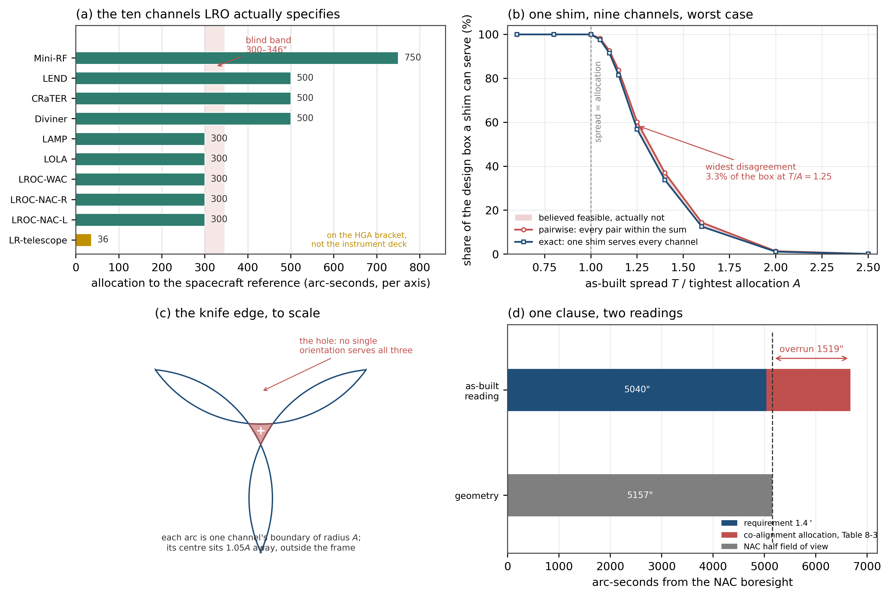
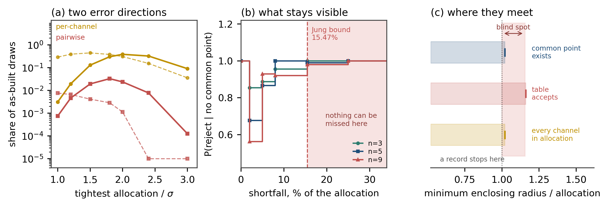
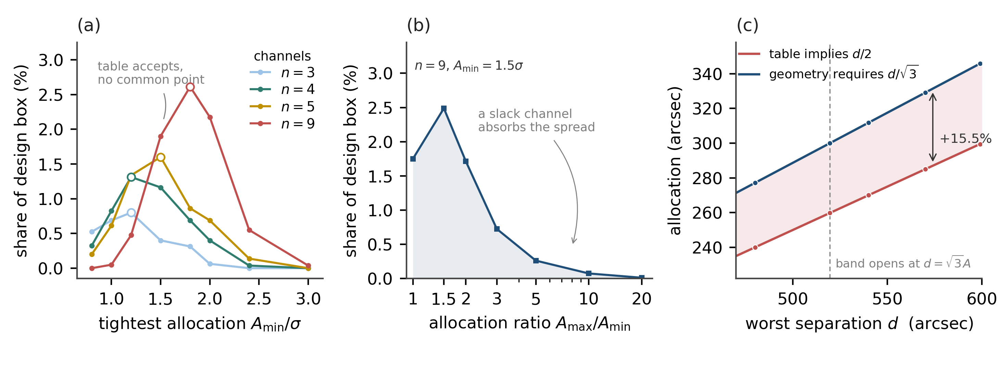
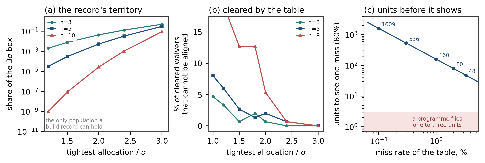

# A Decision Rule Without an Operating Characteristic: The Pairwise Sum in Multi-Channel Boresight Alignment

**BYLINE: Author names, affiliations, e-mail and ORCID to be completed at submission — all authors' ORCID iDs are mandatory for this journal**

Manuscript received 31 October 2026. This work received no external funding. The author declares no conflict of interest. Code and derived data are listed under *Data and Code Availability*.

## Abstract

Multi-channel payloads are allocated tolerances one channel at a time but checked one pair at a time: every pair of deviations must lie within the sum of the two allocations. This paper asks what that check establishes in design and in assembly, and whether any record can test it. In design it is optimistic by a fixed constant. With equal allocations a common orientation exists whenever the worst pairwise separation does not exceed the square root of three times the allocation, while the pairwise sum admits twice the allocation; allocations derived from pairwise sums are therefore 15.5 percent too small, the worst case being three channels in an equilateral configuration. The constant is Jung's; no new geometry is claimed. In assembly the rule has no operating characteristic: a pairwise violation implies that some channel already violates its own allocation, so on conforming data the rejection probability is identically zero, and no record of passing builds can distinguish it from an exact feasibility test. The blind spot is nonetheless bounded in depth, making it a detector with a guaranteed threshold: a missed configuration is short by at most 15.5 percent. Sweeps over channel count, allocation ratio and heterogeneity bound the disagreement at a few percent of the design box, and at zero under a three-sigma convention. A replay on a public ten-channel specification reproduces its single pairwise addition to the arc-second, returns one clause undecided with a 1519 arc-second spread between readings, and recovers the mechanical partitioning.

**Index Terms**—Boresight alignment, conformance assessment, decision rule, minimal enclosing circle, operating characteristic, tolerance allocation.

## Nomenclature

| Symbol | Meaning | Symbol | Meaning |
|---|---|---|---|
| $n$ | channels on one interface | $d$ | worst pairwise separation, $\max_{i,j}\lVert d_i-d_j\rVert$ |
| $d_i\in\mathbb{R}^2$ | as-built deviation of channel $i$ | $d_{\max}$ | the same, bounded over admissible builds |
| $A_i$ | allocation of channel $i$ (half-cone, per axis) | $r^{\star}$ | radius of the smallest disk containing all $d_i$ |
| $A$ | common allocation when all channels are equal | $\rho$ | ratio $r^{\star}/(d/2)$ |
| $x\in\mathbb{R}^2$ | displacement supplied by one shim | $T$, $\sigma$ | spread of a uniform draw; per-axis standard deviation |
| $D_i$, $C$ | disk of radius $A_i$ about $d_i$; conforming set of $d$ | DC, SP | detection coverage; false-alarm probability |
| $p$ | miss rate of the pairwise rule | $\Delta c$, $c_a$ | cost of a late fix; cost of one analysis |

## I. Introduction

### A. Two Uses of One Inequality

A camera, a laser rangefinder, a radar and a star tracker on one spacecraft share a mechanical reference. Each carries an angular allocation — "aligned to the spacecraft reference to within $300$ arc-seconds per axis", say — set during design and verified during assembly. Both activities are usually organised **pairwise**. In design, the sum of two allocations is required to cover the worst relative misalignment the two channels can accumulate. In assembly, every pair of as-built deviations is required to lie within the sum of the two allocations. The two statements look like the same statement seen from opposite ends, and they are not.

The geometry underneath is elementary and old. Each channel's allocation is a disk on the tangent plane, or a cap on the sphere, and a single common orientation exists exactly when the disks intersect. That pairwise intersection of convex sets does not imply intersection of the family is Helly's theorem, in the plane since 1923 [1]; that a planar set of diameter $d$ fits in a circle of radius $d/\sqrt{3}$ is Jung's theorem, from 1901 [2]. Neither is in question here and this paper claims neither. The contribution is a statement about a *decision rule* built on that geometry, and about what kind of evidence could ever test such a rule.

The distinction that motivates the paper is one that conformance-assessment practice makes explicitly and tolerance analysis usually does not. A decision rule used to declare conformity is characterised by its operating characteristic: the probability of rejection as a function of the true state of the item [3]. Acceptance sampling has been built on that curve since Dodge and Romig [4]. A rule whose operating characteristic is flat — which rejects nothing, or rejects everything, regardless of the state — is not a weak rule but a non-rule, and no amount of field data can validate it. Section III-B shows that the pairwise sum, used as a conformity check, is exactly of this kind: its rejection region is contained in the region already rejected by the per-channel check, so on conforming data it is silent by construction rather than by luck.

### B. Relation to Prior Work

*1) Feasibility of a family of angular constraints.* The object is the intersection of a family of disks in two dimensions, and it is well understood. The smallest enclosing circle is determined by two or three of the points; linear-time algorithms exist [7], as does the randomised incremental construction most implementations use [5], and the LP-type framework that explains why both work [6]. The intersection is convex, so feasibility is a convex feasibility problem and can be written as a second-order cone program [8], [9]. What is not in that literature is the question asked here: not whether a family is feasible, but what a *scalar summary* of a tolerance table can decide, and when the answer it gives can be tested against a build.

*2) Alignment budgeting as practised.* An angular alignment budget is written twice: as a requirement on a relative orientation, and as an allocation to each contributor — alignment cube, bracket, interface, reference transfer — usually a half-cone per axis at a declared confidence, combined by the classical conventions of tolerance analysis, arithmetic (worst case) or root-sum-square. Dimensional and geometrical tolerancing standards [10], [11] fix the language for the mechanical contributors but deliberately do not prescribe how a multi-instrument budget is combined; that is left to the programme. In practice the combination is pairwise, for a reason as much organisational as technical: a pairwise requirement is a requirement between two responsible parties, it can be written into two interface control documents, and it can be verified by pointing one instrument at another. A three-way requirement has no natural owner. The result is a table whose rows are pairs, and a review whose question is "is every row inside its sum?" That question has a precise answer, and it is the subject of this paper.

*3) Decision rules and their operating characteristics.* Conformance assessment formalises the distinction this paper turns on. A decision rule maps a measured value to accept/reject; its performance is the probability of acceptance as a function of the true value, and measurement uncertainty is handled by a guard band or a stated risk [3]. The framework presupposes that the rule *has* such a curve and that the curve is not degenerate; acceptance sampling made the same presupposition explicit a century earlier [4]. A rule evaluated only on items that have already passed another rule has no operating characteristic of its own: its curve is identically zero on the population it is applied to. That is the situation of the pairwise sum, and it is not a criticism of the engineers who use it — it is a statement about which question the rule can answer.

### C. Contributions

1. **In design, the rule is optimistic by a constant.** With equal allocations $A$, a common orientation exists whenever the worst pairwise separation does not exceed $\sqrt{3}A$, while the pairwise sum admits $2A$; allocations derived from pairwise sums are therefore short by $15.5\%$ of the allocation, and the worst case is attained by three channels in an equilateral configuration (Proposition 4). The constant is scale-free and holds for every channel count.
2. **In assembly, the rule has no operating characteristic.** Its rejection region is a subset of the region already rejected by the per-channel check, so its rejection probability on conforming data is zero identically, and no build record can distinguish it from the exact test (Proposition 1, Corollary 2).
3. **The blind spot has bounded depth.** A configuration the rule misses is short by at most $15.5\%$; the rule is a detector with a guaranteed threshold, not a rule with no guarantee (Corollary 3).
4. **The decision is cheap and certifiable.** Complete enumeration decides feasibility in $O(n^3)$ arithmetic with no solver, and returns, besides the verdict, the support set and the minimal infeasible subset — the two objects a review needs (Section IV).
5. **The measurable disagreement is small, and its smallness is explained.** Over channel count, allocation-to-spread ratio and heterogeneity, the share of the design box on which the rule accepts and geometry does not peaks at a few percent and vanishes under the $3\sigma$ convention (Sections VI, VII). Section V closes the accounting on a real table.

## II. Measurement Model and Decision Rules

### A. From Measured Deviations to a Feasibility Question

Let $n$ channels share one mounting interface. Channel $i$ has an as-built angular deviation $d_i\in\mathbb{R}^2$, obtained by measurement and expressed in the tangent plane at the common boresight, and an allocation $A_i$. A single shim displaces every channel by the same vector $x$, so the residual of channel $i$ is $d_i-x$. The interface is adequate if

$$
\exists\,x\in\mathbb{R}^2:\quad \lVert d_i-x\rVert\le A_i\quad\text{for all } i=1,\dots,n,
\tag{1}
$$

that is, if the disks $D_i=D(d_i,A_i)$ have a common point. The input to (1) is a vector of measured angles; the output is a conformity verdict. Everything between the two is the subject of the paper, and it is not measurement: it is the rule that turns a measurement into a verdict.

### B. Idealisations and Their Cost

Three idealisations bound what follows. The tangent-plane replacement of the sphere is accurate to $O(\theta^2)$; the largest allocation in the document replayed in Section V is $750''=0.208^\circ$, a relative distortion below $1.4\times10^{-5}$, and a planar solver was cross-checked against an independent spherical-cap solver on 300 random four-channel instances with no disagreement on any. The interface is rigid, isothermal and order-free: thermal gradients, fastener preload and tightening sequence, adhesive cure shrinkage and structural flexibility all move channels relative to one another and none of them appear in (1). And one interface is a counterfactual for the document replayed in Section V, which aligns each instrument on its own cube; the replay validates the method against the document's arithmetic and makes no claim about the flight article.

### C. The Three Tests

*TABLE I — THE THREE TESTS AND THEIR LOGICAL STATUS*

| Test | Condition | Status |
|---|---|---|
| Per-channel | $\lVert d_i\rVert\le A_i$ for all $i$ | sufficient ($x=0$) |
| Pairwise | $\lVert d_i-d_j\rVert\le A_i+A_j$ for all $i\neq j$ | necessary |
| Exact | (1) | necessary and sufficient |

The per-channel test is the assembly gate: it is what an alignment measurement is compared against, channel by channel, and the only one of the three normally written into an acceptance procedure. The pairwise test is the design rule, and occasionally the rework rule. The exact test is the one nobody runs, because it needs all channels at once and returns a verdict rather than a per-channel number.

### D. Guard Bands and the Effective Allocation

A measured deviation carries an uncertainty $u$, and conformance assessment requires the rule to account for it, by a guard band $w=ku$ or by a stated risk [3]. In the present notation a guard band is absorbed without change of form: replacing $A_i$ by $A_i-w$ leaves every proposition of Section III true verbatim, since none uses more than $A_i>0$. Two consequences matter. The $15.5\%$ shortfall of Proposition 4 applies to the *guarded* limit, so the absolute shortfall is $(2/\sqrt3-1)(A-w)$: a guard band shrinks geometry and error together, in proportion. And the per-channel gate inherits the same substitution, so the empty rejection region of Section III-B is independent of how wide the guard band is. The failure documented here is not a measurement-uncertainty failure and cannot be fixed by better metrology.

## III. Theoretical Results

### A. The Rejection Region Lies Inside the Failed Region

**Proposition 1.** Let $\lVert d_i\rVert\le A_i$ for every $i$. Then $x=0$ satisfies (1), and $\lVert d_i-d_j\rVert\le A_i+A_j$ for every pair. Conversely, if $\lVert d_i-d_j\rVert>A_i+A_j$ for some pair, then at least one of $i,j$ violates its own allocation.

*Proof.* The first part is the triangle inequality, $\lVert d_i-d_j\rVert\le\lVert d_i\rVert+\lVert d_j\rVert\le A_i+A_j$, and $x=0$ gives residual $d_i$. For the converse, if both channels were within allocation the first part would apply. $\square$

**Corollary 1.** Write $C=\{d:\lVert d_i\rVert\le A_i\ \forall i\}$ for the conforming set. Proposition 1 gives $\{d:\exists i,j,\ \lVert d_i-d_j\rVert>A_i+A_j\}\subset\mathbb{R}^{2n}\setminus C$, and the exact test's rejection region lies inside the same complement, since $d\in C$ implies $x=0$ is feasible. Hence **all three tests accept every conforming configuration**, and the pairwise and exact tests can differ only on data that the per-channel check has already rejected.

This is trivial, and triviality is the content: the question "how often does the pairwise rule get it wrong?" has the answer zero for structural reasons, and that answer is not evidence of correctness. Numerically, across the 32 cells of the sweep in Section VI-C the share of draws the per-channel test accepts and the exact test rejects was zero in every cell, and across 4729 draws conditioned on per-channel acceptance the count rejected by either the exact or the pairwise test was zero.

### B. The Rule Has No Operating Characteristic

**Corollary 2.** If a population of builds is supported on $C$ — which is what "the assembly passed its alignment check" means — then the pairwise test's rejection probability is zero, identically in $A$, $n$ and the distribution of $d$. The rule has no operating characteristic on the population to which it is applied, and no record of passing builds can distinguish it from the exact test.

The corollary also relocates the rule's real function. After the per-channel gate fails on some channel the question changes from *is this build conforming* to *can one shim still save it*, and there the rule does have power: it is a rework-capacity criterion, evaluated on a population that has already failed. Section V-E measures that population.

### C. Exactness at Two Channels

**Proposition 2.** For $n=2$ the pairwise condition is necessary and sufficient for (1): two disks intersect if and only if the distance between their centres does not exceed the sum of their radii.

The two-circle condition holds for unequal radii without modification. Its practical consequence is diagnostic: wherever a specification writes a *sum* of two allocations it is writing it for a pair — two cameras that must be co-aligned, one instrument that must fall inside another's field of view. In exactly those places the shortcut is not a shortcut; it is the answer. The defect cannot appear where the rule is written, which is Section VII's point stated algebraically.

### D. The Band and Its Constant

**Proposition 3.** Let $A_i=A$ for all $i$, let $d=\max_{i,j}\lVert d_i-d_j\rVert$, let $r^{\star}$ be the radius of the smallest disk containing all $d_i$, and set $\rho=r^{\star}/(d/2)$. Then

1. (1) holds if and only if $r^{\star}\le A$;
2. $\rho=1$ if the minimal disk is pinned by a diameter pair, and $\rho>1$ otherwise;
3. $\rho\le2/\sqrt{3}$ for every planar configuration, with equality for three points in an equilateral triangle.

*Proof.* (1) is the definition of $r^{\star}$. (2): $r^{\star}\ge d/2$ always, with equality exactly when the two farthest points are antipodal on the minimal circle. (3) is Jung's theorem in the plane, $r^{\star}\le d/\sqrt{3}$. $\square$

The pairwise rule accepts $d\le2A$; the geometry accepts $d\le\sqrt{3}A$. The disagreement is the band

$$
\sqrt{3}\,A<d\le2A,
\qquad (2-\sqrt{3})A=0.268\,A,
\qquad \frac{2-\sqrt{3}}{2}=1-\frac{\sqrt{3}}{2}=13.4\%,
\tag{2}
$$

where $13.4\%$ is the band measured against the span the table permits and $26.8\%$ is the same band measured against the allocation. Both describe the same strip, and quoting one without its denominator is how the figure gets misread; for $A=300''$ the strip is $519.6''$–$600''$, i.e. $80.4''$ wide. It is non-empty in the strong sense: for every $d$ inside it there are feasible configurations (three nearly collinear channels, whose minimal circle is the diameter circle, $r^{\star}=d/2\le A$ throughout) and infeasible ones (the equilateral triple). Feasibility is not a function of $d$ alone, which is why no scalar summary of a table — not the largest pair, not the mean — can decide (1).

*Fig. 1. The band of (2). (a) Three channels with equal allocation $A$ whose deviations form an equilateral triangle of side $1.95A$: every pair is inside its sum ($1.95A<2A$) and no common orientation exists ($r^{\star}=1.13A>A$). (b) The three tests on one axis; the shaded strip is where the pairwise rule admits configurations that the geometry rejects.*

### E. The Design-Side Multiplier

Proposition 3 is a statement about a given set of deviations. The designer's question is the inverse, and its answer is a multiplier.

**Proposition 4.** Suppose every admissible build satisfies $d\le d_{\max}$, and let $A_i=A$. Then $A\ge d_{\max}/\sqrt{3}$ is necessary and sufficient for (1) to hold on every such build; the pairwise sum requires only $A\ge d_{\max}/2$. The ratio is

$$
\frac{2}{\sqrt{3}}=1.1547 .
\tag{3}
$$

*Proof.* Necessity and sufficiency follow from Proposition 3 with $d=d_{\max}$ attained by an equilateral triple, which is admissible for any $d_{\max}$. The pairwise requirement is $2A\ge d_{\max}$. $\square$

An allocation set derived from pairwise sums therefore under-provisions by $15.5\%$ of the allocation, and the worst case is three channels. More channels do not make it worse — by Jung's theorem the extremal configuration is always a triangle — which is counter-intuitive enough to state twice: the failure is not a many-channel effect but a three-channel effect that any group of three within a larger payload can realise. The right-hand panel of Fig. 4 draws this as a nomogram: for a given $d$, the table implies an allocation $d/2$ and the geometry requires $d/\sqrt{3}$, and the strip between the two lines is the shortfall, always $15.5\%$ of whichever allocation is chosen.

### F. The Blind Spot Has Bounded Depth

Proposition 4 is the design-side reading of the constant. Its assembly-side reading is the more useful one for a decision rule, and it follows from the same two inequalities turned around.

**Corollary 3.** Let $A_i=A$ and suppose the pairwise rule accepts a configuration for which no common point exists. Then

$$
r^{\star}\le\frac{2A}{\sqrt{3}}
\qquad\Longleftrightarrow\qquad
\text{shortfall}=\frac{r^{\star}-A}{A}\le\frac{2}{\sqrt{3}}-1=15.47\% .
\tag{4}
$$

*Proof.* Acceptance gives $d\le2A$; Jung gives $r^{\star}\le d/\sqrt{3}$. Composing, $r^{\star}\le2A/\sqrt{3}$. The bound is attained on the equilateral family for every $r^{\star}\in(A,2A/\sqrt3]$, which is missed at every point of that interval. $\square$

So the rule is not a rule with no guarantee: it is a detector with a guaranteed threshold. A shortfall larger than $15.47\%$ implies that some pair exceeds its sum, so the rule must reject; only shortfalls below $15.47\%$ can pass unseen. Measured (Section VI-A, $n=3/5/9$ at $A/\sigma=1.5$), the largest shortfall among missed configurations was $6.6\%$, $8.5\%$ and $9.3\%$ — inside the bound and short of it, because a random draw rarely produces the evenly spread configuration that attains it.

This is the sharpest statement in the paper, and it changes the practical question. "The rule does not detect infeasibility" is false. "The rule does not detect infeasibility shallower than $15.5\%$" is true, provable and quantitative — and $15.5\%$ is precisely the region in which a mature design operates, since an allocation that is nearly exhausted is the normal state of a budgeted interface. The detector is blind where the target lives.

### G. Ring Families and Scale Invariance

For $n$ equally spaced channels on a circle, $\rho_n=1/\sin(\lfloor n/2\rfloor\pi/n)$ (Appendix B): exactly $1$ for even $n$, where an antipodal pair pins the disk, and $1/\cos(\pi/2n)$ for odd $n$, peaking at $n=3$ and decaying as $1+\pi^2/(8n^2)$. The values for $n=3,5,7,9$ are $1.1547$, $1.0515$, $1.0257$, $1.0154$.

That sequence is easy to over-read: for a *given* worst separation $d$, no configuration of any number of channels is more pessimistic than an equilateral triple of the same diameter, and adding channels to an evenly spread ring brings $\rho$ toward $1$. This concerns the extremal configuration at fixed spread, not exposure as $n$ grows; Section VI-C measures the other direction. Proposition 3 bounds how wrong a single verdict can be, the sweep bounds how often it is wrong. And because both thresholds in (2) are proportional to $A$, the *fraction* is independent of the tolerance magnitude: a payload with $0.5^\circ$ allocations and one with $30^\circ$ allocations have identical disagreement geometry, and only the absolute width changes. The failure is neither a small-angle artefact nor a numerical one.

## IV. Making the Decision Exactly

If the intersection of the disks is non-empty, a witness exists in one of two families: the centre of a disk contained in all the others, or a crossing point of two circle boundaries, since the boundary of the intersection is made of arcs of the $D_i$ and its vertices are such crossings. Enumerating the $n$ centres and at most $2\binom{n}{2}$ crossings, and testing each against all $n$ constraints, is exact, needs no initial guess, no tolerance parameter and no solver, and costs $O(n^3)$ arithmetic (Appendix A). For the ten-channel table of Section V a decision takes $0.74\,\mathrm{ms}$ in a single Python thread against $0.073\,\mathrm{ms}$ for the vectorised per-channel check — ten times a check that a review already performs, which is the relevant multiple.

Two by-products are more useful than the verdict. The **support set** — the two or three channels that pin the answer — answers "which channels would have to move". The **minimal infeasible subset** (IIS), obtained by deletion, answers "which channels cannot share an interface", and by Helly's theorem every minimal infeasible family of planar disks has at most three members [1]. Both are statements about the table rather than about the arithmetic, and both are checkable by hand on a table a reviewer already has.

A third verdict — undecided — is needed when non-convex constraints such as keep-out cones are added, and then the branch must carry the unsearched area rather than a shrug. Section V-C is a case where it is the honest answer for a different reason: the document admits two readings that differ by a number, and a procedure returning only yes or no would have picked one, silently.

## V. Replay on a Public Ten-Channel Specification

### A. The Allocation Table and the Missing Column

`431-SPEC-000113` Rev A (NASA/GSFC, 2007) states, per instrument, an alignment allocation relative to the spacecraft reference, as a half-cone in arc-seconds per axis, at a declared confidence ("$3\sigma$ or worst case") [12]. Ten channels are specified: five at $300''$ (the two LROC narrow-angle cameras, the wide-angle camera, LOLA and LAMP), three at $500''$ (Diviner, CRaTER, LEND), Mini-RF at $750''$, and the laser-ranging telescope at $36''$.

Three of the four columns a full replay needs are public: the nominal geometry, the allocation, and the reference frame. The fourth — the as-built deviation of each channel — is not, and will not be. The as-built spread $T$ is therefore carried as a free parameter and swept, with the criteria compared inside the sweep rather than against an asserted value. That is the only honest use of a public document here: it constrains the allocations, not the build.

### B. The One Place the Document Adds Two Allocations

Its Table 9-3 allocates $102''$ to the relative alignment of the two narrow-angle cameras against a requirement of $103''$ ($500\,\mu$rad) — a margin of $1''$. Two channels, so by Proposition 2 the pairwise rule is exact, and the solver reproduces the $102''$ capacity and the $1''$ margin with $\rho=1.000$.

The document's only pairwise addition is in the one case where pairwise addition is exact. The same arithmetic applied to three channels would over-state the capacity by $13.4\%$, and the document contains no three-channel sum. This is Proposition 1's mechanism seen from the design side, and it is why Section VII can be stated as a general claim rather than a suspicion about this document.

### C. A Clause With Two Readings

Clause 8.4.2 of the specification requires LOLA's field of view to fall within $1.4^\circ=5040''$ of a narrow-angle camera's boresight; its Table 8-3 allocates $1636''$ of co-alignment. The half field of view of a narrow-angle camera is $0.05\,\mathrm{rad}/2=1.4324^\circ=5157''$.

Two readings are grammatically available. Under the first, $1.4^\circ$ bounds the *nominal* placement and the allocation is spent inside it, leaving $117''$ of geometric slack. Under the second, $1.4^\circ$ bounds the *as-built* placement, in which case requirement plus allocation exceeds the geometric room by $5040+1636-5157=1519''$ and the clause cannot be met as written. The document does not say which applies. The output is *undecided*, with the gap between the readings quantified. This is not fault-finding: a clause that will be signed off should not depend on which reading its reviewer adopts, and the value of a third verdict is that it makes the ambiguity a number rather than a footnote.

### D. The Mechanical Partition, Recovered From Ten Numbers

Take an as-built spread $T=220''$ (uniform in a disk, the worst-case convention) for the ten channels. The nine instruments on the deck, treated as one interface, are feasible with at least $140.3''$ to spare. Add the laser-ranging telescope — allocated $36''$, six times tighter than anything else, and mounted six hundred millimetres away on a different bracket — and the family becomes infeasible: every allocation would have to grow by $15.4''$ before a common point exists; the minimal infeasible subset is $\{$LAMP, laser-ranging telescope$\}$, and loosening a single allocation by $0.96''$ restores feasibility.

Clause 12.0 states that the laser-ranging optic is mounted on the high-gain-antenna bracket, not on the instrument deck. The tool recovered the document's mechanical partitioning from ten numbers, without being told the partitioning. That is the practical content of the IIS: not a diagnostic about arithmetic, but a statement about structure, obtained from the same table a reviewer already has.

### E. The Rescue Regime

The regime in which the pairwise rule has power is the one Corollary 2 excludes from conformity: builds in which at least one channel is outside its allocation and the question is whether one shim still saves the build. Sweeping the as-built spread $T$ over the design box for the nine deck instruments, with their real unequal allocations:

*TABLE II — THE RESCUE REGIME. SHARE OF THE DESIGN BOX, NINE DECK INSTRUMENTS*

| $T/A_{\min}$ | 1.00 | 1.05 | 1.10 | 1.15 | 1.25 | 1.40 | 1.60 | 2.00 |
|---|---|---|---|---|---|---|---|---|
| pairwise says a shim exists | 1.000 | 0.982 | 0.926 | 0.837 | **0.602** | 0.370 | 0.144 | 0.014 |
| one actually exists | 1.000 | 0.976 | 0.915 | 0.815 | **0.569** | 0.338 | 0.126 | 0.011 |
| builds the table misses | 0.000 | 0.006 | 0.011 | 0.022 | **0.033** | 0.032 | 0.018 | 0.002 |

The two rules agree at $T/A_{\min}\le1$, where every channel is inside its allocation and no shim is needed — Proposition 1, visible as a table — and agree again above $1.6$, where neither promises much. Between them the rule over-states the chance that one shim saves the build, peaking at $3.3$ percentage points of the design box at $T/A_{\min}=1.25$, where the rule promises a rescue in $60.2\%$ of builds and geometry allows $56.9\%$: a $5.8\%$ relative over-statement.

*Fig. 2. Replay on the ten-channel specification. (a) The ten allocations, with the band of (2) marked at $300''$; the $36''$ laser-ranging telescope is mounted on the antenna bracket, not the instrument deck. (b) Share of the design box for which one shim exists: pairwise estimate against exact, nine deck instruments, worst-case convention. (c) The knife edge at $T=1.05A$: three boundary arcs of radius $A$ whose centres sit outside the frame. (d) The field-of-view clause of Section V-C: requirement plus allocation exceeds the half field of view by $1519''$.*

The denominator of the $3.3$ is the share of a design box, and the box here is the population of builds in which the per-channel gate has already failed. It is not a rate in a population of flights, and nothing in this paper converts it into one (Section VII-B).

## VI. Operating Characteristics of the Two Rules

### A. Two One-Sided Error Profiles

Corollary 2 says the pairwise rule never rejects a conforming build; Proposition 1's contrapositive says the per-channel rule never accepts an infeasible one. Both statements are exact, and both are visible in a Monte Carlo sweep: a $21$-cell grid ($n=3,5,9$ against seven values of $A/\sigma$, 8000 draws per cell) with three outcomes per draw — accepted and infeasible (a miss), rejected and feasible (a false rejection), correct. The per-channel rule's false-rejection peak is $44.4\%$, $41.0\%$ and $30.0\%$ at $n=3,5,9$; its false-acceptance count is zero in all $21$ cells. The pairwise rule's miss peak is $0.41\%$, $1.41\%$ and $3.28\%$; its false-rejection count is zero in all $21$ cells.

The two zeros are theorems, not observations, and they are what make the pair of rules describable in reliability language: each rule errs in exactly one direction, and the directions are opposite. The per-channel rule is a gate that never lets a bad build through and refuses $30$–$44\%$ of good ones; the pairwise rule never refuses a good build and lets through up to $3.3\%$ of bad ones. Fig. 3(a) plots the two curves on a logarithmic axis.

### B. Detection Coverage and False-Alarm Rate

Cast as a detector of infeasibility, a rule has a detection coverage (the share of infeasible builds it rejects) and a false-alarm rate (the share of feasible builds it rejects), both computable from the same sweep.

*TABLE III — DETECTION COVERAGE (DC) AND FALSE-ALARM RATE (SP), EIGHT CELLS, 8000 DRAWS EACH*

| $n$ | $A/\sigma$ | DC, per-channel | SP, per-channel | DC, pairwise | SP, pairwise |
|---|---|---|---|---|---|
| 5 | 1.2 | 1.000 | 0.842 | 0.987 | 0.000 |
| 5 | 1.5 | 1.000 | 0.709 | 0.969 | 0.000 |
| 5 | 2.0 | 1.000 | 0.433 | 0.966 | 0.000 |
| 5 | 2.4 | 1.000 | 0.218 | 0.959 | 0.000 |
| 9 | 1.2 | 1.000 | 0.873 | 0.997 | 0.000 |
| 9 | 1.5 | 1.000 | 0.786 | 0.977 | 0.000 |
| 9 | 2.0 | 1.000 | 0.605 | 0.924 | 0.000 |
| 9 | 2.4 | 1.000 | 0.346 | 0.961 | 0.000 |

This is the most persuasive table in the paper and the most uncomfortable one. By the standard metrics of detection theory the pairwise rule is an excellent detector — near-complete coverage, zero false alarms — and the per-channel rule is a poor one, with complete coverage bought at $22$–$87\%$ false alarms. A programme that switched from the per-channel gate to the pairwise rule would be making a defensible engineering decision on this evidence, and would thereby move its residual $1$–$8\%$ miss into precisely the shortfall band that Corollary 3 identifies as the operating region of a mature design. The metrics are not wrong; they are computed on the whole design box, and the design box is not where the builds are.

### C. Channel Count and Allocation-to-Spread Ratio

Section V-E is one slice through a three-dimensional regime. This section maps it, using equal allocations so that $\rho$ of Proposition 3 applies without confounding. Share of the design box on which the pairwise rule accepts and no common point exists, in percent, three thousand draws per cell, Gaussian deviations with per-axis $\sigma$:

*TABLE IV — REGIME MAP. MISSED SHARE OF THE DESIGN BOX, PERCENT, 3000 DRAWS PER CELL*

| $n$ \ $A/\sigma$ | 1.0 | 1.2 | 1.5 | 1.8 | 2.0 | 2.4 | 3.0 |
|---|---|---|---|---|---|---|---|
| 3 | 0.50 | 0.60 | 0.53 | 0.30 | 0.07 | 0.00 | 0.00 |
| 4 | 1.10 | 1.43 | 1.33 | 0.83 | 0.57 | 0.07 | 0.00 |
| 5 | 0.60 | 1.63 | 2.07 | 0.70 | 0.73 | 0.17 | 0.00 |
| 9 | 0.00 | 0.43 | 1.60 | 2.87 | 2.37 | 0.57 | 0.03 |

Monte Carlo standard error is about $0.15$ percentage points, so the table resolves the order of magnitude of each cell and not the differences within a row: the peak position is meaningful to about one grid step, and the non-monotonicity at $n=5$ between $1.8$ and $2.0$ is not. Three features are robust. The peak sits at $A/\sigma\approx1.2$–$1.8$ — allocations of one to two standard deviations, designs that have been squeezed rather than designs that are comfortable. It grows with channel count but saturates: a factor $1.4$ from $n=5$ to $n=9$, not the factor $1.8$ a "more channels, more failure" intuition would suggest, because the band of (2) has a fixed width $0.268A$ in $d$ and extra channels move the population through it rather than widening it. And it is gone by $A/\sigma=3$: at the convention the replayed specification declares, the residual is $0.03\%$ at nine channels and zero below five.

The zero in the $n=9$, $A/\sigma=1$ cell is not a discrepancy but a ceiling effect: at one standard deviation the pairwise rule itself accepts only $0.7\%$ of builds, so there is almost no acceptance region in which to disagree.

### D. Allocation Heterogeneity

Nine channels at $A_{\min}=1.5\sigma$, allocations spaced geometrically up to $A_{\max}$, again in percent:

*TABLE V — ALLOCATION HETEROGENEITY AT FIXED CHANNEL COUNT ($n=9$)*

| $A_{\max}/A_{\min}$ | 1.0 | 1.5 | 2.0 | 3.0 | 5.0 | 10 | 20 |
|---|---|---|---|---|---|---|---|
| missed by the table | 1.80 | 2.73 | 1.90 | 0.80 | 0.33 | 0.10 | 0.00 |

Heterogeneity is not neutral, and it is not monotone either, which is worth stating because the intuitive account is only half right. A channel with a slack allocation absorbs the common component of the spread for the others — the shim can be pushed toward it — so $\rho$ collapses toward $1$ as allocations become unequal. But spreading the allocations at a *fixed* tightest value also enlarges the acceptance region: the pairwise acceptance rate rises from $17\%$ to $48\%$ between ratios $1$ and $1.5$ in the same sweep, and the disagreement can only live inside an acceptance region. The two effects compete, and the measured result is a hump: $1.8\%$ at equal allocations, $2.7\%$ at ratio $1.5$, then $1.9\%$, $0.8\%$, $0.33\%$, $0.10\%$ and $0.00\%$ at ratios $2$, $3$, $5$, $10$ and $20$. Dilution wins decisively only beyond a factor of five, and the replayed deck's own ratio of $2.5$ ($300''$ to $750''$) sits near the top of the hump rather than past it.

*Fig. 3. One-sided errors and the guaranteed threshold. (a) The two rules err in opposite directions and in one direction only, against the tightest allocation in standard deviations; the vertical axis is logarithmic. (b) Probability that a missed configuration has no common point, against shortfall in percent of the allocation: every miss lies below the Jung bound of $15.47\%$ in (4), and above it nothing can be missed. (c) The three strips — common point exists, table accepts, every channel inside its allocation — and the width of the blind spot between the last two.*

### E. What the Sweeps Bound

The two sweeps place the number measured in Section V-E without claiming to predict it. The nine deck instruments span an allocation ratio of $2.5$ and, at $T/A_{\min}=1.25$, a missed share of $3.3\%$; the heterogeneous cells of Section VI-D sit in the range $0.8$–$2.7\%$. The two sweeps use different parametrisations — spread relative to the tightest allocation under a worst-case draw, against allocation relative to $\sigma$ under a Gaussian one — so no point prediction should be read across them; what transfers is the shape. The effect needs few channels, allocations of comparable size at one to two standard deviations, and it is bounded above by a few percent of the design box in every configuration tested. That bound, not any single cell, is the paper's quantitative claim.

*Fig. 4. The regime. (a) Share of the design box on which the table accepts and geometry does not, against the allocation measured in standard deviations, for four channel counts; hollow markers are the peaks. (b) The same against allocation heterogeneity at fixed channel count: a slack channel absorbs the spread. (c) The design-side statement of Proposition 4.*

## VII. Why No Build Record Can Settle It

Corollary 2 explains the silence of the record; three features of this class of document explain why the silent regime is the one that gets visited. Each has a number attached in Section VI.

**The clauses are pairwise.** Where a specification writes a sum it writes it for two instruments — two cameras, one instrument inside another's field of view — and Proposition 2 makes the addition exact there. The configuration that would expose the defect, three channels sharing one orientation, is the one the document does not contain. The replay found exactly one pairwise sum in the replayed document, and it is correct to the arc-second.

**The confidence convention is generous.** Allocations at $3\sigma$ against an as-built spread of order $1\sigma$ leave a factor of three between the two sides of the inequality. The disagreement needs the allocation to be comparable to the spread, and the convention forbids that by construction: at $A/\sigma=3$ it is $0.03\%$ at nine channels and zero below five.

**The allocations are heterogeneous, though this one is not decisive.** A slack channel absorbs the common component for the others, and at large ratios the disagreement disappears: $0.8\%$ at ratio $3$, $0.10\%$ at ratio $10$, zero at ratio $20$. But the deck's own ratio is $2.5$, which sits on the hump of Section VI-D rather than past it, and the document's ratio of $20.8$ counts the laser-ranging telescope, which is not on the deck. So this feature does not account for the null: the $3\sigma$ convention does.

### A. The Reachable Domain of a Build Record

A stronger statement is available than "the effect is small where this document lives", and it is geometric. The population a build record can contain is the conforming set $C$. The population in which the rule errs is the set of draws the pairwise rule accepts and the exact test rejects. By Corollary 1 these sets are disjoint, and by Proposition 3 they touch at exactly one point: $r^{\star}=A$, attained by an equilateral triple in which each channel uses its allocation exactly.

*TABLE VI — THE RECORD AND THE ERROR TOUCH, AND SEPARATE, AT $r^{\star}=A$. THREE EQUILATERAL CHANNELS*

| $r^{\star}/A$ | max pairwise sep. $/A$ | per-channel | pairwise | exact |
|---|---|---|---|---|
| 0.85 | 1.47 | pass | pass | pass |
| 1.00 | 1.73 | **pass** | pass | pass |
| 1.02 | 1.77 | fail | **pass** | fail |
| 1.15 | 1.99 | fail | **pass** | fail |
| 1.16 | 2.01 | fail | fail | fail |

Row 2 is the last configuration a record can hold; row 3 is one step past it, and the rule is already wrong there. The distance between the rows is $2\%$ of the allocation. At $r^\star/A=1.16$ the pairwise rule wakes up — not because it has detected the error, but because $d$ has finally crossed $2A$.

The same geometry makes the record's share of the design box vanish as the allocation tightens:

*TABLE VII — SHARE OF THE $3\sigma$ DESIGN BOX OCCUPIED BY THE CONFORMING SET (THE ONLY POPULATION A BUILD RECORD CAN HOLD), AND THE SHARE THAT IS ALIGNABLE*

| $n$ | $A/\sigma$ | in the record | alignable |
|---|---|---|---|
| 10 | 1.5 | $8.5\times10^{-8}$ | — |
| 10 | 2.0 | $2.7\times10^{-5}$ | $1.2\times10^{-3}$ |
| 10 | 2.4 | $1.0\times10^{-3}$ | $2.7\times10^{-2}$ |
| 5 | 2.0 | $5.2\times10^{-3}$ | — |

At the document's own convention the record covers $2.7\times10^{-5}$ of the box, while $97\%$ or more of alignable builds are refused by the per-channel gate — the same fact as the false-alarm column of Table III, read as a statement about which builds ever reach a record.

### B. Learning Rate: Not Rare but Unobservable

If the true miss rate is $p$, the number of units needed to see one miss with probability $1-\beta$ is

$$
N=\frac{\ln\beta}{\ln(1-p)} .
\tag{5}
$$

*TABLE VIII — UNITS NEEDED FOR AN $80\%$ CHANCE OF OBSERVING ONE MISS*

| $p$ | 3.3% | 2% | 1% | 0.3% | 0.1% |
|---|---|---|---|---|---|
| $N$ | 48 | 80 | 160 | 536 | 1609 |

A programme flies one to three units. The conclusion is not that the defect is rare; it is that the defect is unobservable within a programme's lifetime, at every value of $p$ the sweeps produce. This is why the published record contains no rate for it, and it is the argument for computing the rate rather than waiting for it (Fig. 5(c)).

### C. What Is Invariant and What Is Not

**Common-mode bias is removable, provably.** Replacing $d_i$ by $d_i+b$ for a common $b$ leaves both the feasibility verdict and the pairwise verdict unchanged — $0$ of $600$ draws changed — because both depend on differences only; the per-channel verdict changed on $78$ of $600$. Bench, fixture and reference-cube bias can therefore be deleted from the analysis wholesale, and the per-channel rule is the only one of the three that charges a build for an error a shim would absorb.

**The distribution cannot be assumed away.** At the same $\sigma$, $n=9$ and $A/\sigma=1.5$, Gaussian, uniform-disk and $t_3$ draws give miss rates of $1.9\%$, $2.7\%$ and $1.2\%$ — a factor of $2.3$. No as-built data exist to choose among them. The response is to report the band and not the probability: the $15.47\%$ of Corollary 3 is geometric, exact and distribution-free, while the $3.3\%$ of Table II is a share of a design box under a stated convention. A referee is entitled to ask whether the percentage depends on the Gaussian assumption; it does, which is why it is offered as an order of magnitude and the constant is offered as a result.

*Fig. 5. The record. (a) Share of the $3\sigma$ design box that a build record can occupy, against the tightest allocation in standard deviations, for three channel counts. (b) Share of per-channel-cleared draws that cannot be aligned, i.e. of waivers that a shim cannot rescue. (c) Units needed to observe one miss at $80\%$ confidence, against the miss rate; the shaded band is the range a programme can fly.*

## VIII. A Screen, and the Limits of the Claim

### A. Three Questions Answerable From the Table

The three features of Section VII are properties of the table, not of the build, so they can be checked before any measurement is made. The sweeps of Section VI rank them:

1. **Is the tightest allocation at least $2.5\sigma$?** The dominant knob, decisive on its own: at $A_{\min}/\sigma=3$ the missed share is $0.03\%$ at nine channels and zero below five, whatever the allocation pattern; at $1.5\sigma$ it is $1$–$3\%$. A *yes* here bounds the answer to a fraction of a percent before any geometry is computed.
2. **How many channels share the interface?** Exposure rises with channel count — a peak of $0.6\%$ at three, $1.4\%$ at four, $2.1\%$ at five, $2.9\%$ at nine — so a large family is the unfavourable direction, contrary to what the extremal-configuration argument of Section III-G might suggest. The factor available is about five and it saturates.
3. **How heterogeneous are the allocations?** Dilution is real but arrives late and is not monotone: it protects beyond a ratio of about five, and between one and two it can make things slightly worse (Section VI-D). A *no* here is a weak all-clear.

Applied to the replayed specification: $3\sigma$ on the tightest channel (question 1 passed, and passed decisively), ten channels (question 2 at its worst), a deck ratio of $2.5$ (question 3 not protective). The verdict is therefore *expect a fraction of a percent*, and that is what the measurement found: $0$ misses in $12000$ draws for the deck at the declared convention, a $95\%$ upper bound of $3.2\times10^{-4}$; $0.79\%$ for the same deck at $A/\sigma=2$.

A screen that predicts its own null result is a weak test of the screen, and this one should be read that way. What it claims is the right shape: it ranks the axes, it tells a reviewer whether the geometry is worth computing at all, and it tells an analyst when a reported $0$ is informative — here precisely because the dominant axis can be named. Its thresholds are calibrated to Section VI, not derived; the constant of Proposition 3 holds for every $n$ and every scale, and is attained.

### B. Limits

**No as-built column.** Every number in Sections V-E and VI is a function of a swept parameter, not of a measurement. The sweep design — uniform in a disk for the worst-case convention, Gaussian otherwise — is a convention, and the percentages are shares of a design box, not frequencies in a population of builds. The distinction between "$13.4\%$ of the tolerance span" and "$13.4\%$ of designs" is the one this paper exists to keep straight, and it applies to its own measurements.

**One interface is counterfactual for this document.** The specification replayed in Section V aligns each instrument separately. The check against its arithmetic (Section V-B) is real, but it is not evidence that the flight article used a shared interface, and the partition recovered in Section V-D is a consistency check with the document's mechanical description, not a discovery about the spacecraft.

**The model is geometric and static.** Thermal gradients, preload, cure shrinkage and flexibility are outside it, and several produce relative motions of the same order as the allocations. A tool of this kind belongs upstream of those effects, in the allocation and rework decisions, not downstream in the verification of a finished assembly.

**No failure is claimed.** The paper does not assert that any programme has suffered a misalignment attributable to this rule. The claim is narrower and harder to dismiss: the rule's guarantee in design is weaker than its use by a constant that is known, attained and scale-free, and in conformity assessment its guarantee is empty, so the empirical record cannot adjudicate it.

### C. What Would Change the Conclusion

One column of as-built deviations from a build in which the per-channel check passed and the assembly nevertheless required rework, together with the criterion the review actually applied, would convert the bound of Proposition 3 from a possibility into a rate, and would test Proposition 1 against practice rather than against its own definition. Nothing else here is as decisive, and no public document contains it. The reverse case is equally informative: a documented rework in which the pairwise table promised a rescue that one shim did not deliver would establish that the rework population of Section V-E is non-empty.

Whether the change is worth making is a question about costs, and it can be posed without the missing data. Comparing the exact test against the pairwise rule on one build, the exact test pays off when

$$
\frac{\Delta c}{c_a}>\frac{1}{p},
\tag{6}
$$

where $\Delta c$ is the extra cost of discovering the problem at integration rather than at analysis, $c_a$ the cost of one analysis, and $p$ the miss rate. For the rates measured here, $p=3.3\%$ to $0.1\%$, the threshold is a factor of $30$ to $1000$. An integration rework costs of order $20$–$40$ person-days and an analysis of order $1$ person-day, a ratio of $20$–$40$: on this arithmetic the exact test pays for itself only in the worst cell of the sweep, and not at all for a design at the $3\sigma$ convention. That argues for computing the number, not for buying the tool: the tool's value is to turn $p$ from an unknown into a computable quantity.

## IX. Conclusion

The pairwise sum rule is the two-channel feasibility condition applied to $n$ channels. It is exact at $n=2$; it is inert at $n\ge3$ for conformity, because its rejection region lies inside the region the per-channel check has already rejected, so on conforming data it cannot fire and no build record can test it; and when it is used to set allocations it is optimistic by at most Jung's constant — allocations must be $2/\sqrt{3}=15.5\%$ larger than pairwise sums imply, with the worst case attained by three channels in an equilateral configuration and independent of the tolerance magnitude.

The two readings of the same constant are the contribution. In design it is a multiplier. In assembly it is a guaranteed detection threshold: the rule misses nothing that is short by more than $15.47\%$, and everything it misses is short by less. A detector with a guaranteed threshold is a legitimate object of measurement science; the error is to read its silence as validation, when the silence is over the band where the threshold is blind.

On a public ten-channel specification the accounting closes. The rule reproduces the document's one pairwise addition to the arc-second, in the one place where that addition is exact; one clause is returned undecided with a $1519''$ spread between its two readings; the minimal infeasible subset recovers the document's mechanical partitioning from ten numbers. And the disagreement peaks at $2.9\%$ of the design box, reaches $3.3$ percentage points on the document's own unequal allocations, and vanishes at the declared $3\sigma$ convention — a null result that three questions answerable from the table alone predict in advance, and that no programme could have measured (Table VIII).

The rule is not wrong. In design it is optimistic by a constant that can be carried in a nomogram; in assembly it is silent, and it is silent for a reason that no further measurement will remove.

## Appendix A: Completeness of the Enumeration

Let $I=\bigcap_i D_i\neq\emptyset$ and $y\in I$. If some $D_j$ contains all the others then $d_j\in I$ is a candidate. Otherwise the boundary of $I$ meets $\partial D_i$ for every non-redundant $i$; moving from $y$ along a ray to $\partial I$ reaches a point where some constraint is tight, and that point either is a vertex or lies on a single circle, from which sliding along the circle reaches one. Hence a witness exists among the $n$ centres and the $2\binom{n}{2}$ crossings, and testing the $O(n^2)$ candidates against $n$ constraints is $O(n^3)$ arithmetic.

## Appendix B: Ring Families

Let $n$ points be equally spaced on a circle of radius $R$. The minimal enclosing disk is that circle, so $r^{\star}=R$; the worst pairwise separation is the chord subtended by $\lfloor n/2\rfloor$ steps, $d=2R\sin(\lfloor n/2\rfloor\pi/n)$; hence $\rho_n=R/(d/2)=1/\sin(\lfloor n/2\rfloor\pi/n)$. For even $n$ the index is $\pi/2$ and $\rho_n=1$, an antipodal pair pinning the disk. For odd $n$ it is $\pi/2-\pi/(2n)$, so $\rho_n=1/\cos(\pi/2n)=1+\pi^2/(8n^2)+O(n^{-4})$, maximised at $n=3$ where it equals $2/\sqrt{3}$ — the equality case of Proposition 3.

## Acknowledgment

The author thanks the reviewers of an earlier version for pressing the distinction between a bound on a verdict and a rate in a population, which is now Section VII-B.

## Data and Code Availability

- Allocations, with clause numbers and verbatim quotes: `analysis/data/lro_alignment_allocations.csv`.
- Solver (planar enumeration, cross-checked against an independent spherical-cap solver, no disagreement on 300 random instances): `src/rpy_polar_synth/p3_replay.py`.
- Sweeps and figures: `run_p3_replay.py`, `run_regime_map.py`, `run_ress.py`; `plot_p3_replay.py`, `plot_paper_fig1.py`, `plot_regime.py`, `plot_ress.py`.
- Outputs: `outputs_p3/` (replay and regime map), `outputs_ress/` (error profiles, coverage, record reachability, learning rate).

## References

[1] E. Helly, "Über Mengen konvexer Körper mit gemeinschaftlichen Punkten," *Jahresber. Dtsch. Math.-Ver.*, vol. 32, pp. 175–176, 1923.

[2] H. Jung, "Ueber die kleinste Kugel, die eine räumliche Figur einschliesst," *J. Reine Angew. Math.*, vol. 123, pp. 241–257, 1901.

[3] Joint Committee for Guides in Metrology, *Evaluation of Measurement Data—The Role of Measurement Uncertainty in Conformity Assessment*, JCGM 106:2012, 2012.

[4] H. F. Dodge and H. G. Romig, "A method of sampling inspection," *Bell Syst. Tech. J.*, vol. 8, no. 4, pp. 613–631, 1929.

[5] E. Welzl, "Smallest enclosing disks (balls and ellipsoids)," in *New Results and New Trends in Computer Science*, vol. 555. Berlin, Germany: Springer, 1991, pp. 359–370.

[6] K. L. Clarkson, "Las Vegas algorithms for linear and integer programming when the dimension is small," *J. ACM*, vol. 42, no. 2, pp. 488–499, 1995.

[7] N. Megiddo, "Linear-time algorithms for linear programming in $\mathbb{R}^3$ and related problems," *SIAM J. Comput.*, vol. 12, no. 4, pp. 759–776, 1983.

[8] R. T. Rockafellar, *Convex Analysis*. Princeton, NJ, USA: Princeton Univ. Press, 1970.

[9] Y. Nesterov and A. Nemirovski, *Interior-Point Polynomial Algorithms in Convex Programming*. Philadelphia, PA, USA: SIAM, 1994.

[10] *Dimensioning and Tolerancing*, ASME Y14.5-2018, Amer. Soc. Mech. Eng., New York, NY, USA, 2018.

[11] *Geometrical Product Specifications (GPS)—Geometrical Tolerancing—Tolerances of Form, Orientation, Location and Run-Out*, ISO 1101:2017, Int. Org. Standardization, Geneva, Switzerland, 2017.

[12] NASA Goddard Space Flight Center, *LRO Pointing and Alignment Specification*, 431-SPEC-000113 Rev. A, Apr. 6, 2007.
