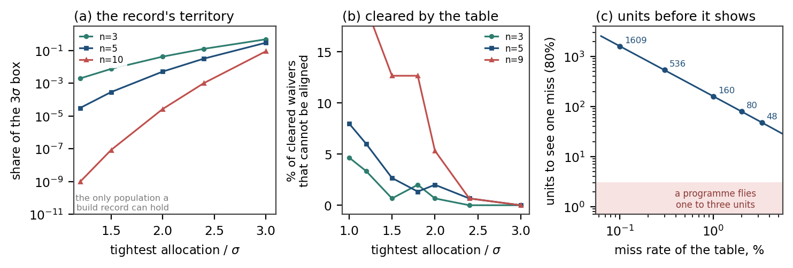

# Supplementary Material for “A Decision Rule Without an Operating Characteristic: The Pairwise Sum in Multi-Channel Boresight Alignment”

*Fig. S-1. The record. (a) Share of the $3\sigma$ design box that a build record can occupy, against the tightest allocation in standard deviations, for three channel counts. (b) Share of per-channel-cleared draws that cannot be aligned, i.e. of waivers that a shim cannot rescue. (c) Units needed to observe one miss at $80\%$ confidence, against the miss rate; the shaded band is the range a programme can fly.*

The plotted quantities are generated by `run_ress.py` and `plot_ress.py`; the underlying tables are `outputs_ress/box_shares.csv`, `outputs_ress/gate_profile.csv`, and `outputs_ress/economics.csv`.
