# 从像平面到方向光锥：RPY 分层极坐标观测模型的数学性质、UV 对比与工程转化价值

## 摘要

本项目将相机观测由像平面坐标 `(u,v)` 转换为视线方向空间中的极角 `theta` 与方位角 `phi`，并采用特殊旋转分解

$$
R=R_z(\psi)R_y(p)R_x(r),
$$

其中 `roll=r`、`pitch=p` 决定光轴方向，`yaw=psi` 表示绕当前光轴的旋转，而不是通常绕重力方向的导航航向角。本文证明：在该约定下，`theta` 与 `psi` 精确解耦，三维姿态被分层为球面上的二维光轴方向与圆上的一维绕轴旋转；该分解与深度尺度和具体相机投影模型无关。与此同时，原始 `roll-pitch` 平方角残差并非全局凸，现有热图只能支持局部盆地现象，不能支持全局凸性结论。可严格证明的是：良态解附近的局部强凸，以及角锥方向约束在笛卡尔未归一化光轴变量下的二阶锥凸表示。

相对于传统 UV 残差，polar 方法没有增加观测信息，也不会在相同噪声模型和全局最优意义下自动提高估计精度。其核心优势是**结构显式化与搜索路径重构**：将径向/切向信息、光轴奇异性和绕轴旋转弱可观测性显式分离；先用与初始 yaw 无关的 `theta-only` 子问题恢复光轴，再用 `phi-only` 恢复绕轴旋转，最后返回完整联合 BA，从而减少深度、平移和自由结构在早期对姿态错误的吸收。这一解耦可由数值 Jacobian 直接验证：`theta` 通道的 yaw 灵敏度比 Cartesian UV 低约十个数量级（`2.64e-11` 对 `2.81e-1`）。已有合成实验显示，在若干强耦合、弱初始化场景中，直接 UV 联合优化失败而 polar-staged 收敛；但单视图良好条件下 UV 同样全部成功，且更强的 pose-first 基线在部分场景同样达到 100%，因此不能宣称普遍优越，也不宜把增益全部归因于“分阶段”本身。

“传统 UV 无法解决而本方法能够解决”应限定为求解器与问题表述层面，而非信息论层面：一是固定-yaw、直接局部联合 UV 求解器在强耦合弱初始化下可能无法进入正确盆地；二是只关心光轴方向且绕轴旋转未知或属于规范自由度时，固定-yaw UV 模型包含不可回避的干扰变量，而 `theta` 商模型可直接求解；三是局部非凸 UV 方法不能提供全局可行性证书，而角锥方向约束可转化为凸二阶锥可行性问题。

在此基础上，本文增加两项此前缺失的内容。其一是**三个消融**（第 8.3 节），把“换坐标”与“换度量”分开：同一场景、同自由度、同优化器的 2×2 全因子显示，极坐标在不做协方差加权时比 UV 更差（`14.85°` 对 `1.72°`），白化后与 UV 等价，而全部增益由近轴门控承担、且该门控在 UV 中可直接复现；另两个消融显示二维与三维参数化的**轴精度完全相同**，差异只在条件数（`3.0e5` 对 `5.3`）、规范依赖与伪逆给出的虚假置信。其二是**原型与三场景实验**（第 9 节）：在自由空间光通信出光联锁、星敏感器/太阳敏感器轴优先定姿、望远镜与大天线指向限位三类场景上，用 `S^2` 上的两自由度轴估计、闭式不确定度与“可行／不可行／未定”三值证书做出可运行原型；该节同时补齐三类场景的工程背景（FOU 与束散角差两到三个数量级、单参考下绕轴零信息、限位逐条检查的 Helly 失效）与完整设计（估计器、闭式 Fisher 信息、候选集引理与 `O(n^3)` 精确判定）。结果是：`k = 2` 的置信上界判据把误放行压到 `0/2400` 并量化其可用率代价；轴误差与闭式 `sqrt(2)sigma_theta` 吻合到 `2.4%`；限位校验给出“逐对检查全部通过却不存在可行指向”的精确反例窗口 `Theta in (30°, 35.26°)`，逐对检查在 `241` 个通过者中漏掉 `2` 个（`0.83%`），而证书在 `360` 例规模实验中给出 `0` 个危险方向的错误、完备性对任意锥数成立。

这三项合起来把结论压缩为一句：本方法的独特价值不在“算得更准”，而在**适定性**（同一测量只有一个答案）与**可判定性**（可行给点、不可行给见证）。前者由商空间消去规范自由度得到，后者由角锥的凸性得到；二者都只在“绕轴信息缺失且任务只关心指向”的场合才成立。第 8.4 节把 8.3 节的经验结论再推进一步，并同时给出它的边界：等角权重不可能优于逐点白化，这一条由 Gauss–Markov 定理直接给出（膨胀因子 $R(\alpha)\ge1$，$R(1)=1.000$ 精确成立）；但"更差多少"不能由方差预测——只改权重指数 $\alpha$ 时 $R$ 降了 `15` 倍，实测误差比几乎不动，说明机制是近轴切向的杠杆而非方差，且表现为阈值而非渐变。同一节的短程 Gauss–Newton 预测在 `10` 个格点上判对 `8` 个方向，但幅度偏差达一个数量级。

第 8.5 节补第四个消融，把噪声模型翻过来：星敏感器不提供像平面，噪声在角度上各向同性，$\sigma_\phi$ 与 $\theta$ 无关而非按 $1/\theta$ 爆炸。若 8.4 的杠杆归因成立，门控的需求应当照样存在。实测正是如此——正确白化在 `yaw ≥ 90°` 仍崩到 `5.3°–6.1°`，`3°` 硬门控只压到 `2.2°–7.8°`，而把切向乘上 $\theta$ 的连续降权全程 $\le0.56°$。这一条同时修正了先前的层 3 主张：在角量原生传感器上，polar 的优势是**表示的存在性**（UV 的伪像平面在大扰动下残差无界、全程停在 `15°–22°`），不是**加权的正确性**——后者在两种噪声模型下都是开放问题。

第 3.8 节补一张 2×2 表，把**残差坐标**与**姿态参数化**分成两个正交维度，并据此把 L1 再收窄一格：解耦由参数化决定、与坐标无关——把 tilt+yaw 分解套在 UV 残差上同样解耦（径向像素等于 $f\theta$，$\theta$ 与 $\psi$ 无关，exp16 的灵敏度 `5.30e-11` 与 polar 的 `2.64e-11` 是同一个零），把 polar 配上三维欧拉角同样不解耦。polar 买到的是"不必先构造 $\sqrt{u^2+v^2}$"，属推导与接口便利，不是能力独占。

第 9.6 节补上此前列为边界的**补锥**（太阳/月球规避）。一个恒等式把"避开半角 $\beta$ 的锥"化为"进入半径 $\pi-\beta$ 的锥"，凸性判据因此只剩一行：$\beta>90^\circ$ 时现行框架逐字适用（`16/16` 与分支判定一致），$\beta\le90^\circ$ 时 `72/72` 一律返回未定。窄锥下的失效是可预测的而非随机的：太阳锥落在指向盒内部时可行集是**环域**，候选点没有一个落在环里，候选集 `0/21` 全判错（方向恒为假不可行），外层分支 `21/21` 全对。代价在证书形态——最小不可约见证不再有上界（`k=8` 时为 `9` 条约束，Helly 数 4 失效），L3 因此从"精确判定"退为"精确可行 + 数值不可行证明"。

第 9.8 与 9.9 节把 9.6 的结论**反向读了一遍**。9.6 读起来像"非凸 = 框架失效"，实际正相反：凸情形的球面 cap 交是标准 SOCP，成熟求解器毫秒解完并给 Farkas 证书，本框架在那里没有任何优势；非凸情形 SOCP 不适用、内点法只给局部解，而"有没有解"是存在性问题，只能靠分支定界。所以**失效区与独占区是同一片区域**。据此给出三个新候选场景（多探头星敏的联合可用性与遮光罩反设计、地基望远镜的可观测域、航天器热控的多面入射角环域），三者共同的用法是"判定器作外层设计优化的内层 oracle"，而不是单次判定。第 9.9 节对地基望远镜做了验证，三个发现都有数值：其一，**光学夜间太阳约束恒为冗余**（太阳低于 $-18^\circ$ 时规避锥完全落在地平门限之下，移除面积 `0.000` sr；而白天射电观测可移除 `0.54–0.85` sr），所以"三约束"只在白天成立的传感器上成立；其二，**可行域恒单连通**，10 月 31 天（含新月）与 $h_{\min}$ 从 $5^\circ$ 扫到 $75^\circ$ 的连通块数恒为 1，这不是采样偶然——球面 cap 减 cap 仍连通，因此"网格漏掉窄连通块"的先验担忧不成立；其三，在等价精度下分支法比网格**快 `75` 倍**（`0.096` s 对 `7.17` s），节点数少 `275` 倍（`2.95e5` 对 `8.10e7`），且给**严格区间**而非单值，代价律实测为 $O(1/\varepsilon)$。结论是场景五的价值成立，但来源从"完备性"改为"更快且知道误差多大"。

第 10 节据此给出价值判断与产品化路径：作为估计器价值接近零，作为接口价值中等，作为判定器在“多约束同时满足/必须证明无解”时价值大且不可替代；可产品化的形态是**指向可行性的证据生成器**（离线校验工具优先，在线联锁组件宜走 IP 授权），其定价权来自“可举证”，不来自“更准”。

第 9.10 节把 9.8 剩下五个候选场景逐个审了一遍，方法是"找出载荷假设，再用一个数拆掉它"。结果是三次改口、一次加强、一次方向错：**场景一**的判据是一次点查询而非存在性判定（`0.5°` 目标锥下 `30°` 规避锥只在 `6.4%` 的姿态上改变结论，且那一步是闭式，`400` 例中需要"并覆盖"才不可行的为 `0`），它属于 L2 不属于 L3；**场景二**的"单参考"在真实星敏上不成立（$\pm10^\circ$ 视场到 6 等含 `67.6` 颗星），且 $N\ge2$ 时 roll 的精度是轴的 `0.87` 倍——roll 不是弱通道而是更好的通道，"不输出 roll"只对单矢量敏感器有意义；**场景六**的双侧带并不罕见（`35%` 的参数点），但法线闭合的面组上 $\sum\cos\theta_i=0$ 使交集恒空（`16/16`），非闭合的三面角上面积 `0.33%`–`5.2%` 且连通块恒为 `1`，所以"多重非凸"不成立；**场景三**反而被加强——把几何按容差等比缩放后，Helly 失效窗口恒为 $1-\sqrt3/2=0.134$，与容差大小无关，$0.5^\circ$ 与 $30^\circ$ 的窗口完全重合，只是随机摆位的命中率随容差急降；**场景四**的表述方向错了——给定轨道后太阳方向是时间的一维曲线，切换时刻解析可解，判定是 1-D 而非 3-D，真正的边界是"轨道圆与可行域相切"这个零测度事件，而打点扫描确实会把它抹掉（$5^\circ$ 步长下 `50%` 的近临界设计被误判为全轨道干净）。五条合起来改写了 9.8.5 的定位：操作层要的是点查询，设计层要的是一维标量边界，**"3-D 全局存在性 oracle"在五个场景里出现零次**；L3 独占性因此收窄为"零测度事件的精确定位"，这是本轮审计唯一没有被削掉的部分。

---

## 1. 项目模型与代码对应

### 1.1 旋转约定

核心实现位于：

- `src/rpy_polar_synth/geometry.py`：旋转、球面/极坐标转换、等距投影、协方差传播；
- `src/rpy_polar_synth/experiment.py`：单视图残差、分阶段初始化与代价地形；
- `src/rpy_polar_synth/ba_experiment.py`：逆深度 BA；
- `src/rpy_polar_synth/realistic_ba_experiment.py`：含平移的三视图 BA；
- `src/rpy_polar_synth/free_xyz_ba_experiment.py`：自由 `XYZ` 多视图 BA；
- `src/rpy_polar_synth/airborne_strip_experiment.py`：UAV 斜视条带场景。

这些模块做的是标准的稀疏 BA[2][3]，不对应本文任何新命题。本文与它们的差别只在两处：残差取在哪个坐标上（第 2、3 节），以及姿态用哪组参数化（第 4 节）。

代码采用

$$
R(r,p,\psi)=R_z(\psi)R_y(p)R_x(r)
$$

作为 world-to-camera 旋转，即相机坐标 `q=R d`。这一顺序是精确解耦成立的关键。若把 yaw 改为绕固定世界轴或重力轴的旋转，通常不能直接得到本文的 `theta/yaw` 分离。

### 1.2 观测模型

对等距投影相机，代码使用

$$
u=c_x+f\theta\cos\phi,\qquad
v=c_y+f\theta\sin\phi,
$$

以及

$$
\theta=\operatorname{atan2}(\sqrt{q_x^2+q_y^2},q_z),
\qquad
\phi=\operatorname{atan2}(q_y,q_x),
$$

其中 `q` 是相机坐标系下的三维视线向量。`theta` 是视线与光轴的夹角，`phi` 是垂直于光轴平面内的方位角。严格地说，这里的数学对象是单位方向球面及其极坐标；本文沿用项目“光锥”表述，但它不是相对论中的闵可夫斯基光锥。

### 1.3 方法链条

项目不是以一种残差简单替换另一种残差，而是形成以下层次：

1. `uv_joint`：直接最小化像素残差；
2. `polar_plain_joint`：直接使用 `theta/phi`，但固定角度权重会错误处理近轴方位角；
3. `polar_cov_joint`：传播像素协方差、处理角度包裹并对近轴 `phi` 降权；
4. `polar_staged`：先 `theta-only` 求倾角，再 `phi-only` 求光轴旋转，最后回到完整协方差感知联合优化。

在 BA 中，分阶段初始化期间冻结深度、逆深度、平移或自由 `XYZ`，其目的不是简化最终估计，而是防止这些耦合变量过早吸收姿态误差。

---

## 2. 方位解耦：定理、证明与信息损失

### 2.1 精确解耦定理

令第 `j` 个相机到第 `i` 个三维点的向量为 `d_ij`，相机坐标为 `q_ij=R_jd_ij`，并令

$$
A_j=R_y(p_j)R_x(r_j),\qquad R_j=R_z(\psi_j)A_j.
$$

定义世界参考系中的单位光轴方向

$$
a_j=A_j^\top e_3
=
\begin{bmatrix}
-\sin p_j\\
\sin r_j\cos p_j\\
\cos r_j\cos p_j
\end{bmatrix},
\qquad e_3=(0,0,1)^\top.
$$

由于 `R_z` 保持 `z` 轴和向量范数不变，有

$$
\boxed{
\theta_{ij}=\arccos\left(a_j^\top\frac{d_{ij}}{\|d_{ij}\|}\right)
}
$$

以及

$$
\boxed{
\phi_{ij}=\operatorname{wrap}\bigl(\alpha_{ij}(r_j,p_j,d_{ij})+\psi_j\bigr)
}
$$

其中

$$
\alpha_{ij}=\operatorname{atan2}\bigl((A_jd_{ij})_y,(A_jd_{ij})_x\bigr).
$$

因此：

- `theta` 只依赖光轴方向 `a`，与 `psi` 完全无关；
- `phi` 随 `psi` 产生相同的角度平移；
- 在权重、门控和数据关联不依赖 yaw 的条件下，`theta-only` 子问题的代价和最优解与初始 yaw 无关；本项目的各向同性像素模型满足这一条件。

角度解耦本身是恒等式，不是线性化近似；一般各向异性 UV 协方差经旋转后可能使 `theta` 权重依赖 `phi`，此时代价不变性还需额外检查。

### 2.2 商空间解释

左乘 `R_z(psi)` 表示绕当前光轴的旋转。所有仅相差这一旋转的姿态，在 `theta` 观测下不可区分。令 `H={R_z(psi)}`，本文等价关系为 `R' in HR`，因此与左侧群作用一致的写法是

$$
H\setminus SO(3)\cong S^{2},\qquad [R]\mapsto R^{\top}e_3.
$$

即 `theta` 将姿态空间商去一个绕光轴的 `SO(2)` 自由度。文献中也常写作 `SO(3)/SO(2) ≅ S²`；右陪集与左陪集只相差群逆，二者是同一个商空间，本文按左作用记为 `H∖SO(3)`。

所谓“一维观测约束丢失”，本质是**主动在商空间中求解**：每条完整 bearing 观测有两个角度分量，而 `theta-only` 只保留径向角距离，暂时放弃绕轴方位。它不是观测硬件损失，也不意味着后续阶段永久丢弃信息；`phi` 阶段和最终联合优化会重新使用该分量。

### 2.3 可观测性与恢复条件

设已知单位参考方向 `u_i`，无噪声角距离观测给出

$$
a^\top u_i=\cos\theta_i.
$$

- 一个观测通常只给出一个球面小圆，留下一个自由度；
- 两个观测通常仍可能有两个交点；
- 若三个参考方向 `u_1,u_2,u_3` 线性无关，则矩阵 `U=[u_1,u_2,u_3]ᵀ` 可逆，

$$
a=U^{-1}
\begin{bmatrix}
\cos\theta_1\\\cos\theta_2\\\cos\theta_3
\end{bmatrix},
$$

从而光轴方向唯一确定，且应与单位范数一致。

有噪声时，局部可观测性要求角度 Jacobian 的秩为二。固定光轴后，一个充分离轴且具有可靠方位角的观测即可将 `psi` 确定到模 `2π`；近轴点几乎不提供可靠的绕轴旋转信息。

### 2.4 数值验证：零 yaw 导数不是渐近近似

定理 2.1 的结论可以由有限差分 Jacobian 直接检验，而不必依赖热图。`outputs_exp16/exp16_conditioning_diagnostics.csv` 在 SLAM 局部 BA 场景（9 个关键帧、118 个自由 `XYZ` 点、985 条观测，观测 `theta` 中位数 4.55°）上，固定中心与结构，对位姿阶段残差计算 yaw 列与 tilt 列的范数比，以及归一化交叉项：

| 残差通道 | `‖J_yaw‖ / ‖J_tilt‖` | 归一化 tilt–yaw 耦合 |
|---|---:|---:|
| `uv_full` | `2.81e-1` | `0.624` |
| `uv_radial` | `5.30e-11` | `0.0846` |
| `uv_tangential` | `2.70e-1` | `0.449` |
| `polar_full` | `2.18e-1` | `0.142` |
| `polar_theta` | `2.64e-11` | `0.0680` |
| `polar_phi` | `3.71e-1` | `0.256` |

`polar_theta` 的 yaw 灵敏度比 Cartesian UV 低约十个数量级，与 `|d theta/d psi|=0` 的精确结论一致；这正是数值上可验证的恒等式，而不是“耦合较弱”的经验描述。同时应注意到 `uv_radial` 也具有同样的零灵敏度，这一点在 3.8 节单独讨论，它限制了“解耦是 polar 独有能力”的表述。

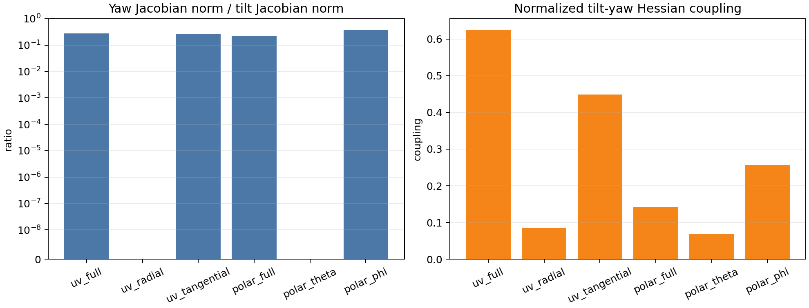

图：左图为 yaw 与 tilt 的 Jacobian 范数比（对数轴），`uv_radial` 与 `polar_theta` 的柱条低于可视范围，对应约 `1e-11`；右图为归一化 tilt–yaw 耦合。该图验证的是局部导数结构，不涉及全局凸性。

---


## 3. 相较于传统 UV 坐标的数学优势

### 3.1 UV 与 polar 的信息等价边界

在理想等距投影下，像素坐标只是 `(theta,phi)` 的平滑可逆变换（光轴处除外）。因此，如果两种方法使用相同观测、等价噪声模型、相同完整状态并都达到全局最优，则它们不存在信息论意义上的精度差异。

所以，polar 的优势不能被表述为“二维像素经过变换后获得了额外约束”。真正的优势是：**同一个 Fisher 信息在不同坐标中被隐藏还是显式表达，以及优化器以什么顺序进入这些方向。**

### 3.2 径向—切向分解与局部 Gauss–Newton 等价

径向—切向分解不是本文的发明：图像速度场的这种分解在光流文献里早已是标准做法[1]。本节只把它用在等距投影的微分上，并算出两条通道的 Fisher 信息。令中心化像素为 `z=(u-c_x,v-c_y)ᵀ`。对等距投影微分：

$$
dz=f\,d\theta\,e_r+f\theta\,d\phi\,e_\phi,
$$

其中 `e_r=(cos phi, sin phi)`、`e_phi=(-sin phi, cos phi)` 正交。于是各向同性像素噪声下

$$
\frac1{\sigma_{\mathrm{px}}^2}\|dz\|^2
=
\frac{f^2}{\sigma_{\mathrm{px}}^2}d\theta^2
+
\frac{f^2\theta^2}{\sigma_{\mathrm{px}}^2}d\phi^2.
$$

这正是协方差白化 polar 残差的局部度量。因此，在无门控、同一线性化点和一致白化条件下，UV 与 covariance-aware polar 的 Gauss–Newton **正规矩阵**相同。非零残差下两种残差还相差高阶项，所以包含残差向量的完整正规方程及实际 GN 步长只在小残差条件下近似相同；若协方差在观测点计算而雅可比在预测点计算，还需计入两者的尺度差。

更精确地说，像素坐标下的 Fisher 信息是 `I_z = sigma_px⁻² I_2`，其条件数为 1；但拉回到姿态参数 `x=(r,p,psi)` 后为

$$
I_x=J_z^\top I_zJ_z,
$$

而 polar 只是把同一个 `I_x` 写成 `J_yᵀ I_y J_y`，其中

$$
I_y=\frac1{\sigma_{\mathrm{px}}^2}
\operatorname{diag}\!\left(f^2,\,f^2\theta^2\right).
$$

因此 polar 不改变姿态参数空间的可观测性谱；在精确重参数化（含 Jacobian）意义下也不改变最大似然解。实现中的协方差白化 polar 残差是局部高斯近似，非零残差下与 UV 最大似然目标相差高阶项。

真正改变的是**弱方向在残差层的表达方式**：在 UV 中，近轴点的 yaw 弱信息体现为像素 Jacobian 两列近似线性相关，只在对 `I_x` 做特征分解后才暴露；在 polar 中，同一个量直接表现为 `I_y` 的一个小对角元 `f²theta²/sigma_px²`，以及一个大于 1 的方差比。二者描述的是同一个 `I_x`，但后者可以在组装正规方程之前被逐点诊断、门控和加权，而不必求解全局特征问题。这是“可计算性优势”的精确含义；它不是精度优势，也不是条件数优势——`I_x` 的条件数作为矩阵不变量并不因坐标改写而改变。

综合上述，可给出两条同等重要的结论：

1. 协方差感知 polar 残差具有明确统计意义，不是任意调权；
2. 它的优势不在改变局部最大似然几何，而在显式分解和分阶段搜索。

### 3.3 近轴奇异性与 Fisher 信息显式化

反投影 Jacobian 给出精确的一阶协方差

$$
\Sigma_{\theta\phi}
=
\begin{bmatrix}
\sigma_{\mathrm{px}}^2/f^2&0\\
0&\sigma_{\mathrm{px}}^2/(f\theta)^2
\end{bmatrix},
\qquad \theta>0.
$$

即

$$
\boxed{\sigma_\theta=\sigma_{\mathrm{px}}/f},\qquad
\boxed{\sigma_\phi=\sigma_{\mathrm{px}}/(f\theta)=\sigma_{\mathrm{px}}/r_{\mathrm{px}}}.
$$

当像素靠近主点时，`phi` 方差发散。UV 坐标本身仍然良好，但绕光轴旋转的信息被隐藏在像素雅可比中；raw polar 若使用固定 `sigma_phi`，则会对不可靠方位角过度自信。

固定其余状态、且未对 nuisance 参数做边缘化时，单个像素对光轴旋转的 Fisher 信息块满足

$$
I_{\psi\psi}=\frac{f^2\theta^2}{\sigma_{\mathrm{px}}^2}
=\frac{r_{\mathrm{px}}^2}{\sigma_{\mathrm{px}}^2}.
$$

因此近轴点的 yaw 信息趋于零，而倾角仍可产生一阶像素位移。联合估计深度、平移和结构后，有效信息还需通过 Schur 补减去 nuisance 耦合项，通常会更弱。这一结论解释了中心占优、前视和弱视差场景中的典型弱方向，但不是“yaw 永远比倾角不可观测”的普遍定律。

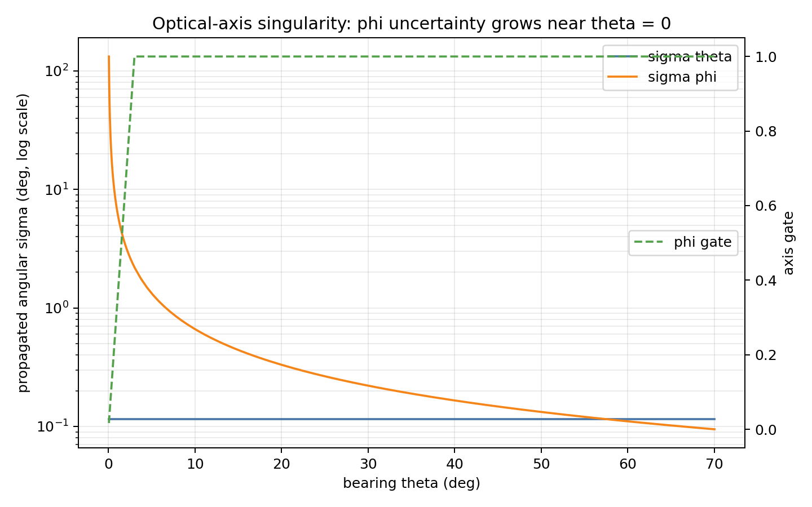

图：`sigma_theta` 与 `theta` 无关（约 0.115°，对应 `sigma_px/f`），`sigma_phi` 按 `1/theta` 增长；绿色虚线为代码实际使用的门控 `g(theta)=clip(sin theta / sin 3°, 0, 1)`（`airborne_strip_experiment.py`、`ba_experiment.py` 中一致）。该图是 3.3 节两个公式的数值呈现，属于误差传播结果，不是独立经验发现；门控则是工程正则化，其阈值 3° 与协方差公式无关。

### 3.4 搜索路径优势：先消除最大初始化干扰

直接 UV 联合优化同时面对：

- 光轴方向误差；
- 绕轴旋转误差；
- 深度/结构误差；
- 平移误差；
- 遮挡和错误轨迹等鲁棒性问题。

`theta-only` 阶段则在权重与数据关联不依赖 yaw 的条件下，从目标函数中精确消去初始 yaw，使倾角恢复不被错误的绕轴旋转初值直接拖拽。随后 `phi-only` 只需求解一维圆回归，最后才释放完整耦合状态。

因此其优势可概括为：

$$
\text{直接联合搜索}
\quad\longrightarrow\quad
\text{商空间中的二维搜索}
+\text{圆上的一维搜索}
+\text{最终联合精化}.
$$

这主要扩大实际收敛盆地，而不是改变最终联合估计量的统计定义。

### 3.5 可认证性优势

UV 像素残差通常直接形成非凸最小二乘，局部求解器只能给出局部收敛结果。相反，光轴角距离约束可以写成凸二阶锥，从而在适当归一化和问题范围内进行全局可行性求解或证伪。这是表述能力上的实质差异，但它对应的是角锥可行性问题，不应与原平方角残差全局最小化混为一谈。

9.5 节把这一条做成了可运行的三值判定（可行／不可行／未定），并给出两个必须同时接受的边界：完备性止于三个锥（球面 Helly 数 4）；“必须避开某个锥”的补锥约束非凸，9.6 节证明它只在 $\beta>90^\circ$ 时落回本框架，窄锥需要外层分支，而且分支能保住“可行给点”，保不住“不可行给最小见证”。

### 3.6 UV 与 polar 的逐项对比

| 维度 | 传统 UV 残差 | 本文 polar 分层 |
|---|---|---|
| 观测信息量 | 完整 | 相同（仅坐标变换） |
| 坐标奇异性 | 主点处坐标良好，但 yaw 信息弱 | `phi` 在 `theta=0` 显式奇异，需协方差/门控 |
| 参数耦合 | tilt、yaw 混在像素 Jacobian 中 | `theta` 与 yaw 精确解耦，`phi` 仅平移 |
| 局部度量 | 各向同性像素度量 | 对角度量，近轴条件数约 `1/theta²`，弱方向显式 |
| 初始化路径 | 三自由度联合搜索 | 二维光轴 + 一维绕轴 + 联合精化 |
| 全局可行性 | 非凸最小二乘，局部求解器无证书 | 方向角锥可写为 SOCP，可全局求解或证伪 |
| 主要代价 | 近轴弱方向被隐藏，易被结构/平移吸收 | 需处理 `phi` 奇异、角度包裹和阶段切换 |

该表概括了本文的核心立场：polar 的优势是**同信息的更好组织方式**，而不是更多信息或普遍更高的精度。

### 3.7 polar 的代价与局限

- `phi` 在光轴处无定义，需要协方差正则化或门控；
- 角度包裹使 yaw 子问题在全局仍可能多峰；
- `roll-pitch` Euler 图在 `cos p=0` 附近退化；
- 代码中的近轴门控是工程正则化，不是高斯协方差传播的自然定律；
- Huber 损失、门控和不同残差参数化会破坏严格的 UV 等价；
- 若已存在良好初始化、可靠先验和高质量联合求解器，分阶段方法的边际价值可能很小。

### 3.8 与“径向 UV”的等价性：解耦不是 polar 的独占能力

必须明确指出一个容易被忽略的事实。对等距投影，中心化像素的极坐标为

$$
r_{\mathrm{px}}=\sqrt{u^2+v^2}=f\theta,\qquad
\varphi_{\mathrm{px}}=\operatorname{atan2}(v,u)=\phi .
$$

也就是说 `(r_px, phi_px)` 与 `(theta, phi)` 只相差一个常数尺度 `f`。于是

$$
\sum_i w_i\bigl(\theta_i-\tilde\theta_i\bigr)^2
=\frac{1}{f^2}\sum_i w_i\bigl(r_{{\mathrm{px}},i}-f\tilde\theta_i\bigr)^2 ,
$$

两者的**最小值点完全相同**：`theta-only` 最小二乘与“只用径向像素距离”的最小二乘不是近似等价，而是同一个估计量。exp16 的数据也印证了这一点：`uv_radial` 的 yaw/tilt 灵敏度比为 `5.30e-11`，与 `polar_theta` 的 `2.64e-11` 同量级；exp17 中 `uv_radial -> uv_tangential` 的分阶段在干净场景下也与 `polar_staged` 表现一致（第一阶段倾角误差 0.57°→0.48°，见第 8 节）。

因此，严谨的表述必须是：

1. 解耦来自**等距投影的径向坐标**这一几何事实，不是 polar 记号本身的功劳；
2. `polar` 的真正贡献是把 `(theta, phi)` 选作与旋转分解对齐的**统一接口**，并在该接口上完成协方差传播、近轴门控、分阶段求解与角锥约束表示；
3. 任何“polar 独有解耦”的说法都应被撤回；正确的说法是“在该旋转约定下，polar 坐标把已经存在的径向不变量与方位角弱方向显式化、可加权化、可分层化”。

把这件事讲清楚的最好方式，是把两个互相独立的维度分开——**残差坐标**和**姿态参数化**——因为混淆恰恰发生在这两维之间：

| 残差坐标 ↓ ／ 参数化 → | 3-DOF 欧拉 $(r,p,\psi)$ | 分解为 tilt + yaw |
|---|---|---|
| **UV** $(u,v)$ | 常规 BA 基线（A1 `uv_uniform`） | **一样能解耦**：径向像素 $=f\theta$，$\theta$ 与 $\psi$ 无关 |
| **polar** $(\theta,\phi)$ | 坐标换了、解耦没来（A1 `polar_isotropic` 照样崩到 `14.85°`） | 解耦成为坐标轴本身（本项目） |

看这张表：**解耦由列决定，不由行决定。** 把 $R_z(\psi)R_y(p)R_x(r)$ 这套分解套在 UV 残差上，它照样解耦；把 polar 配上普通三维欧拉角，它不因为换了坐标就获得解耦。因此 polar 的真实贡献是省掉了“先构造 $\sqrt{u^2+v^2}$ 再回到径向最小二乘”这一步——是推导与接口上的便利，不是能力上的独占。这与 7.3 节把 L1 判为“真但不独占”是同一判断，只是这里给出了它的代数依据。

这条边界不削弱工程价值，但严格限制了可发表的创新声明：创新点只能是**坐标与旋转约定的匹配、协方差处理、以及基于该结构的求解策略**，而不是“发现了新的不变量”。

---


## 4. 子问题凸化：可证明结论与不可成立的全局命题

### 4.1 原始 `roll-pitch` 目标不是全局凸函数

固定结构时，代码中的平方角目标可写为

$$
C(r,p)=\frac12\sum_iw_i\bigl(\theta_i(r,p)-\tilde\theta_i\bigr)^2,
\qquad w_i>0.
$$

该目标关于 Euler 角周期延拓。非恒定周期函数不可能在整个 `ℝ²` 上全局凸：周期函数全局有界，而 `ℝ²` 上有界的凸函数必为常数。还可以给出不依赖周期性的显式反例：取单个参考方向 `u=e_1`、`r=0`、观测角 `theta_tilde=π/2`，则

$$
\theta(p)=\arccos(-\sin p),
$$

并且

$$
C(0)=C(\pi)=0,\qquad C(\pi/2)=\pi^2/8,
$$

所以

$$
C(\pi/2)>\frac{C(0)+C(\pi)}2,
$$

直接违反凸函数中点不等式。

现有热图只覆盖真实值附近 `±30°`，并使用 `log10(cost-min+1)` 色标。即使图形看似碗状，也不能证明全域 Hessian 半正定。代码中的 `hessian_diagnostics` 计算的是有限差分 `Jᵀ J`，不包含残差二阶项和 Huber 曲率，同样不能单独证明精确 Hessian 正定。

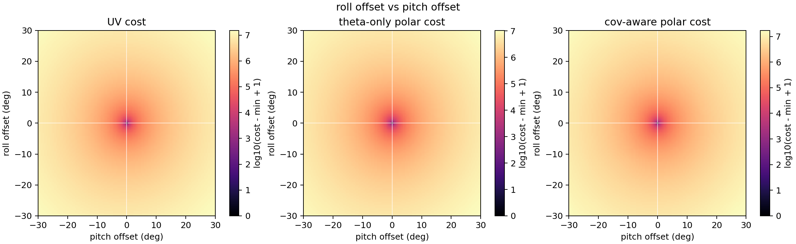

图（仓库既有图 `outputs/cost_landscape_roll_pitch.png`）：横轴 pitch offset、纵轴 roll offset，范围 `±30°`，颜色为 `log10(cost-min+1)`，白色十字线标出真值。三个面板（UV、`theta-only`、covariance-aware polar）几乎不可区分，这一点本身值得强调：它从经验上支持 3.2 节的结论——polar 不改变代价地形，只改变权重的显式程度与求解路径。该图能支持“存在一个碗状局部盆地”，不能支持“全域凸”；窗口之外的周期性多解在该图中不可见，正是 4.1 节反例所在的区域。

### 4.2 局部强凸定理

令 `x=(r,p)ᵀ`、`e_i=theta_i−theta_tilde_i`、`J_theta` 为角度 Jacobian，则精确 Hessian 为

$$
\boxed{
\nabla^2C=J_\theta^\top WJ_\theta+
\sum_iw_ie_i\nabla^2\theta_i
}.
$$

在零残差点，

$$
\nabla^2C=J_\theta^\top WJ_\theta.
$$

若满足：

1. `w_i>0`；
2. `rank(J_theta)=2`；
3. 所有相关角度处于可微区域；
4. Euler 图正规，即 `cos p ≠ 0`；

则 Hessian 正定。由连续性，在该解的某邻域内目标强凸，且该解为孤立局部极小点。非零残差时，还需要残差二阶项足够小，例如

$$
\lambda_{\min}(J_\theta^\top WJ_\theta)
>
\sum_iw_i|e_i|\,\|\nabla^2\theta_i\|_2.
$$

这就是当前可视化所显示“凸盆地”的严格数学解释。它是**有条件局部强凸**，不是全局凸化。

从几何上看，令 `E=[∂a/∂r, ∂a/∂p]`，则

$$
\nabla\theta_i=-\frac{E^\top u_i}{\sin\theta_i}.
$$

满秩条件要求至少两个有效观测的切向梯度张成二维切空间；单一观测通常留下谷方向。`p=±π/2` 时 Euler 图还会发生自身退化。

### 4.3 球面距离曲率给出的进一步解释

在单位球面上，`theta(a)=arccos(aᵀ u)` 是到固定点 `u` 的测地距离。对切向量 `v`，其 Riemann Hessian 可写为

$$
\operatorname{Hess}\theta[v,v]
=
\cot\theta\left(\sqrt{v\cdot v}^2-\langle\nabla\theta,v\rangle^2\right).
$$

当 `theta>π/2` 时，`cot theta<0`，在垂直于梯度方向上出现负曲率。这从球面几何进一步说明：大角度区域不能普遍宣称凸；小残差、良好几何和适当角度范围是本文建立局部强凸保证时采用的充分条件，而非所有局部强凸实例都必须满足的必要条件。

需要注意，这是球面上的**内蕴曲率**，并不等于 `(r,p)` 坐标下的欧氏 Hessian；欧氏 Hessian 还包含角度图册的二阶项。全局非凸性已由 4.1 的显式中点反例独立证明，这里的曲率只提供几何直觉，不承担证明作用。

### 4.4 角锥约束的二阶锥凸表示

若只关心光轴方向，不直接使用 `(r,p)`，而用未归一化笛卡尔向量 `b` 表示一条方向射线，则对 `Theta_i<π/2`，以下约束等价（除额外包含原点外）：

$$
\boxed{
\|(I-u_iu_i^\top)b\|
\leq \tan\Theta_i\,u_i^\top b
}
$$

且

$$
\theta_i=\angle(b,u_i)\leq\Theta_i.
$$

证明：令 `P_i=I-u_iu_iᵀ` 为垂直投影。`||P_i b||` 是到轴线的垂直距离，`u_iᵀ b` 是轴向距离，因此不等式等价于 `tan∠(b,u_i) ≤ tan Theta_i`。左侧是线性映射的范数，右侧是仿射函数，所以每个可行集都是二阶锥，交集仍为凸集。

**这一条不是本文的发现，是定义的重述**：圆锥按定义就是二阶锥，而"线性映射的原像保凸"是凸分析的第一页。写成方框只是为了让后面引用方便，不承担任何新颖性（`novelty-assessment.md` 第 2 条已列为"不能主张"）。审稿人第一句话通常就是"这是一个 SOC 的重写"，所以正文必须自己先说出来。

为排除 `b=0` 并选择方向射线上的尺度，可在目标半球内使用仿射归一化，例如

$$
c^\top b=1,
$$

其中 `c` 是接近预期光轴的参考方向。不能使用 `||b||=1` 作为凸归一化，因为球面等式本身非凸。若目标方向跨越不同半球，需要多个图或相应分支处理。

由此可形成凸可行性问题：

$$
\text{find }b,\qquad
c^\top b=1,\qquad
\|P_i b\|\leq \tan\Theta_i\,u_i^\top b,\quad i=1,\ldots,N.
$$

它可以全局求解或在给定图和归一化下证明不可行。这是“凸化”的最强严谨版本，但它是**方向约束的凸表示**，不是原 Euler 平方角残差的等价全局凸重构。

### 4.5 固定倾角后的 yaw 子问题

固定 `(r,p)` 后，

$$
\phi_i=\operatorname{wrap}(\alpha_i+\psi).
$$

令 `beta_i=wrap(phi_obs,i-alpha_i)`，则小残差且没有角度分支跨越时，yaw 估计退化为加权平均；在圆统计近似下可写为

$$
\hat\psi\approx\operatorname{atan2}
\left(\sum_iw_i\sin\beta_i,\sum_iw_i\cos\beta_i\right).
$$

这使第二阶段成为低维、易诊断的一维问题。圆均值公式对 von Mises 型目标 `sum w_i cos(psi-beta_i)` 是精确最优解，对一般 wrapped-square 目标则不是通用全局闭式解。周期性和角度包裹意味着其全局目标仍可能多峰，不能宣称全局凸。

---

## 5. 其他可严格证明的良好性质

### 5.1 深度尺度不变性

对任意 `lambda>0`，

$$
\theta(\lambda q)=\theta(q),\qquad
\phi(\lambda q)=\phi(q).
$$

因此旋转分层不依赖逆深度参数化或尺度选择。多视图 BA 中方向和结构仍然耦合，因为 `d_ij` 依赖平移与三维点；冻结结构后的旋转子问题则具有最简洁的球面形式。

### 5.2 相机投影模型无关的旋转分解

`theta/yaw` 解耦直接来自 `R_z` 保持光轴不变，不依赖等距投影公式。等距模型只决定像素如何映射到球面角度。因此该分解可推广到针孔、鱼眼和全景相机，只要能由像素可靠反投影为单位视线；协方差公式则需随投影模型重新计算。

### 5.3 块三角 Jacobian

局部分量可排列为

$$
\begin{bmatrix}
d\theta\\d\phi
\end{bmatrix}
=
\begin{bmatrix}
J_{\theta,a}&0\\
J_{\phi,a}&1
\end{bmatrix}
\begin{bmatrix}
da\\d\psi
\end{bmatrix}.
$$

右上零块是精确解耦的 Jacobian 表现。但完整 polar/UV 问题并未完全解耦，因为 `phi` 仍依赖倾角；在一般权重和非最优点的正规方程中，倾角—yaw 交叉项仍可非零。

### 5.4 奇异性被分离而不是被隐藏

UV 在主点附近坐标稳定，但 yaw 信息弱；raw polar 在 `phi` 坐标上显式奇异。协方差感知 polar 将这种弱信息转化为明确权重，便于监测、门控和实验设计。这是可解释性优势，不意味着 UV 中不存在同样的物理弱可观测性。

---

## 6. 项目创新性的严谨定位

### 6.1 候选创新点

1. **与旋转分解对齐的观测分层**：不是一般地换用球坐标，而是选择 `Rz(yaw)Ry(pitch)Rx(roll)`，使径向角与绕轴旋转精确分离。
2. **协方差感知的极坐标残差**：将像素噪声传播到 `theta/phi`，显式处理近轴方位角不可靠性。
3. **几何分层初始化而非传统姿态—结构交替**：先恢复光轴，再恢复绕轴旋转，期间冻结最容易吸收姿态误差的结构变量，最后回到完整联合 BA。
4. **可解释的搜索机制**：将复杂失败解释为“弱初始化 + 强耦合 + 错误盆地进入”，而不是笼统归因于优化器性能。
5. **可进一步发展的凸几何接口**：角锥约束可转化为 SOCP，为全局方向可行性、约束筛选和初始化证书提供可能。

### 6.2 不应过度宣称的内容

- 球面坐标、bearing residual、旋转分层和分阶段优化各自都不是新概念；
- 相同完整观测下没有新增信息；
- 在等距投影下，`theta-only` 最小二乘与径向像素最小二乘是**同一个估计量**（3.8 节），因此“解耦”是几何事实而非 polar 的独有能力；
- 原始 `roll-pitch` 子问题没有全局凸化；
- polar-staged 不保证全局最优，也不保证普遍优于联合 UV；
- Exp16/Exp17 中 `polar_pose_stage` 同样达到 100% 成功，分阶段初始化相对强 pose-first 基线的**独占优势尚未被证明**；
- 近轴门控阈值（3°）是工程选择，可能承担部分甚至大部分增益，需与通道分层分别消融；
- 消融 A1 已经显示：在 BA 循环内，极坐标**不加权**时比 UV 更差（`yaw = 0` 处 `14.85°` 对 `1.72°`），而 UV 加上同一门控即可复现极坐标的全部门控增益，因此不能宣称“极坐标本身”在 BA 内带来鲁棒性；
- 当前实验均为合成数据，且部分场景每个条件只有 3—6 次试验，统计证据仍有限。

因此，学术创新更适合定位为**观测几何、旋转商空间与 BA 初始化策略的组合创新及其机制分析**。正式论文仍需系统进行相关工作和新颖性检索。

---

## 7. 应用场景：何时 UV 困难而 polar 更有价值

### 7.1 是否存在“传统方法绝对无法解决”的场景？

若“传统方法”指使用同一观测和等价噪声模型的全局最优统计估计，则不存在 polar 独有能力。UV 也可以通过全局优化、边缘化 yaw 或重新参数化获得同样信息。

若“传统方法”指工程中常见的**固定-yaw、直接局部联合 UV 求解器**，则存在以下有实际意义的可解性差异。

| 场景 | 传统直接 UV 的困难 | polar 方法的价值 | 结论边界 |
|---|---|---|---|
| 弱初始化、强耦合 BA/SLAM | yaw、深度、平移和结构共同吸收误差，容易进入错误盆地 | `theta` 消除初始 yaw；冻结结构后先恢复光轴，再联合精化 | 是实际收敛优势，不是全局最优保证 |
| 未知像面滚转的鱼眼、全景或内窥镜 | 固定错误 yaw 的 UV 模型把未知滚转当成模型误差；完整 UV 需同时搜索该干扰自由度 | 径向观测先求视线轴；若只关心指向，可完全不估计滚转 | 其他全局/边缘化方法也可实现 |
| 望远镜、激光通信、轴对称天线/光束指向 | 绕轴旋转与任务无关，却作为 nuisance 变量进入像面模型 | 直接在 `SO(3)/SO(2)` 商空间中估计二维指向 | 一维约束“丢失”恰好消除规范自由度 |
| 角锥容差下的指向可行性与安全校验 | 局部 UV 非凸求解不能证明全局可行或不可行 | 使用 SOC 全局求解或证伪，适合约束筛选和安全检查 | 需要角度小于 90°、合适图和仿射归一化 |
| 星敏感器/太阳敏感器的轴优先初始化 | 大姿态误差下直接三自由度搜索容易耦合 | 先由角距离恢复视线轴，再由离轴特征恢复绕轴旋转 | 经典球面方法同样可做到，价值在统一接口 |
| 大 yaw 误差的 UAV 斜视条带恢复 | 直接联合 BA 可能停滞或产生极端平移/结构 | 项目 Exp5 中 polar-staged 在所测条件下全部收敛 | 仅 3 次/条件，需真实数据复验 |

### 7.2 最有转化潜力的两个方向

**方向一：弱初始化视觉优化的“盆地救援器”。** 它不要求替代现有 BA，而是作为前端模块嵌入视觉 SLAM、SFM、在线标定和跟踪丢失恢复。工程接口清晰：输入现有姿态、结构和观测，输出更好的姿态初值，再由原联合 BA 精化。

**方向二：只关心光轴方向的指向与约束系统。** 对望远镜、自由空间光通信、轴对称传感器和光束控制，绕轴旋转本就是无关自由度。此时 `theta` 商模型比完整 UV 更贴合任务，SOC 形式还能提供局部非凸求解器无法提供的全局可行性证书。

---

### 7.3 独特价值的四层分解与唯一独占场景

7.1 与 7.2 回答的是“哪些场景更难”，本节回答“哪些价值是本方法**独占**的”。把主张按强度分成四层，逐层给出判定与证据。这一分解的意义在于：任何强度超过其证据层级的表述都应被撤回。

| 层级 | 主张 | 判定 | 依据 |
|---|---|---|---|
| L0 信息层 | 增加观测信息、提高估计精度 | **伪（有定理）** | 3.8 节：等距投影下 `theta-only` 最小二乘与径向像素最小二乘是同一估计量；8.3.1 节 `polar_whitened` 与 `uv_uniform` 的成功/失败模式一致 |
| L1 解耦层 | `roll/pitch` 与 `yaw` 精确分离 | **真，但不独占** | 2.1 节定理；8.1 节 `2.64e-11` 对 `2.81e-1`；但 `uv_radial` 同为 `5.30e-11` |
| L2 适定层 | 问题中不存在规范自由度，无需先验、无需正则 | **真，且难以在 3-DOF 接口内复制** | 8.3.2、8.3.3 节：轴精度完全不变（`0.047°` 对 `0.047°`），条件数 `3.0e5` 对 `5.3`，报告的 `yaw` 跨规范 `180°`，伪逆仍给出 `18.3°` 的“不确定度” |
| L3 判定层 | 角锥容差下的全局可行/不可行证书 | **真独占** | 9.5 节：局部求解器只能“未找到解”，不能证明无解；球面 Helly 数 4 使逐对检查在三个锥时即不成立 |

L0 与 L1 已在第 3 章被否证或限定，L2 与 L3 是本文保留的全部价值主张。二者都不涉及“算得更准”。

#### 7.3.1 L2：为什么“难以复制”不等于“算得更好”

统计上二维与三维参数化的轴边缘分布相同：Schur 补 `I_{aa} - I_{aψ}I_{ψψ}^{-1}I_{ψa}` 给出的 Fisher 信息与二维商模型一致，因此任何“轴更准”的表述都会被证伪。L2 的价值落在三个与精度不同量纲的位置：

1. **条件数**。同一场景、同一数据，三维法方程的条件数为 `3.0e5`（`theta-only`）到 `3.2e3`（近轴全像素），二维商模型为 `5.3`。相差四个数量级以上，直接决定求解器是否需要在零空间上做启发式阻尼。
2. **规范依赖**。三维接口必须返回一个姿态矩阵，因此必须替数据回答“绕轴转了多少”。在五个不同 `roll` 先验下，同一数据给出五个不同姿态：轴分量离散 `0.000°`，而报告的 `yaw` 跨 `180°`。
3. **伪逆的虚假置信**。对完全不可观的方向，`pinv(J^T J)` 仍给出 `18.3°` 的一倍标准差，而真实误差均匀分布在整圆上。任何下游控制律或验收流程只要消费这个数，就会得到错误的置信。

三点合起来的准确表述是：**三维接口不是算错，而是必须回答一个数据无法回答的问题**。本方法的价值是让这个问题不出现在接口里，而不是让答案更准。

#### 7.3.2 L3：唯一在复杂性类上有差别的层

对单站指向，容差集 `{b : angle(b,u) <= Theta}` 等价于

$$
\|(I-uu^\top)b\| \le \tan\Theta \cdot u^\top b ,
$$

在仿射归一化 `c^T b = 1` 下是凸二阶锥。于是“在 `Theta` 内是否存在可行指向”属于凸可行性问题，可以在多项式时间内给出证书；而任何在三维位姿上跑的局部非凸求解器，失败时只能报告“未收敛”，原理上无法区分“确实无解”与“初值不好”。

这一层有三个硬边界，不满足即不成立：`Theta < 90°`；必须用仿射归一化而不是 `‖b‖ = 1`；多视图时旋转 `R_i` 的耦合会使整体重新非凸。因此它只对**单站、单轴、多帧**的场景干净成立，这一点在 9.2.4 节被当作设计约束而不是脚注。

#### 7.3.3 唯一推荐的独占场景

同时满足下列三条的指向系统，是本方法唯一能称为“独占”的落点：

1. **绕轴信息在物理上缺失**（圆对称光斑、单颗星、合作靶标对称星座），因此三维解必须人为取规范；
2. **需要可复现、可验收的数值**，不同实现不得给出不同的姿态与不同量级的“不确定度”；
3. **需要可行/不可行的判定**，而不只是“优化收敛了”。

具体形态是：自由空间光通信与激光雷达的捕获—指向—跟踪链路及其出光联锁、星敏感器与太阳敏感器的轴优先定姿、望远镜与大天线的指向限位校验。9.3—9.5 节在这三类场景上各做了一套原型与实验。

反过来，下列情形不应使用本方法：单视图良态标定、一般 SLAM/BA 的常规精化（Exp1 已给出反证：两法均 100%）、以及绕轴信息充分且下游确实需要完整姿态的场合——此时把 `roll` 商掉只会丢掉本可用的信息。

## 8. 项目实验给出的证据

下表汇总仓库 Exp1—Exp5 的 CSV 收敛率。收敛沿用各实验自身阈值，不应跨实验比较误差绝对值。Exp16/Exp17 提供的是通道诊断与位姿盆地证据，单独列在 8.1、8.2 两节。

| 实验 | 方法 | 初始 yaw 误差范围 | 收敛率概况 |
|---|---|---|---|
| Exp1 单视图，`n=10/条件` | `uv_joint` | 0°—120° | 全部 100% |
| Exp1 单视图，`n=10/条件` | `polar_staged` | 0°—120° | 全部 100% |
| Exp2 逆深度 BA，`n=6/条件` | `ba_uv_joint` | 0°—170° | 全部 0% |
| Exp2 逆深度 BA，`n=6/条件` | `ba_polar_staged` | 0°—170° | 全部 100% |
| Exp3 三视图 BA，`n=6/条件` | `ba_uv_joint` | 0°—170° | 全部 0% |
| Exp3 三视图 BA，`n=6/条件` | `ba_polar_staged` | 0°—170° | 66.7%—100% |
| Exp4 全局自由 XYZ，`n=4/条件` | `xyz_uv_joint` | 0°—140° | 0%—75% |
| Exp4 全局自由 XYZ，`n=4/条件` | `xyz_polar_staged` | 0°—140° | 全部 100% |
| Exp5 UAV 斜视，`n=3/条件` | `xyz_uv_joint` | 0°—140° | 全部 0% |
| Exp5 UAV 斜视，`n=3/条件` | `xyz_polar_cov_joint` | 0°—140° | 全部 0% |
| Exp5 UAV 斜视，`n=3/条件` | `xyz_polar_staged` | 0°—140° | 全部 100% |

Exp1 是必要的反证性对照：在较简单场景中 UV 已经很好，polar-staged 没有必要被包装成普遍替代方案。Exp2—Exp5 支持的更准确结论是：**在仓库所构造的强耦合、弱初始化合成场景中，几何分层初始化显著提高了进入正确收敛盆地的概率。**

这些数据不能单独证明真实世界普遍优势，也不能排除调参、迭代预算、场景尺度和初值分布对结果的影响。

### 8.1 通道诊断：解耦带来的可测量差异

Exp17 在 SLAM 局部 BA 场景（9 关键帧、985 观测、观测 `theta` 中位数 4.55°）上，用同一批初值比较五种方法，并记录**第一阶段结束时的倾角误差**。固定 `tilt_init=24°`、每格 3 次试验，干净场景下的均值如下：

| 方法 | yaw 0° | 30° | 60° | 90° | 120° |
|---|---:|---:|---:|---:|---:|
| `xyz_uv_staged_init`（全 UV 残差，仅优化 tilt） | 0.59° | 0.84° | 1.57° | 1.98° | 3.00° |
| `xyz_uv_rt_staged_init`（径向→切向） | 0.57° | 0.54° | 0.57° | 0.56° | 0.48° |
| `xyz_polar_staged_init`（`theta`→`phi`） | 0.57° | 0.54° | 0.57° | 0.56° | 0.48° |

这张表是定理 2.1 的直接实验后果：只要残差里仍含切向分量，**冻结 yaw 变量并不等于从目标中消去 yaw**，初始 yaw 误差会通过切向残差渗入倾角更新，误差随 yaw 单调增长；而 `theta`（或等价的径向）通道的倾角误差对 yaw 基本不变。这正是“变量分层”与“通道分层”的区别，也是本项目最容易被误述的一点。

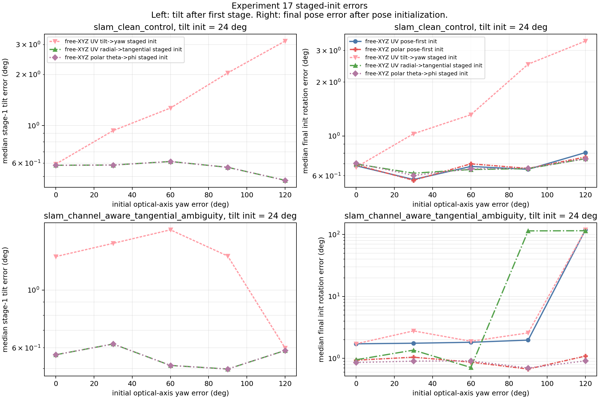

图：左列为第一阶段倾角误差，右列为位姿初始化后的最终旋转误差；上行为干净场景，下行为注入近轴切向歧义（77% 优化视图观测被污染）的场景。粉色虚线（全 UV 残差 + 仅 tilt 更新）随 yaw 发散，是“变量分层不等于通道分层”的证据。

### 8.2 位姿盆地与强基线的负结果

在近轴切向歧义场景、`tilt_init=24°` 下，最终旋转误差（3 次均值）为：

| 方法 | yaw 0° | 30° | 60° | 90° | 120° |
|---|---:|---:|---:|---:|---:|
| `xyz_uv_pose_stage`（Cartesian UV，三自由度） | 1.79° | 1.90° | 1.82° | 40.61° | 118.89° |
| `xyz_polar_pose_stage`（polar，三自由度） | 0.87° | 0.93° | 0.84° | 0.84° | 0.98° |
| `xyz_uv_staged_init`（全 UV 残差，仅 tilt） | 1.72° | 2.75° | 1.94° | 40.32° | 118.95° |
| `xyz_uv_rt_staged_init`（径向→切向，无门控） | 0.97° | 1.40° | 0.89° | 76.71° | 115.28° |
| `xyz_polar_staged_init`（`theta`→门控 `phi`） | 0.83° | 0.89° | 0.87° | 0.87° | 0.92° |

必须同时报告三条结论：

1. **直接 Cartesian UV 联合位姿优化在强 yaw 初值误差下确实崩溃**（118.89°），这与 Exp2—Exp5 的结论一致；
2. **但 `polar_pose_stage` 在该场景达到 100% 成功**，与 `polar_staged` 无显著差别。因此“`theta`→`phi` 分阶段严格优于强 pose-first 初始化器”**未被证明**，Exp16 的干净位姿阶段网格也给出同样的负结果（四种方法均 100%，中位旋转误差 0.66°—0.68°）；
3. 无门控的径向→切向方案在 90° 以上同样失败（76.71°、115.28°），说明真正起作用的是 `phi` 通道的**协方差门控**，而不只是坐标改名。

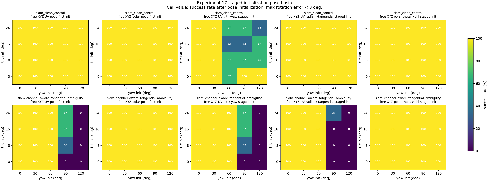

图：每格为位姿初始化成功率（最大旋转误差 < 3°）。在注入歧义的下列，Cartesian UV 三自由度与“仅 tilt 更新”的方案在大 yaw 处成片失败，而 polar 两种方案保持 100%。该图不支持“分阶段优于强 pose-first”的更强主张。

据此，项目最稳妥的因果归因是：

$$
\text{成功} \approx
\underbrace{\text{释放结构前先进入位姿盆地}}_{\text{pose-first 已能做到}}
+\underbrace{\text{按通道分离并使用 } \phi \text{ 的协方差门控}}_{\text{polar 提供}}
$$

而不是“分阶段本身带来了更大盆地”。

---


### 8.3 三个消融：把“坐标”与“门控”分开

Exp17 的对照同时改变了两个因素：残差所在的坐标（像素 `uv` 对角度 `theta/phi`）与通道加权（均匀对半径感知加近轴门控）。二者混在一起，无法支撑“极坐标带来了增益”的读法。本节用三个消融把它们分开。所有消融代码位于 `src/rpy_polar_synth/abl_channel_vs_coord.py` 与 `abl_symmetry_repeatability.py`，数据在 `outputs_abl/`。

#### 8.3.1 A1：坐标还是门控？

设计为 2×2 全因子加一个中间点，五个方法全部是**三自由度、仅位姿阶段**、同一优化器设置（`trf` + Huber，`max_nfev=90`），场景与初值与 Exp17 完全同一序列（种子 `18700`，`4` 个倾角 × `5` 个 yaw × `3` 次试验）。

`tilt_init = 24°`、歧义场景下的旋转误差中位数（度），括号内为 3° 判据下的成功率：

| 方法 | 坐标 | 加权 | yaw 0° | 30° | 60° | 90° | 120° |
|---|---|---|---|---:|---:|---:|---:|
| `uv_uniform` | uv | 无 | 1.72 (1.00) | 1.76 (1.00) | 1.82 (1.00) | 1.97 (0.67) | **118.98 (0.00)** |
| `uv_rt_gate` | uv 径向/切向 | 门控 | 0.95 (1.00) | 1.03 (1.00) | 0.87 (1.00) | 0.68 (1.00) | 1.08 (1.00) |
| `polar_isotropic` | polar | 均匀角度 | **14.85 (0.00)** | 28.04 (0.00) | 66.00 (0.00) | 97.81 (0.00) | 121.53 (0.00) |
| `polar_whitened` | polar | 白化 | 1.00 (1.00) | 1.53 (1.00) | 0.83 (1.00) | **114.11 (0.00)** | 112.94 (0.00) |
| `polar_whitened_gate` | polar | 白化+门控 | 0.93 (1.00) | 1.05 (1.00) | 0.87 (1.00) | 0.67 (1.00) | 1.09 (1.00) |

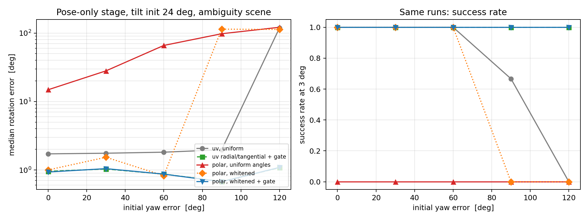

图：左为旋转误差中位数（对数轴），右为成功率。灰色（纯 UV）与橙色（白化极坐标）在同一 yaw 处同步崩溃，说明坐标本身不提供鲁棒性；红色（极坐标但不加权）自 `yaw = 0` 起即失败，说明错误的度量比不换坐标更糟；绿色与蓝色（任一坐标 + 门控）全程保持。

三条结论：

1. **换坐标而不换度量，是负收益。** `polar_isotropic` 在 `yaw = 0`、即初始化完全正确时也有 `14.85°` 的中位误差、成功率 `0`；在 `tilt = 0` 的更宽松格点上仍有 `8.08°`。原因是等角度加权把近轴方位角按 `1/theta` 放大，恰好强化了最不可靠的通道。这是本报告最需要强调的工程警告：极坐标**必须**与协方差白化同时使用。
2. **白化之后，极坐标与 UV 等价。** `polar_whitened` 与 `uv_uniform` 的成败边界同在前一个 yaw 步长（`90°`），量级亦相同（`114.11` 对 `118.98`）。逐点不完全相等来自 Huber 损失：鲁棒核作用在旋转后的残差分量上，不是旋转不变的，因此二次代价下的定理 3.2 不会原样传递到鲁棒代价。
3. **全部增益来自门控，而门控可以在 UV 中复现。** `uv_rt_gate` 与 `polar_whitened_gate` 在 `20` 个格点上的误差差不超过 `0.02°`，成功率完全一致。门控判据 `sin(theta)/sin(3°)` 只需要观测半径，`theta = r/f` 在 UV 中直接可得。

因此，极坐标在 BA 循环内的角色是**推导工具**：它把 `sigma_phi = sigma_px/(f theta)` 与近轴退化一次性显式化，使门控无需额外标定即可写出；但门控一旦写出，坐标系就不再重要。这一结论收紧了 7.2 节方向一的表述：可转化的不是“极坐标 BA”，而是“带通道门控的前端”。

#### 8.3.2 A2：精确对称与近轴的可辨识性

构造一个已知参考方向的合作目标，只观测离轴角（`theta_only`，与单星、单信标一致），再做一组近轴全像素观测（`near_axis_pixel`，六个参考位于 `1°`）。三个求解器：三维 `rpy`（显式规范先验，阻尼 `0.3`）、二维 `theta`、二维 `profile`（把 `yaw` 解析地 profile 掉：对每个候选轴，方位残差的最优 `yaw` 是加权圆均值）。

| 情形 | 求解器 | 轴误差均值 | 条件数（中位） | 报告 `yaw` 跨规范跨度 | 伪逆给出的 `sigma_yaw` |
|---|---|---:|---:|---:|---:|
| `theta_only` | 3-DOF rpy | `0.047°` | `3.0e5` | **`180.0°`** | `18.26°` |
| `theta_only` | 2-DOF theta | `0.047°` | `5.3` | 无此量 | 无此量 |
| `near_axis_pixel` | 3-DOF rpy | `0.055°` | `3.2e3` | `3.9°` | `2.67°` |
| `near_axis_pixel` | 2-DOF theta | `0.073°` | `5.3` | 无此量 | 无此量 |
| `near_axis_pixel` | 2-DOF profile | `0.056°` | `5.4` | 无此量 | 无此量 |

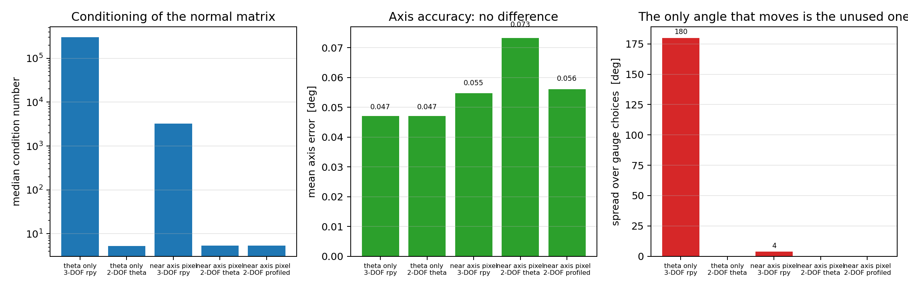

图：左为法方程条件数，中为轴误差，右为跨规范的报告 `yaw` 跨度。三维与二维的轴误差在同一位小数上不可区分（左二），条件数相差四个数量级（左一），唯一剧烈变化的是那个任务不需要的角度（右）。

三点读法：

1. **轴精度没有差异。** `theta_only` 下两者均为 `0.047°`（RMS 均为 `0.0494°`），与 Schur 补的预测一致。任何“二维更准”的说法在此被否证。
2. **近轴区丢弃 `phi` 是有代价的。** 纯 `theta` 解比全像素解差 `33%`（`0.073°` 对 `0.055°`）；把 `yaw` 解析 profile 掉而不是丢掉 `phi`，代价消失（`0.056°`）。这说明正确的降维方式是**边缘化**，不是**删通道**——这是原型里采用的实现。
3. **三维接口被迫生产一个数据无法支撑的数。** 跨五个规范先验，报告的 `yaw` 跨 `180°`，而 `pinv` 仍给出 `18.26°` 的一倍标准差。

#### 8.3.3 A3：同一数据的九种实现

固定一份带噪数据，重复 `24` 次独立噪声，比较三维的九种实现（`3` 个规范 × `3` 个阻尼）与二维的单一实现：

| 求解器 | 运行数 | 轴误差均值 | 轴误差标准差 | 实现间的轴跨度 | 实现间的 `yaw` 跨度 |
|---|---:|---:|---:|---:|---:|
| 3-DOF rpy | 216 | `0.0468°` | `0.0325°` | `0.000°` | **`180.0°`** |
| 2-DOF axis | 24 | `0.0468°` | `0.0325°` | `0.000°` | 无此量 |

同一份数据、同一套噪声，三维实现给出的轴完全一致，但姿态矩阵随实现选择在 `180°` 范围内变化；二维实现只有一个答案。**可复现性差异不在估计量，而在输出语义。**

这里必须给“逐位相同”加一个限定，否则会被读成比实际更强的结论。这张表证明的是**该场景下 `yaw` 不可辨识**：实现间 `yaw` 跨度 `180°`、条件数 `3.0e5`，说明 `psi` 只是一个规范自由度，$\hat R=R_z(\hat\psi)A$ 里的 $\hat\psi$ 由实现而非数据决定，于是轴部分自然与二维一致。它**不是**“解耦在一般场景下成立”的证据。一般场景里 $\hat\psi$ 由数据决定，$\hat\psi$ 的估计误差会通过 $R_z$ 与 $A$ 的乘积给轴解带来二阶漂移；解耦的严格依据是 2.1 节的恒等式（$\theta$ 与 $\psi$ 无关），而不是这张表。

三个消融合起来，把第 7 章的主张压缩成一句可检验的话：BA 循环内没有坐标优势（A1），指向问题里有接口优势（A2、A3），判定问题里才有证书优势（9.5 节）。

### 8.4 权重错配的方差定理，以及它为何不能外推

8.3 节的结论是经验性的：极坐标不加权时比像素残差差。一个自然的问题是，这一条能否升级为定理，并且定量预测"差多少"。本小节给出前半部分的答案（能），以及后半部分的否证（不能），并说明原因。这一否证同时修正了 7.3 节 L0 层的表述。

#### 8.4.1 一条由 Gauss–Markov 直接给出的定理

设 $J_u$ 为像素残差 $r_u=(\hat{\pi}-\pi)/\sigma_{px}$ 对姿态参数的 Jacobian，$\theta_i$ 为第 $i$ 个观测的离轴角。极坐标残差与像素残差只差一个逐点的旋转与缩放，用一个权重指数 $\alpha$ 统一写出：

$$J(\alpha)=T(\alpha)J_u,\qquad
T(\alpha)=\mathrm{blkdiag}\begin{bmatrix}
\cos\phi_i & \sin\phi_i\\[2pt]
-\sin\phi_i\,\theta_i^{\alpha-1} & \cos\phi_i\,\theta_i^{\alpha-1}
\end{bmatrix}$$

其中 $\alpha=0$ 是等角权重（两项都除以 $\sigma_\theta$），$\alpha=1$ 是正确白化（切向除以 $\sigma_\phi=\sigma_\theta/\theta_i$）。同一残差坐标下的噪声协方差为

$$\Sigma(\alpha)=\mathrm{diag}\bigl(1,\ \theta_i^{2\alpha-2}\bigr)$$

加权最小二乘的渐近协方差由三明治公式给出：

$$\mathrm{Cov}_\alpha=\bigl(J^\top J\bigr)^{-1}J^\top\Sigma\,J\bigl(J^\top J\bigr)^{-1}$$

等距投影下像素噪声各向同性，因此像素残差恰好使用了最优权重，$\mathrm{Cov}_u=(J_u^\top J_u)^{-1}$。Gauss–Markov 定理于是直接蕴含

$$\mathrm{Cov}_\alpha\succeq\mathrm{Cov}_u
\quad\Longrightarrow\quad
R(\alpha)=\frac{\mathrm{tr}\,\mathrm{Cov}_\alpha}{\mathrm{tr}\,\mathrm{Cov}_u}\ \ge\ 1$$

等号成立当且仅当 $\alpha=1$，或所有 $\theta_i$ 相等。**这就是"等角权重不可能更准"的证明**：它不需要跑实验，也不需要任何场景假设，只需要噪声各向同性这一条。

$R(\alpha)$ 只依赖几何（$\theta_i$ 的分布）与当前姿态，不含 $\sigma_{px}$，也不含初始化误差。这既是它的优点（纯几何、可闭式计算），也是它的局限（无法知道初始化把解带到了哪里）。

#### 8.4.2 数值与定理的等号点

在 A1 的同一场景上（$985$ 个观测，$\theta_{\min}=0.04^\circ$，$\theta_{\mathrm{med}}=4.55^\circ$）：

| $\alpha$ | `0` | `0.30` | `0.60` | `1.00` |
|---|---:|---:|---:|---:|
| $R(\alpha)$ | `59.84` | `9.15` | `1.92` | **`1.000`** |
| $\sqrt{R(\alpha)}$ | `7.74` | `3.03` | `1.38` | `1.00` |

$\alpha=1$ 处 $R$ 精确为 `1.000`，正是定理等号成立点。这一条同时是 3.8 节等价性结论的数值复核：白化后的极坐标代价与像素代价只差一个逐点正交变换。

#### 8.4.3 因果实验：只改权重指数

要检验"$R$ 是不是机制"，必须只改权重、不改别的东西。两条看起来可行的路都不可用：

- **删掉近轴观测**会同时改变条件数与问题难度。实测中 $\theta_{\min}$ 从 `4.05°` 增到 `8.02°` 时 $R$ 降到 `2.33`，但实测误差比反而从 `4.10` 升到 `12.31`——剔点本身改变了问题。
- **换 Huber 与纯最小二乘做对比**不成立。scipy 的 `loss` 逐残差分量作用，不具旋转不变性；两个只差逐点旋转的残差会得到不同的 Huber 权重，因此不是同一个代价函数。

唯一干净的做法是扫 $\alpha$：几何、点集、初值全部固定，只动切向权重。纯最小二乘，`10` 次重复取中位数：

| $\alpha$ | $R$ | 预测比 $\sqrt{R}$ | 实测误差 | 实测比 |
|---:|---:|---:|---:|---:|
| `0.00` | `59.84` | `7.74` | `23.05°` | `4.73` |
| `0.15` | `22.86` | `4.78` | `24.05°` | `4.93` |
| `0.30` | `9.15` | `3.03` | `23.22°` | `4.76` |
| `0.45` | `3.96` | `1.99` | `21.07°` | `4.32` |
| `0.60` | `1.92` | `1.38` | `16.45°` | `3.37` |
| `0.75` | `1.22` | `1.10` | `11.92°` | `2.45` |
| `0.90` | `1.02` | `1.01` | `8.72°` | `1.79` |
| `1.00` | `1.00` | `1.00` | `6.87°` | `1.41` |

像素法在同一批初值上的中位误差是 `4.87°`，即表中"实测比"的分母。

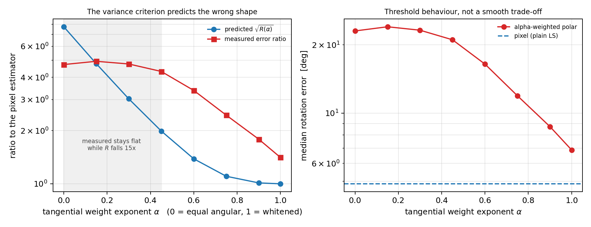

#### 8.4.4 形状对不上，而且原因不是精度

$\alpha\le0.45$ 这一段是决定性的：$R$ 从 `59.84` 降到 `3.96`（`15` 倍），$\sqrt{R}$ 从 `7.74` 降到 `1.99`，而实测比几乎不动（`4.73 → 4.32`）。若机制是方差，实测比本应跟随 $\sqrt{R}$ 同步下降。它没有。

真正的机制是**杠杆**，不是方差。近轴点的切向残差带着 $1/\theta_i$ 的噪声放大，这些点在切向把整条优化轨迹拽偏；这是一个由 $\max_i\theta_i^{\alpha-1}$ 决定的一阶效应，而不是由 $\sum_i\theta_i^{2\alpha-2}$ 决定的二阶效应。它的表现是**阈值**：只要杠杆足够大，解就落进坏盆地，此时无论方差名义上降了多少都没有区别；杠杆一旦被压到阈值以下，误差骤降。表中 `0.45 → 0.60` 这一格（`21.07° → 16.45°`）之后斜率明显变陡，就是这个转折。

这同时解释了 8.3 节 A1 的结果为什么"增益全在门控"：门控把近轴点的切向杠杆直接置零，而白化只是把它按 $1/\theta$ 缩小，后者仍留下有限杠杆。二者在方差上差别不大（门控后的 $R=15.74$，仍未到 `1`），但在杠杆上差别是数量级的。

#### 8.4.5 短程可预测，逃逸不可预测

既然方差不行，退一步：用优化器自己的前几步来预测方向。从同一初值出发，对两种残差各跑 `3` 步纯 Gauss–Newton，比较迭代后的误差。

`10` 个格点上方向判对 `8` 个；两个失败点都在 $\text{yaw}=105^\circ$，那里像素法自身崩到 `119°`，比值已失去意义。

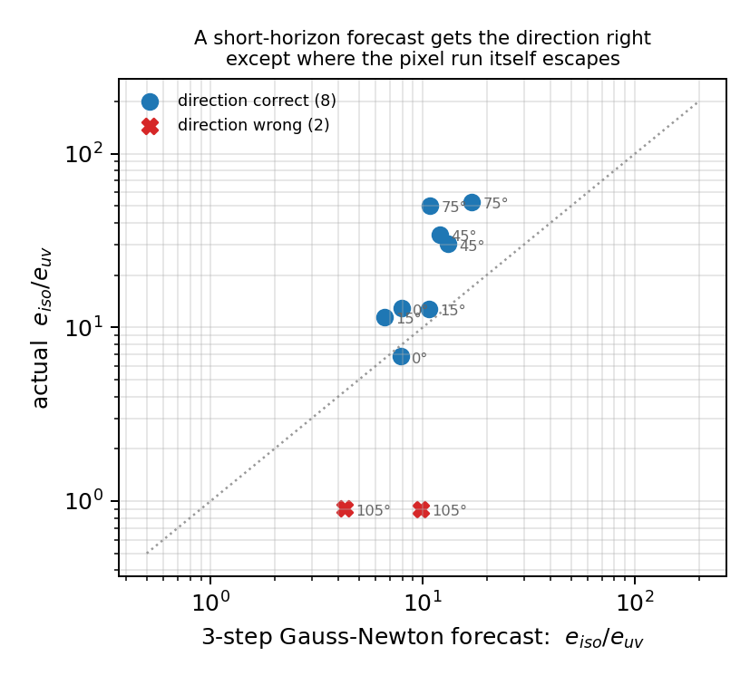

含义可以分开说：**早期梯度结构是可预测的**（"谁更差"能判，`8/10`），**完全逃逸不可预测**（"差多少"不能判，图 10 中各点偏离对角线达一个数量级）。

#### 8.4.6 这一节改变了什么

三条，其中两条是对本文自身叙事的修正。

1. **"等角权重永不更优"从经验升级为定理**，条件是噪声各向同性与真值邻域。这一条可以写进论文，且不需要任何实验支撑。
2. **但"更差多少"不能由方差预测。** 本节最初的计划是画出以 $R$ 为等值线的相图并预测未见格点，这个计划不成立：$R(\alpha)$ 随 $\alpha$ 幂律下降，实测误差呈阈值跳变，两者形状不同，任何以 $R$ 为横轴的预测都会系统性高估 $\alpha$ 较小处的劣化、低估 $\alpha$ 接近 `1` 处的残差。
3. **A1 的机制解释需要改述。** 不是"权重错了导致方差大"，而是"权重错了保留了近轴切向的杠杆，把解拽进坏盆地"。这个改述有操作后果：**靠调权重救不了等角极坐标，只能靠门控或换参数化**；反过来，门控在像素残差里同样有效，因为杠杆与坐标系无关。这与 A1 的 2×2 结果（`uv_rt_gate` 与 `polar_whitened_gate` 在 `20` 个格点上差 $\le0.02^\circ$）完全一致，并且给了它一个机制层面的解释，而不只是"两者数值接近"。

### 8.5 第四个消融 A4：把噪声模型翻过来

8.3 与 8.4 的全部结论都建立在一个隐含前提上：**相机是针孔的**。在这个前提下，像素噪声各向同性，而角噪声不是：

$$\sigma_\theta=\frac{\sigma_{px}}{f}\ \text{(常数)},\qquad
\sigma_\phi=\frac{\sigma_{px}}{f\theta}\ \text{(近轴爆炸)}$$

8.4.4 把机制归给杠杆而非方差，但"杠杆"本身是几何量，与噪声模型无关。如果这个归因成立，那么把噪声模型翻过来、让 $\sigma_\phi$ 变成与 $\theta$ 无关的常数，近轴门控的需求应当**照样存在**。如果归因不成立、真正起作用的是 $1/\theta$ 的噪声放大，那么门控应当失去作用。

星敏感器正好提供了这个翻转。它的原始观测就是单位矢量（或星对角距），噪声在角度上各向同性：

$$\sigma_\theta=\sigma_\phi=\sigma\ \text{(常数)},\qquad \text{没有像平面}$$

本小节用 A4 做这个对照。代码 `src/rpy_polar_synth/abl_isotropic_angle.py`，数据 `outputs_abl4/`。

#### 8.5.1 设计：两种噪声模型严格互为镜像

场景几何、3D 点、真值姿态、初值格点、优化器设置全部沿用 A1，只把观测的生成方式换掉。角噪声取 $\sigma=\sigma_{px}/f=1.25/620=0.1155^\circ$，使径向角精度与 A1 完全一致，唯一改变的是切向律（常数而非 $1/\theta$）。

为了让 UV 侧有可比对象，用同一焦距造一个伪像平面：$u=c_x+f\theta\cos\phi$。于是像素噪声变成径向 $f\sigma$、切向 $f\theta\sigma$——**各向异性**，恰好与 A1 的"像素各向同性、角各向异性"互为镜像。

真实观测的离轴角分布：$\theta_{\min}=0.109^\circ$，$5\%$ 分位 $0.836^\circ$，中位 $4.548^\circ$；$2.5\%$ 的观测在 $0.5^\circ$ 以内，$35.4\%$ 在 $3^\circ$ 以内。由于 $\sigma=0.1155^\circ$，最靠近光轴的那批点信噪比约为 $1$——在星敏上这些点的方位本质上不可用，这与针孔场景的成因不同但后果类似。

六个方法（全部 3-DOF、仅位姿阶段、`trf`+Huber、`max_nfev=90`）：

| 方法 | 坐标 | 加权 |
|---|---|---|
| `polar_iso` | 极坐标 | 等权 $1/\sigma$（理论上的正确白化） |
| `polar_iso_gate` | 极坐标 | 等权 + 近轴门控 `sin θ/sin 3°` |
| `polar_pinhole_rule` | 极坐标 | 把针孔公式 $\sigma_\phi=\sigma_\theta/\theta$ 照搬过来 |
| `uv_iso` | 伪像平面 | 标量权重 $1/\sigma_{px}$ |
| `uv_rt` | 伪像平面 | 径向 $1/\sigma_{px}$、切向 $1/(\sigma_{px}\theta)$（精确） |
| `uv_rt_gate` | 伪像平面 | 精确 + 近轴门控 |

做了两个变体。`truth` 变体从真值重算无噪方位再加噪声，因此抹掉了 Exp13 regime 注入的切向偏差，得到"干净几何 + 纯噪声"；`injected` 变体保留 Exp13 的污染观测作为基准，与 A1 的观测同一名义值，只换噪声律，是**逐格点可比**的那一组。

#### 8.5.2 结果：门控的需求没有消失

`truth` 变体，`tilt_init=24°`，轴误差中位数（度）：

| 方法 | yaw 0° | 30° | 60° | 90° | 120° |
|---|---:|---:|---:|---:|---:|
| `polar_iso` | 0.495 | 1.178 | 1.473 | **5.267** | **6.111** |
| `polar_iso_gate` | 0.469 | 0.402 | 0.673 | 2.232 | **7.829** |
| `polar_pinhole_rule` | 0.563 | 0.509 | 0.474 | 0.534 | 0.557 |
| `uv_iso` | 0.531 | 0.508 | 0.471 | 0.538 | 0.555 |
| `uv_rt` | **15.210** | **21.551** | **19.592** | **20.946** | **21.033** |
| `uv_rt_gate` | 0.471 | 0.405 | 0.383 | 1.436 | 1.249 |

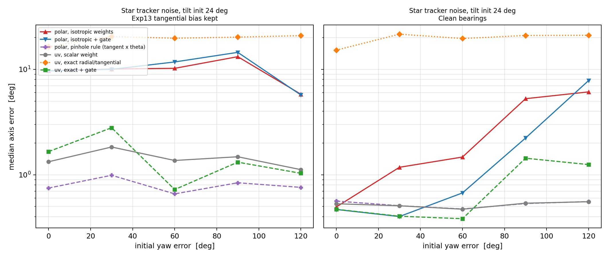

四点读法：

1. **正确白化仍然是最差的可用选项。** `polar_iso` 在 $\theta$ 噪声完全各向同性、没有任何 $1/\theta$ 放大的条件下，仍然在 `yaw ≥ 90°` 崩到 `5.3°–6.1°`。8.3.1 里 `polar_isotropic` 崩到 `14.85°` 时还可以推给噪声放大，这里推不掉了。**这独立地支持了 8.4.4 的杠杆归因**：机制是近轴方位通道的虚假约束，不是方差的错。
2. **硬门控不够，连续降权才够。** `polar_iso_gate` 把 `yaw=90°` 从 `5.27°` 压到 `2.23°`，但在 `120°` 反而更差（`7.83°` 对 `6.11°`）。而 `polar_pinhole_rule` 仅仅把切向乘上 $\theta$（连续降权，无阈值），全程 $\le0.56^\circ$。差别在于：$3^\circ$ 以上门控全开，而 `3°–10°` 这一段近轴点的杠杆仍然可观。
3. **照搬到星敏上的针孔公式反而最好。** `polar_pinhole_rule` 在星敏上是**错**的加权（它以为 $\sigma_\phi$ 依赖 $\theta$，实际不依赖），却在全部 `20` 个格点上给出最低或次低的误差。原因是过度降权恰好抵消了近轴虚假约束——一个模型误设下的"保守即正确"。
4. **UV 的伪像平面在全局不可用。** `uv_rt` 在所有格点停在 `15°–22°`，即几乎不动。这不是梯度实现问题：局部上它与 `polar_iso` 只差一个逐点线性变换（定理 3.2），但像素切向残差在远离解时**无界**（预测点可以跑到图像外无穷远），而极坐标的方位残差被 `wrap` 到 $[-\pi,\pi]$。大扰动下前者把 `trf` 的信任域压到零，每步几乎不前进。加上门控（`uv_rt_gate`）后恢复，但 `yaw≥90°` 仍有 `1.2°–1.4°`。

`injected` 变体（保留切向偏差，与 A1 同名义观测）给出方向一致但更尖锐的结果：`polar_iso` 与 `polar_iso_gate` 双双落在 `5.7°–14.5°`，门控**完全无效**；`polar_pinhole_rule` 仍在 `0.66°–0.99°`。

#### 8.5.3 三种崩法，三种解药

把 8.3、8.4 与本节放在一起，近轴崩塌有三种成因，它们的解药不同：

| 场景 | 主因 | 近轴门控 | 连续降权（切向 ×θ） |
|---|---|---|---|
| 针孔 + 切向偏差（A1） | 近轴噪声按 $1/\theta$ 放大 | **完全治好**（`114°` → `1.0°`） | 未测 |
| 星敏 + 切向偏差（A4 `injected`） | 大 $\theta$ 处也有系统偏差 | **无效**（`10°–14°`） | 有效（`0.66°–0.99°`） |
| 星敏 + 干净（A4 `truth`） | 近轴方位虚假约束 | 部分（`5.3°` → `2.2°`） | 有效（`≤0.56°`） |

这张表是本节最有操作价值的产出。它说明 A1 里"门控带来全部增益"这个结论**不能直接移植**：门控治的是噪声放大这一种崩法，对系统偏差无能为力；而连续降权在三行里都有效。8.3.1 把门控判据写成 `sin θ/sin 3°` 是一个具体的工程选择，本节的证据倾向于认为它**过窄**——`sin θ` 的连续形式（即 `polar_pinhole_rule` 的权重）在两种噪声模型下都更稳。

#### 8.5.4 对层 3 主张的修正

一个自然的推论是：在角量原生传感器上，polar 的白化是"平凡的"（两个分量除以同一个 $\sigma$），因此 polar 在星敏上是**零成本正确**的，UV 反而要伪造像平面并做各向异性映射。若成立，层 3 的优势就与加权设计无关。

这个推论被本节的数据**部分否证**，需要收窄：

- **成立的部分**：UV 在星敏上确实没有自然表示。伪像平面在局部等价、全局不可用（`uv_rt` 停在 `15°–22°`），要让它工作必须借用 $\theta$ 做逐点加权，而 $\theta$ 本来就是 polar 的量。这一条支撑"UV 是伪坐标"。
- **不成立的部分**：polar 在星敏上并不"天然正确"。等权白化在该传感器上同样崩（`5.3°–6.1°`），而且在有切向偏差时门控救不回来（`10°–14°`）。白化的设计问题原样存在。
- **更麻烦的一点**：针孔场景里 $\sigma_\phi=\sigma_{px}/(f\theta)$ 给出了"该降多少权"的**物理标度**；星敏场景里 $\sigma_\phi=\sigma$ 与 $\theta$ 无关，**没有物理标度可以借用**。所以星敏上有效的"切向 ×θ"是一个启发式，不是从噪声模型推出来的。这意味着在星敏上，polar 提供的不是白化公式，而是**一个可以把降权律写出来的坐标**——价值比原来主张的更弱，但仍是接口层的。

净结论：层 3（传感器模型）的优势保留为**表示的存在性**，不扩展到**加权的正确性**。后者在两种传感器上都是开放问题，且都需要门控或降权，与选择哪个坐标无关。


---

## 9. 原型设计与三场景实验

本节把 7.3 节的 L2（适定性）、L3（可判定性）做成可运行的原型，并在三类真实工程场景上做实验。代码为 `src/rpy_polar_synth/pointing_prototype.py` 与 `run_pointing_prototype.py`，数据在 `outputs_pointing/`。为了让设计与场景对得上，先给出必要的工程背景，再给出原型的完整设计，最后逐场景给实验。

### 9.1 背景：指向为什么是一个独立问题

#### 9.1.1 三段式链路与两个数量级的鸿沟

自由空间光通信、激光雷达、天文观测的共同结构是“捕获—指向—跟踪”（PAT）三段：

1. **开环指向**：由星历、平台姿态、安装矩阵算出对方应在的方向，把终端转过去。误差源包括平台定姿误差、结构热变形、安装偏差、轨道预报误差，合成一个**不确定域**（field of uncertainty, FOU）。
2. **捕获**：对方不在 FOU 中心，只能用信标或扫描把 FOU 覆盖一遍，直到探测器看到光斑。捕获时间近似与 FOU 的**面积**成正比，即随 FOU 半径平方增长。
3. **精跟踪**：锁定后用快反镜与位置敏感探测器闭环，把残差压到 µrad 级。

公开文献与厂商手册给出的典型量级如下（仅用于说明尺度，不作设计依据）：

| 量 | 典型量级 | 说明 |
|---|---|---|
| 不确定域 FOU | `5–20 mrad` | 开环指向的总误差，星间链路常见 |
| 开环指向精度（在轨标定后） | `0.1–0.65 mrad` | EDRS 约 `0.35 mrad`，TBIRD `20–35 µrad` |
| 信号束散角 | `10–50 µrad` | 决定“偏一点就掉链” |
| 精跟踪残差 | `≤5 µrad` | 闭环后的指标 |
| 捕获时间 | 数十秒，LEO—LEO 更短窗口 | 与 FOU、扫描策略强相关 |
| 星敏 cross-boresight | `0.3–10 arcsec` | 高端 `0.3–0.4 arcsec` |
| 星敏 roll | `3–50 arcsec` | 普遍比 cross-boresight 差一个量级 |
| 太阳规避角 | `30–40°` | 星敏在此范围内失效 |
| 太阳敏感器精度 | `0.1–1°` | 比星敏差 2–3 个量级 |

这张表里最关键的一行是前两行：**FOU 与束散角差两到三个数量级**。这意味着捕获不是“对准”，而是“用扫描把一个 mrad 级的圆盘盖住”；而一旦进入闭环，指向问题就交给 µrad 级的另一个回路。本文的原型落在**捕获与出光许可**这一段，不是精跟踪——这一点必须先说清楚，否则 9.3 节 `0.5°` 的容差会被误读成精度指标。

#### 9.1.2 三类场景共享同一个退化结构

三个场景表面上无关，数学结构却是同一个：

- **合作靶标 / 单参考**：靶标是若干个回射器或一颗星、一个太阳像。若靶标绕视线旋转对称（例如均匀分布在圆环上的回射器），则绕轴旋转在物理上**零信息**；若只有一个参考，则绕轴旋转**完全不可观**。
- **旋转对称目标**：太阳像、轴锥、圆形合作标志，同理。
- **多约束限位**：约束本身是“方向必须落在某个锥内”，与绕轴旋转无关。

于是三者都落在同一个商空间 $H\setminus\mathrm{SO}(3)\cong S^2$ 上：真正要估的只有二维光轴，绕轴那一维或者不存在、或者不该估。

#### 9.1.3 工程现状的两个具体失败模式

不是“精度不够”，而是两个可复现的错误：

1. **三自由度接口必须给 roll 一个数。** 单参考时这个数由先验或伪逆决定，没有物理含义，但它会进入协方差、进入验收报告、进入下游滤波器的状态量。9.4 节给出定量后果：形式上 `sigma_roll` 可以报到 `0.16°`，而实际跨度是 `180°`。
2. **限位逐条检查。** 每条限位单独看都满足，并不能推出“存在一个同时满足全部限位的指向”。这是球面凸集的 Helly 数问题（`S^2` 上为 `4`），9.5 节给出精确反例窗口。

这两条都不是本方法“算得更好”能解决的，而是**表述与判定**层面的问题——这正是第 7.3 节把价值放在 L2、L3 的原因。

### 9.2 原型总体设计

原型只有一条数据流和三个接口：

$$
\underbrace{(\theta_i,\varphi_i)}_{N\ \text{个参考的离轴角/方位角}}
\;\longrightarrow\;
\underbrace{\hat a\in S^2}_{\text{2 自由度轴估计}}
\;\longrightarrow\;
\underbrace{\sigma_a}_{\text{闭式 }1\sigma}
\;\longrightarrow\;
\underbrace{\{\text{可行}\mid\text{不可行}\mid\text{未定}\}}_{\text{带证据的三值判定}}
$$

三条设计原则，每一条都对应一个可检验的取舍：

| 原则 | 具体做法 | 反面做法及其后果 |
|---|---|---|
| P1 参数里不出现 roll | 直接在 `S^2` 上优化两参数 | 三自由度 + 先验/伪逆：零空间被“压住”而非消除，条件数 `3.0e5`（A2） |
| P2 不确定度用闭式 | Fisher 信息直接求逆，逐帧给两个数 | 协方差传播/伪逆：对不可观方向仍报 `18.26°` |
| P3 判定给三值 + 证据 | 可行给点、不可行给见证、其余“未定” | 布尔判定：无法区分“无解”与“没找到” |

#### 9.2.1 估计器：`S^2` 上的加权角度最小二乘

目标函数取离轴角残差，而不是像素残差：

$$
C(a)=\sum_{i=1}^{N} w_i\,\frac{\big(\arccos(u_i^{\top}a)-\theta_i\big)^2}{\sigma_\theta^2},
\qquad a\in S^2,\ \|a\|=1 .
$$

先说明它是什么：这就是 Wahba 问题[5]的角度形式。Wahba 问题的目标是让观测方向与参考方向的加权残差最小，闭式解（Davenport $q$ 方法、QUEST 及其后续）[6]对**方向残差**早已成熟。本文没有改进这些解法，用的正是它们；本文加的是**判定**那一层——估计器只在候选点上被调用，用来回答“这个姿态能不能用”。

选它的三个理由都是可证的，不是偏好：

- **与深度和尺度无关**（5.1 节）：`C` 只依赖方向，结构深度与平移不进目标函数；
- **与投影模型弱相关**（5.2 节）：只要能把像素换成离轴角，鱼眼、针孔、全景同一套；
- **与“指向”这一物理量一一对应**：`theta` 就是光轴与参考的夹角，残差单位是角度，可以直接与容差比。

优化分两步：先在 `(alpha, beta)` 图上做 `72 x 37` 的粗网格，再用信赖域反射法（TRF）局部收敛。这里有一个容易被误解的点：**参数化只影响条件数，不影响估计量**。因为 `C` 只通过 `a` 依赖参数，任何图给出的极小点都是同一个 `a`；换图改变的是等高线的形状与迭代步数（A2 中三维与二维的轴误差完全相同、条件数差 5 个数量级，就是这个事实的两面）。

不用四元数或旋转矩阵的原因也是结构性的：`C` 在右乘 $R_z(\psi)$ 下不变，因此三自由度 Hessian 沿 yaw 方向恒有一个零特征值，Gauss–Newton 必须靠阻尼或伪逆才能走步；二维参数化把这个零空间**删掉**，而不是压小。

单帧成本：`N <= 64` 时 Python 实现 `1 ms` 量级，改成 C 后到几十 µs，对 `10 Hz` 的判定绰绰有余（9.5 节给出实测）。

#### 9.2.2 闭式不确定度：为什么可以不用协方差传播

$\theta_i=\arccos(u_i^{\top}a)$，沿 `a` 处切向单位向量 `e_j` 的方向导数为 $-(u_i^{\top}e_j)/\sin\theta_i$。因此 Fisher 信息在切向是对角的：

$$
J_{jj}=\frac{1}{\sigma_\theta^2}\sum_{i=1}^{N}\frac{(u_i^{\top}e_j)^2}{\sin^2\theta_i},
\qquad
\sigma_j=\frac{\sigma_\theta}{\sqrt{J_{jj}}} .
$$

两个特例值得单列：

- **均匀环**（`N` 个参考均匀分布在离轴角 `theta_0` 的圆上）：$\sum_i(u_i^{\top}e_j)^2=N\sin^2\theta_0/2$，故

$$
\sigma_j=\sigma_\theta\sqrt{\frac{2}{N}},\qquad
\sigma_{2D}=\frac{2\sigma_\theta}{\sqrt{N}},
$$

**与 `theta_0` 无关**。指向精度只由参考数量与单点角噪声决定。

- **绕轴**：`sigma_varphi = sigma_theta / (sin theta_0)` 随 `theta_0` 趋零而发散。

这两条合起来是一个反直觉的工程结论：**把参考摆得离轴更远，改善的是 roll，不是指向**。想要更好的指向，只有加参考或降噪声，没有第三条路。这也直接否掉了“用大离轴角靶标提高指向精度”这类直觉。

闭式的第二个价值是**可审计**：每帧输出两个数，不需要构造 $H^{-1}$，也不会因为矩阵奇异而给出一个看似合理的小数。A2 中伪逆对不可观方向仍报 `18.26°` 的 `sigma`，正是“有矩阵就敢求逆”的典型后果。

#### 9.2.3 判定器：候选集引理与三值输出

这是原型里唯一有“证明”成分的部分，因此把引理写清楚。

**引理（候选集）。** 设 $C_i=\{b\in S^2:\angle(b,u_i)\le\Theta_i\}$，且所有 $\Theta_i<90^\circ$（此时每个锥是测地凸集）。若 $K=\bigcap_i C_i$ 非空，则 `K` 必含有限候选集

$$
S=\{\,u_i\,\}\ \cup\ \{\,\partial C_i\cap\partial C_j:\ i\neq j\,\}
$$

中的至少一个点。

*证明要点。* `K` 是球面上紧的测地凸集，因而是一个球面多边形（可以是 0 维或 1 维）。若 `K` 是单点或一段弧，其端点若只落在一个锥的边界上，则 `K` 在该点附近含一个半圆盘，与“单点/弧”矛盾，故端点至少落在两个边界上，属于两两交；若 `K` 有内点，其边界或含顶点（同样是两两交），或退化为单个圆，此时 $K=C_j$，其中心 $u_j$ 属于 `K`。证毕。

**这个引理同样不新。** 它就是 LP-type 问题“基本解不超过常数个约束”的标准论证，组合维数为 3（平面最小包围圆由 2 点或 3 点钉住，球冠同理），Welzl 1991 的随机增量算法整个建立在它上面。本文把它写出来的理由只有一个：原型代码里判定器的完备性依赖它，而报告里不能出现“代码这么做但没证明”的段落。**它是自检，不是贡献。**

由此得到一个**对任意锥数都完备**的判定：`K` 为空当且仅当候选集里没有点满足全部约束。成本 `O(n^3)`：`O(n^2)` 个候选，逐个对 `n` 个锥验证。若判为不可行，再贪心剔除冗余约束，得到一个**不可约子集**作为见证；由球面 Helly 定理，其基数不超过 `4`。

三值语义与工程动作的对应是硬约定：

| 输出 | 数学含义 | 证据 | 联锁动作 |
|---|---|---|---|
| 可行 | 存在满足全部容差的指向 | 一个**已逐条复验**的方向 | 放行 |
| 不可行 | 不存在 | 一个基数 `<= 4` 的不可行子集（本身就是证明） | 闭锁 |
| 未定 | 未能判定 | 无 | 保持（不改变当前状态） |

“未定”不是失败，而是**设计出来的安全出口**：任何两值判定在信息不足时必须二选一，而二选一中的“放行”是不可逆的。

判为可行后还会做一次局部抛光（在 `(alpha,beta)` 图上用 Nelder–Mead 最大化最坏裕度，4 个起点），因为候选点通常落在两个边界上、裕度为零——把零裕度的点交给操作员没有意义。抛光结果会重新复验，因此这一步不可能破坏可靠性。

#### 9.2.4 一个必须写进设计的边界：`Theta < 90°`

$\Theta\ge 90^\circ$ 时锥不再是测地凸集，候选集引理失效（$K$ 可能是整个半球甚至更大，边界不含两两交）。实现里直接返回“未定”而不是照算。

这里要把两个 $90^\circ$ 分清楚，之前写混了。**凸性的断点在 $90^\circ$ 且落在闭侧**：闭半球仍是测地凸集，$90^\circ$ 本身安全，失效从 $>90^\circ$ 开始（取两点同处余纬 $100^\circ$、经度相隔 $90^\circ$，其大圆弧最低点降到余纬 $104.0^\circ$，可见一斑）。**SOC 仿射表示的断点在 $90^\circ$ 且落在开侧**：$c^\top b=1$ 这张图切不出半球（赤道上的点满足 $c^\top b=0$），所以表示能力先于凸性失效。两者相差一个边界情形：$\Theta=90^\circ$ 是凸的但写不进单张仿射图。实现取严的一侧（$<90^\circ$），代价是丢掉一个本来可判的边界，收益是不必为它单独写两张图的代码。

### 9.3 场景一：自由空间光链路的出光联锁

#### 背景

激光终端不是“想开就开”。出光前至少需要确认：对方在视场内、当前指向不落在禁射区（卫星、航空器、人眼安全边界）、终端自身未处于故障或维护状态。工程上这是一组与门（interlock），任一条件不满足就闭锁。

难点在于“对方在视场内”这一条本身带噪声：`2°` 的视场、`0.1°` 量级的估计噪声，点估计落在视场内并不等于真值落在视场内。用点估计做与门，等价于把误放行率完全交给噪声分布；用固定大裕度做与门，则把可用率交给最坏情况。两者都没有回答“我有多大的把握”。

#### 设计

| 项 | 取值 | 依据 |
|---|---|---|
| 合作靶标 | `6` 个后向反射器，均匀分布在 `2°` 的环上 | 环对称是**故意**的：绕轴零信息，这正是场景的真实退化结构 |
| 相机 | `f = 620 px`，`sigma_px = 1.25 px` | 对应 `sigma_theta = 0.1155°` |
| 出光容差 | `Theta = 0.5° = 8.7 mrad` | 与 FOU 同量级，对应“是否允许开始捕获”而非精跟踪 |
| 闭式不确定度 | `sigma_a = 2 sigma_theta / sqrt(6) = 0.094°` | 9.2.2 的环特例 |
| 真实偏差扫描 | `0` 到 `2 Theta`，13 个格点 | 覆盖“刚好在边界上”的区域 |
| 每格点数 | `400` | 每个噪声档共 `5200` 次，其中 `2400` 次真值越界 |

判据不是“点估计在容差内”，而是**置信上界在容差内**：

$$
\text{permit}\iff \|\hat a-a_{\text{ref}}\|+k\,\sigma_a\le \Theta .
$$

`k` 的物理含义是“允许多少估计噪声被预算吸收”。`k = 0` 即点估计判据，是行业默许做法；`k > 0` 是显式的安全余量。

#### 结果

每个噪声档 `5200` 次试验，其中真值越界 `2400` 次、未越界 `2800` 次。误放行率的分母是越界次数，可用率的分母是未越界次数：

| 噪声倍数 | `k=0` | `k=1` | `k=2` | `k=3` |
|---|---|---|---|---|
| `x0.5` | `2/2400` / `93.1%` | `0/2400` / `84.1%` | `0/2400` / `76.4%` | `0/2400` / `68.4%` |
| `x1.0` | `41/2400` / `90.2%` | `1/2400` / `75.1%` | `0/2400` / `59.9%` | `0/2400` / `42.2%` |
| `x2.0` | `143/2400` / `85.2%` | `4/2400` / `54.1%` | `0/2400` / `13.7%` | `0/2800` / `0.0%` |

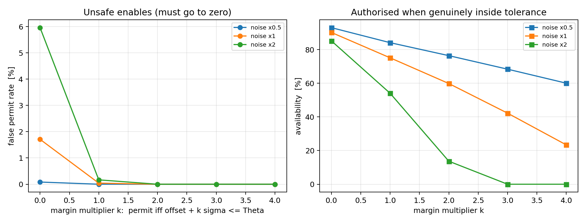

图：左为误放行率，右为真实偏差在容差内时的放行率。`k = 2` 把误放行压到零，代价是可用率随噪声迅速下降。

#### 读法

三点，顺序不能换：

1. **`0/2400` 不等于零。** 按 rule of three，`2400` 次零事件的 `95%` 上界约为 `0.12%`。要报更小的数，需要 `10^5` 量级的试验或解析界。原型里写 `0/2400` 而不是 `0.00%`，就是为了不让读表的人误以为“证明了零”。
2. **`k` 不是免费旋钮。** 在 `2` 倍噪声下 `k = 2` 只剩 `13.7%` 可用率，此时正确的工程动作是增加参考数或降低噪声（闭式直接告诉你加参考的收益是 `1/sqrt(N)`），而不是继续加 `k`。加 `k` 只是把不确定性换成停机。
3. **这条交换曲线本身是产品。** `sigma_a` 有闭式，所以不需要蒙特卡洛就能对每一帧给出可信度、对每一组参数给出“误放行—可用率”曲线。工程上这意味着安全参数可以在设计阶段被算出来、被评审、被写进接口控制文件，而不是在联调时靠试。

必须同时写下的局限：本场景没有闭环、没有时序、没有硬件表决，也没有考虑信标丢失与重捕；`0.5°` 是捕获级容差，与 `≤5 µrad` 的精跟踪指标不在一个层级。它对应的问题是“现在允许开信标/出光吗”，不是“跟踪得多准”。

### 9.4 场景二：星敏感器与太阳敏感器的轴优先定姿

#### 背景

星敏是全自主定姿里精度最高的器件，典型 `cross-boresight 0.3–10 arcsec`、`roll 3–50 arcsec`，输出四元数，`10 Hz`[7]。太阳敏感器精度 `0.1–1°`，但结构简单、可靠、视场大。

两者有三个共同点值得注意：

- **roll 天然弱**：星敏的 roll 精度普遍比 cross-boresight 差一个量级，因为它依赖视场内星点的角距分布；只有一颗星时 roll **完全不可观**。
- **太阳规避**：星敏在距太阳 `30–40°` 内失效，此时通常靠太阳敏感器过渡，而太阳像是一个**旋转对称**的目标——同样不可观 roll。
- **接口仍输出四元数**：即使只有一颗星或一个太阳像，姿态接口仍返回三个角与三个 `sigma`。第三个角的数值由实现决定。多探头时把几个四元数合成一个姿态，是旋转平均问题[4]的一个特例——那套文献讨论的是"怎么平均"，不讨论"平均之前有没有可平均的东西"，而后者正是本节要问的。

于是出现一个具体的工程现象：同一测量、不同实现，roll 的数值不同、`sigma` 也不同，而验收指标里往往就写着“roll 精度优于 `1°`”。

#### 设计

原型在这个场景里做两件事，都不涉及“比星敏更准”：

1. **单参考**：轴由该方向唯一决定，输出 `(a, sigma_a)`，其中二维质心两个方向独立，故 `sigma_a = sqrt(2) sigma_theta`；
2. **双参考**：roll 变为弱可观，`sigma_roll = sigma_theta / sin(s)`（`s` 为两参考角距），此时才允许输出 roll；一旦其中一颗丢失，立即退回“不输出 roll”。

#### 结果

- 单参考轴误差 RMS `0.167°`，闭式 `sqrt(2) sigma_theta = 0.163°`，相对偏差 `2.4%`。这说明闭式在真实（哪怕是合成的）几何下是可用的，不需要事后拟合。
- 双参考时 `sigma_roll` 与“单参考时实际跨度”的比值：`s = 2°` 处 `55` 倍，`s = 40°` 处 `1000` 倍。

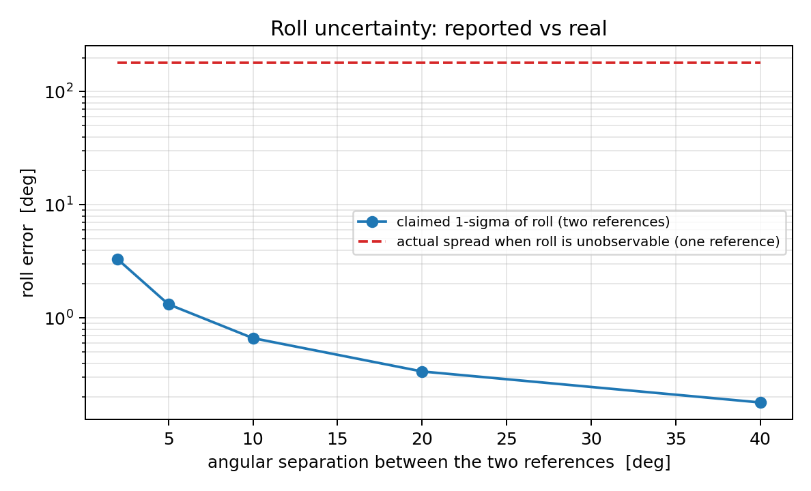

图：蓝线为双参考时滚转的一倍标准差 `sigma_theta / sin(s)`，随两参考角距增大而下降；红色虚线为单参考（滚转不可观）时误差在整圆上的实际跨度。

#### 读法

这张图给出一个可直接用的验收判据：**当两参考角距小于约 `20°` 时，任何以“roll 精度”为指标的验收都不可信**。因为 `sigma_roll` 的形式值虽小，其成立前提是“两参考都在、几何成立”；一旦退化到单参考，误差立刻回到整圆量级。

反过来，这也说明原型在这个场景里的价值不是精度，而是**少输出一个数**：不输出 roll，就不可能给出那个错误数字。对定姿系统而言，这比把 roll 算准更便宜，也更可靠。

必须承认的量级差距：真实星敏是 arcsec 级，本原型是 `0.167° = 600 arcsec`，差两个多数量级。原因是设定为“单星 + `1.25 px` 噪声”，目的是检验估计量与闭式的渐近一致性，**不是**器件指标。任何把 `0.167°` 当作产品精度的引用都是误读。

### 9.5 场景三：望远镜与大天线的指向限位校验

#### 背景

望远镜与大天线的控制软件里有一组“限位”，典型包括：

- 俯仰下限（避免撞基座，等价于天顶方向的一个锥）与俯仰上限；
- 方位行程与电缆缠绕（等价于某个固定轴的锥，超过就要反向解缠）；
- 天顶禁区（keyhole，方位在近天顶处快速变化）；
- 太阳、月球规避（`30–40°` 的**排除**锥）；
- 激光/射电保护区的禁射锥。

工程习惯是**逐条检查**：每一条限位单独判断，全部通过则允许指向。这个习惯在数学上不成立——球面上凸集的交非空不能由两两相交推出，因为 `S^2` 的 Helly 数是 `4` 而不是 `3`。换句话说，需要检查到“四元子集”才完备，两两检查会漏。

#### 设计

把每一类“必须落在某方向附近”的约束统一写成锥 $C_i=\{b:\angle(b,u_i)\le\Theta_i\}$，然后调用 9.2.3 的判定器：

1. 候选集 = 各锥中心 + 所有两两边界圆交点；
2. 任一候选满足全部锥 → **可行**，返回该点并逐条复验；
3. 全部候选都不满足 → **不可行**，贪心剔除冗余约束得到不可约子集作为见证；
4. `Theta >= 90°` → **未定**。

太阳规避这类“必须避开”的约束是补锥、非凸，不在本框架内，需要外层分支——这是 L3 的边界，写在这里而不是脚注里。

#### 精确反例

三个 `31°` 的锥，中心两两相距 `60°`：任意一对的和为 `62° > 60°`，所以**逐对检查全部通过**；但三点的外接圆半径为 `35.26° > 31°`，因此**不存在同时落在三个锥内的方向**。

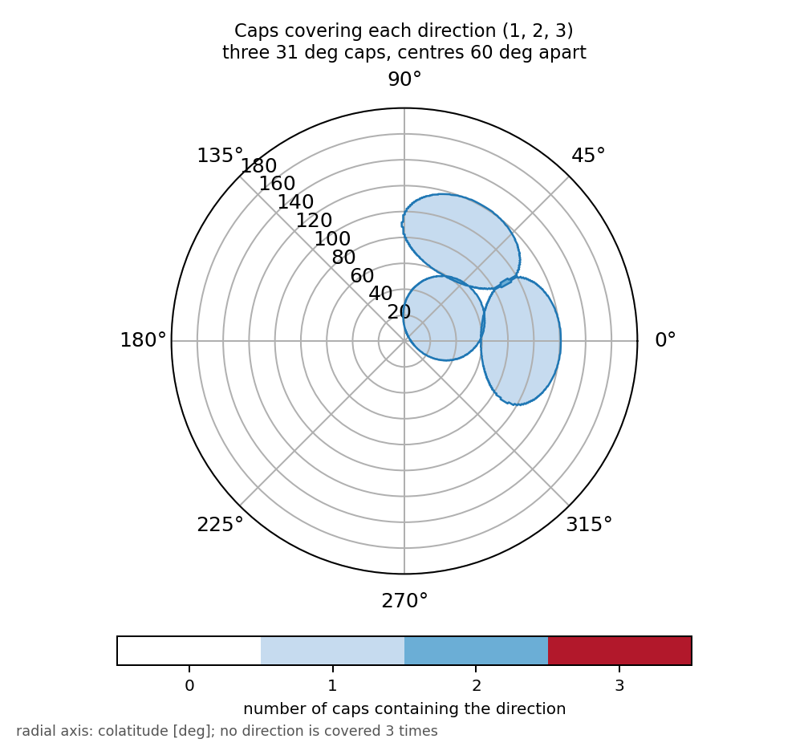

图：每个方向被多少个锥覆盖（`1` 浅蓝、`2` 中蓝、`3` 深红）。图中没有任何深红区域，即没有方向被三个锥同时覆盖，而相邻两个锥确有重叠。

对同一构型扫描容差，可把“不成立区间”精确算出来：

| `Theta` | 逐对检查 | 证书判定 | `0.5°` 稠密网格 |
|---|---|---|---|
| `28°` | 不通过 | 不可行（对见证） | 不可行 |
| `29°–30°` | 不通过 | 不可行（对见证） | 不可行 |
| `31°–35°` | **通过** | **不可行（三元见证）** | 不可行 |
| `36°` 及以上 | 通过 | 可行（给出点） | 可行 |

即 `Theta in (30°, 35.26°)` 是“每条限位都满足、但没有任何指向满足全部限位”的窗口。窗口下界 `30°` 是两两相切的条件（`60°/2`），上界 `35.26°` 是外接圆半径。这不是数值病态，而是维数效应。

#### 随机实例统计

`400` 个随机三锥实例（容差 `15°–35°`，中心在基准轴 `5°–45°` 内随机）：

| 判据 | 结果 |
|---|---|
| 通过全部逐对检查 | `241 / 400` |
| 其中被**证明**无公共方向（带三元见证） | `2`（占逐对通过者的 `0.83%`） |
| 证书判定：可行，且点逐条复验通过 | `239`，违反约束 `0` |
| 证书判定：不可行，且带见证 | `161`（对见证 `159`、三元见证 `2`） |
| 证书判定：未定 | `0` |
| 与 `0.5°` 稠密网格不一致 | `3` 例，均为网格漏判（证书给出并复验了点） |
| 独立复核：对全部 `281` 个不可行见证做 `2x10^5` 点局部采样 | 找到反例 `0` |

三点必须同时读：

1. **`0.83%` 不高，但代价不对称。** 逐对检查出错的方向是放行一个物理上不存在的指向，在望远镜或激光系统里对应撞限位或照到禁区内目标；证书判定的出错方向只会是“多等一次”。
2. **证书比网格更可靠。** `0.5°` 的稠密网格把 `3` 个真实存在的可行指向判成不可行——因为可行区域可以薄于网格步长；而证书给出的可行解自带逐条复验，不会错。
3. **完备性不再是三个锥的专利。** 早期版本依赖“两两 + 三元”枚举，只能在 `n <= 3` 时给确定答复；改用候选集引理后，判定的完备性对任意 `n` 成立（`Theta < 90°`），代价是 `O(n^3)`。

#### 规模与成本

对 `n = 3, 4, 5, 6, 8, 12` 各 `60` 个随机实例（共 `360` 例）：

| `n` | 不可行 | 可行 | 未定 | 与网格矛盾（危险方向） | 网格漏判 | 见证最大基数 | 判定耗时中位数 |
|---:|---:|---:|---:|---:|---:|---:|---:|
| `3` | `26` | `34` | `0` | `0` | `0` | `2` | `1.4 ms` |
| `4` | `40` | `20` | `0` | `0` | `1` | `2` | `3.1 ms` |
| `5` | `48` | `12` | `0` | `0` | `0` | `3` | `5.3 ms` |
| `6` | `52` | `8` | `0` | `0` | `0` | `3` | `19 ms` |
| `8` | `54` | `6` | `0` | `0` | `0` | `3` | `42 ms` |
| `12` | `60` | `0` | `0` | `0` | `0` | `3` | `254 ms` |

“危险方向”指证书说不可行而网格找到点——这是唯一会破坏可靠性的方向，`360` 例中为 `0`。见证基数上限为 `3`，未触及 Helly 界 `4`，与“随机实例里三元洞比四元洞更常见”一致。耗时随 `n` 近似立方增长，`n = 20` 时约 `2.7 s`。

工程含义：限位约束集是**静态**的（一次配置、长期不变），因此 `O(n^3)` 完全可以接受——`n <= 6` 时单次判定 `20 ms` 以内，可以在 `10 Hz` 下逐帧算；约束更多时按配置变化触发重算即可，不需要每帧。

### 9.6 补锥：太阳规避把可行集变成非凸

9.2.4 节把"补锥未实现"列为设计边界。本节把它补上，结论比"没做"具体：**框架能覆盖其中一半，另一半不是更难，是性质变了。**

#### 9.6.1 一个恒等式：把"必须避开"翻译成"必须进入"

避开一个以 $s$ 为轴、半角 $\beta$ 的锥，等价于进入一个以 $-s$ 为轴、半径 $\pi-\beta$ 的锥：

$$
\{u:\angle(u,s)\ge\beta\}=\{u:u\cdot(-s)\le-\cos\beta\}=\mathrm{cap}(-s,\ \pi-\beta)
$$

集合形式完全没变，所以表示上不需要任何新东西。变的是**凸性**：球面 cap 测地凸当且仅当半径不超过 $90^\circ$。

| $\beta$ | 等价锥半径 $\pi-\beta$ | 测地凸 | 现行实现 |
|---:|---:|---|---|
| $105^\circ$ | $75^\circ$ | 是 | 精确，与分支判定 `16/16` 一致 |
| $95^\circ$ | $85^\circ$ | 是 | 精确 |
| $90^\circ$ | $90^\circ$（半球） | 是 | 拒绝（守卫取严格小于，见 9.2.4） |
| $60^\circ$ | $120^\circ$ | **否** | 未定 |
| $30^\circ$ | $150^\circ$ | **否** | 未定 |

在 `96` 个实例上扫（$\beta$ 从 $3^\circ$ 到 $105^\circ$，太阳位置按 $\delta/\beta$ 相对取值，覆盖"太阳远离指向盒"到"太阳压在盒上"整段）：$\beta<90^\circ$ 的 `72` 个**全部**返回未定，$\beta>90^\circ$ 的 `16` 个与分支判定逐例一致。也就是说这条边界不是含糊的"大概不行"，而是一条可以画出来的线。

#### 9.6.2 失效的方向是"假不可行"，且只发生在一种几何里

候选集引理的证明用了两件事：可行集若有内点则其边界含顶点；若没有内点则它是一条弧，端点落在两个边界上。非凸以后，前者不再推出"顶点存在"（边界可以是一整条圆而没有顶点落进可行集），后者也不再成立。

具体反例是**太阳锥严格落在指向盒内部**：此时可行集是一个**环域**。环内是禁飞区，环外是盒外；候选点要么在洞里（盒中心，被太阳锥盖住），要么在盒外（$-s$ 方向）。没有一个候选点在环里。于是候选集把"可行"判成"不可行"。

| 几何 | 真值来源 | 候选集判定 | 外层分支 |
|---|---|---:|---:|
| 太阳在盒边缘（非凸，但可行点靠近两圆交点） | 密网格 | **68 / 68** | 68 / 68 |
| 太阳在盒内部（可行集为环域） | 密网格 | **0 / 21** | **21 / 21** |
| 宽锥 $\beta>90^\circ$（凸） | 分支 | 框架 `16 / 16` | — |

这比"候选集会失效"更具体，也更有用：失效不是随机不准，而是**结构性的、可预测的**——只有当可行集是"被挖掉一块"的形状时发生，方向恒为保守。保守听起来无害，但对一个以"证明"为卖点的判定器，"可行却报不可行"就是错答案。

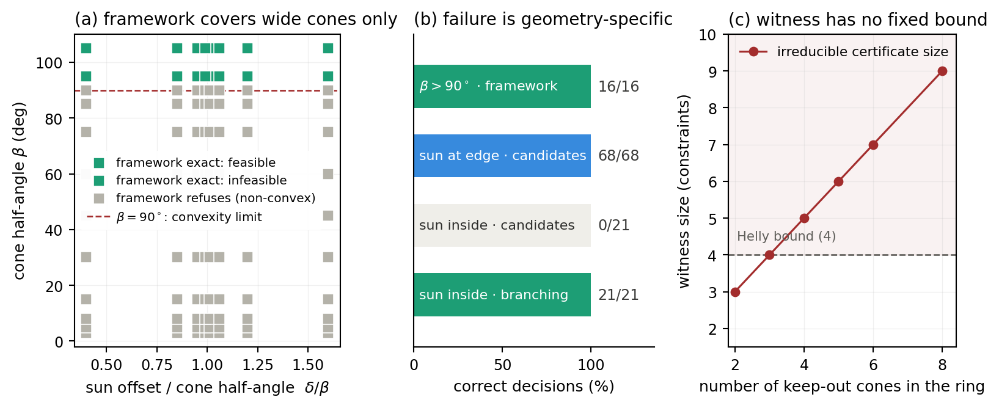

#### 9.6.3 外层分支：把"哪个约束杀掉这一块"当作分支变量

算法只有四条规则，在切平面图上的一个矩形框里依次判断：

1. 若某条约束在整个框上都被满足，把它从活跃集里划掉；
2. 若某条约束在整个框上都被违反，整框丢弃，并记下"被谁杀掉"；
3. 活跃集为空，则整框可行，返回框心（构造性）；
4. 否则四分，继续。

界必须可证，否则分支就退化成抽样。取 $f(x,y)=u(x,y)\cdot a$，其中 $u$ 由切平面提升到球面，可以算出 $|\nabla_{xy}f|\le 1/\sqrt{v\cdot v}$，而 $\sqrt{v\cdot v}$ 在框上有正下界（原点到矩形的距离），于是"中心值 $\pm$ 半对角 $\times$ 该常数"是 $f$ 在框上的严格包络。规则 1、2 都建立在这个包络上，所以既不漏框也不误杀。

代价（$\varepsilon=0.02^\circ$）：中位 `5921` 个框，最大 `20309`，Python 单次判定仍在毫秒量级，比凸情形的 $O(n^3)$ 候选集贵三个数量级，但对 `10 Hz` 的联锁仍然够用。

#### 9.6.4 见证塌掉：Helly 数 4 在非凸情形不再成立

凸情形的"不可行"是"交集为空"，Helly 定理给出上界 `4`[8][9]；非凸情形的"不可行"是"指向盒被若干禁飞锥的**并**覆盖"，而最小覆盖没有固定大小。构造如下：$R=1^\circ$ 的指向盒，$k$ 个禁飞锥均匀排布在半径 $0.5^\circ$ 的环上，半角取"刚好盖住"的覆盖半径（乘 `1.03` 的余量，否则盒边界恰好落在锥边界上，实例会以零测度的余量变成可行）。

| $k$ | 半角 | 判定 | 去掉任一个后 | 不可约证书大小 |
|---:|---:|---|---|---:|
| 2 | `1.152°` | 不可行 | 全部可行 | 3 |
| 3 | `0.892°` | 不可行 | 全部可行 | 4 |
| 4 | `0.759°` | 不可行 | 全部可行 | **5** |
| 6 | `0.638°` | 不可行 | 全部可行 | **7** |
| 8 | `0.588°` | 不可行 | 全部可行 | **9** |

每一行都是不可约的（去掉任意一个锥就变可行），但从 $k=4$ 起大小超过 `4`，并且随 $k$ 无界增长。**非凸情形没有固定的 Helly 数**，这与"Helly 数在球面上是 4"并不矛盾：那条定理的前提是凸集族，而带补锥的族不是。

#### 9.6.5 这对 L3 的定位意味着什么

| 维度 | 凸（现行框架） | 非凸（含补锥） |
|---|---|---|
| 可行 $\to$ 给点 | 组合精确 | **是**，构造性（框心），分辨率受限 |
| 不可行 $\to$ 给见证 | $\le 4$ 条约束的不可约子集 | **只有分区**，每格标注杀掉它的约束，无最小见证 |
| 复杂度 | $O(n^3)$ | 分辨率相关，实测中位 `5.9e3` 框 |
| 完备性来源 | 候选集引理 | 分支覆盖（数值，非组合） |

所以 7.3 节 L3 那句"可行给点、不可行给见证"要改写为：**可行侧保住，见证侧降级**。补锥把 L3 从"精确判定"变成了"精确可行 + 数值不可行证明"。这是真实损失，不能被"加了外层分支"这句话掩盖过去——尤其因为"最小见证"正是 5.2 节论证 L3 相对内点法 Farkas 证书的唯一实质优势。

一个分支：如果应用能接受"把禁飞锥放大到半球"（$\beta\ge 90^\circ$，即太阳必须在地平线以下），那么一切回到凸情形，精确性与 $\le4$ 见证全部保留。这是配置层面的选择，不是算法层面的妥协，值得在需求阶段就提出。

### 9.7 原型的边界

必须与结果同时写下的限制，按严重程度排序：

- **全部是合成数据。** 传感模型理想化（各向同性像素噪声、无畸变、无背景光、无饱和、无外点），因此 `0.047°`、`0.167°` 这类数字只有相对意义，不能当器件指标；
- **单站、单轴、无多视图耦合。** 一旦进入多相机/多帧联合，旋转 `R_i` 之间的耦合会让整体重新变成非凸问题，证书不再成立（7.3.2 已指出）；
- **补锥的见证降级。** 太阳/月球规避（$\beta<90^\circ$）已实现，但换掉了证书形态：能给出构造性的可行点，不能给出 $\le4$ 条约束的不可约见证，只能给数值分区。9.6.4 节的构造显示最小见证随锥数无界增长（$k=8$ 时为 `9`）。这是 L3 定位上唯一一处实质退让，写在这里而不是藏在 9.6 里；
- **不是安全完整性等级（SIL）组件。** 出光联锁原型只做了统计判定，没有故障树、时序、硬件表决与失效率分析，距离可认证的安全组件还有整段工程；
- **真实数据验证缺失。** 星敏星表、激光通信终端、望远镜编码器的实测数据都还没有接入，这是 11.1 节路线中的第 3 项；
- **"万级盒子"是千级到十万级，且依赖围界。** 9.6 的盒子数是拿 8 条约束、几度宽的指向盒测出来的。换成真实规模（200 条以上、$60^\circ$ 域）是 `4.2e5` 个盒子；更要紧的是当时的余弦 Lipschitz 围界在小半角下不紧，2° 的星规避锥根本认证不出来，5.9% 的域面积只有点检验、没有排除约束。9.11 节把这件事算清并给出修法（三角不等式围界，盒子少 10.5 倍、仅点检验面积降到 0.74%）。

---

### 9.8 三个候选场景，以及“独占区”的一次重定位

前面几节把原型做完了，但留下一个误导性的印象：9.6 节证明补锥会让见证失效，读起来像“非凸 = 框架失效”。本节先纠正这个印象，再给三个比现有场景更贴合独占性的候选。

#### 9.8.1 判据：独占性不在凸侧，在非凸侧

球面 cap 可行性在凸情形下根本不需要本文的方法：

$$\angle(u,u_i)\le\theta_i \iff u\cdot u_i\ge\cos\theta_i,\qquad \sqrt{u\cdot u}\le1$$

这是标准的二阶锥规划（SOCP）[10][11]，成熟求解器毫秒级解完，Farkas 证书也照样给。**在凸情形，本框架是弱势方**——没有精度优势，没有速度优势，见证的“$\le4$ 条”也换不来工程收益，因为乘子证书本来就够审计。

非凸情形完全不同。补锥、环域下 SOCP 直接不适用，内点法只能给局部解，而判定问题是**存在性**问题，局部解回答不了“整个姿态空间里有没有解”。唯一能保证全局的是分支定界，9.6 实现的正是它。

所以独占区的准确定义是三层叠加：

> **非凸**（补锥/环域）+ **需要全局**（存在性判定，不容局部解）+ **需要可预测代价**（在线联锁或设计循环内调用）

这三条同时成立的地方，市面上没有替代品。而真实工程约束几乎全是非凸的：太阳规避是补锥，地平门限是 cap 但常与规避锥相交，热控入射角是环域。**失效区与独占区是同一个区域**，9.6 的结论要按这个方向读，而不是反方向。

#### 9.8.2 场景四：多探头星敏的联合可用性与遮光罩反设计

9.4 节做的是“轴优先定姿”，判定单个星敏能否定姿。升级版是**多探头联合**：探头 $i$ 有视轴 $a_i$、遮光半角 $\beta_i$，可用条件是太阳角距大于 $\beta_i$，即必须在补锥外。定姿至少需要两个可用，于是判定变成组合条件：存在一个子集 $S$，$|S|\ge k$，使得对每个 $i\in S$ 都有 $\angle(a_i,s_\odot)>\beta_i$。$n=4$、$k=2$ 时只需枚举 $\binom42=6$ 种，代价可接受。

真正的独占点不在判定，在**反问题**：给定“全轨道 99% 时间至少两个探头可用”，求 $\{a_i,\beta_i\}$ 的可行设计域。现有做法是 STK 沿轨道打点扫描再插值，而插值会抹掉窄的可行窗口。判定器在这里被外层优化调用上万次，O(n³) 加分支的代价结构正好适合做内层 oracle。典型 $\beta$ 在 $20^\circ$–$45^\circ$，全程落在非凸区。

9.10.4 节验证这一段时，两个子句都没站住：“3-D 非凸”其实是 1-D 的时间区间问题，“O(n³) 加分支”在这里用不上；但“插值抹掉窄窗口”成立，而且比这里写的严重（$5^\circ$ 步长下一半的近临界设计被误判）。反设计的对象也因此从“可行设计域”变成一个标量上界曲线。

#### 9.8.3 场景五：地基望远镜的多约束可观测性

可观测要求同时满足：地平高度 $>h_{\min}$（cap）、太阳角距 $>\beta_\odot$（补锥）、月亮角距 $>\beta_{\rm M}$（补锥）。交出的是环域或月牙，正是候选集法失效、分支法有效的那类几何。

与前面三个场景不同的是，这里要的**不是判定而是边界**：排程器需要知道“这个目标今晚可观测多久”，那是可行域的边界位置，不是一次 yes/no。这一条使得它成为最适合先做验证的场景，9.9 节给出结果。

#### 9.8.4 场景六：航天器热控的多面入射角

每个散热面要求太阳入射角落在 $[\alpha_{\min},\alpha_{\max}]$ 内。用两锥之差表示：

$$\alpha_{\min}\le\angle(u,s_\odot)\le\alpha_{\max}\iff u\in \mathrm{cap}(s_\odot,\alpha_{\max})\setminus\mathrm{cap}(s_\odot,\alpha_{\min})$$

几何上是**球面环域**，比补锥更彻底的非凸——它的内边界是一条闭合曲线，可行集绕它一圈。

现有做法是热分析软件做稳态/瞬态求解，回答“这个姿态下某面多热”，没有人把“姿态空间里哪些区域热安全”做成可行性枚举。这是把几何可行性问题当仿真问题做，中间有空白。三个候选里它的独占性最高，因为没有对标工具，且约束结构恰好落在框架最强的一类。

9.10.5 节验证这一段时，“几何上是球面环域”成立，“比补锥更彻底的非凸、绕内边界一圈”不成立：面组法线闭合时交集恒空（$\sum\cos\theta_i=0$ 与“全部 $\cos>0$”矛盾），不闭合时连通块恒为 1。它仍然值得做，但理由变成“没人算过热安全包线”，而不是“这里有多重非凸”。

#### 9.8.5 一个元层面的观察：判定器是内层 oracle，不是终点

三个场景有个共同点：判定器都被**外层搜索调用**，不是单独使用。遮光罩设计、排程、热安全包线，都是“外层优化 + 内层几何判定”。

这改变了对独占性的评估方式。单次判定能赢的地方不多，但作为 oracle 的**接口性质**——完备、代价可预测、可行侧给构造性证据——在非凸情形没有替代品：

| | 单次判定 | 作为设计 oracle |
|---|---|---|
| 凸情形 | SOCP 胜（更成熟、更快） | SOCP 仍胜 |
| 非凸情形 | 内点法只能给局部解 | **唯一能保证全局的一档** |
| 卖点 | 精度、单次速度 | 完备性、代价可预测、构造性证据 |

这个视角对产品化有直接后果：不应该把它做成“一个更快的求解器”，而应该做成“一个可以被调用一万次的判定服务”。前者必输，后者没有对手。

这张表在 9.10 节被改了一次。五个场景审下来，"作为设计 oracle"那一行要动的不是"全局"，而是**精度与无分辨率参数**：四个场景的设计问句是一维标量边界（遮光罩上限、可观测时长），第三个是点查询，没有一个问"姿态空间里有没有解"。全局性只在存在性问句上才是卖点，而这类问句在这五个场景里出现零次。所以 oracle 的规格从"完备、代价可预测、构造性证据"改成"精确、快、可复现、无分辨率参数"——最后一条是新增的关键项，因为设计边界常常是相切（零测度）事件，而任何带分辨率的算法都会把它平滑掉，且分辨率越低越像答对了。

---

### 9.9 场景五的验证：地基望远镜的可观测域

本节把 9.8.3 落到数字。用低精度 Meeus 星历[13]（太阳约 `0.01°`、月亮约 `1°`——后者是 9.12.2 的实测值，比本节初稿写的 `0.3°` 大三倍，见那里的说明）算真实方位，两个站点：FAST（$25.653^\circ$N, $106.856^\circ$E）与丽江（$26.695^\circ$N, $100.030^\circ$E）。

方法上有一处必须交代：可观测域用 $(z,a)$ 参数化，$z$ 是天顶距、$a$ 是方位角，搜索域是 $z\le90^\circ$。判定依赖一个干净的事实——$\angle(u,s)$ 与 $u\cdot\hat z$ 在 $S^2$ 上都是 1-Lipschitz 的（球面梯度模分别为 1 与 $\cos z\le1$），所以对一个直径 $d$、中心 $c$ 的框：

$$f(c)-\tfrac{d}{2}\ \le\ f(u)\ \le\ f(c)+\tfrac{d}{2}\qquad \forall u\in\text{box}$$

一次求值即可界定整框。于是框只有三种去向：全部约束都满足（认证可行）、某条约束必定违反（丢弃）、否则细分。因为界是双侧的，枚举**不会误分类，只会过度细分**，这是“完备”的来源。

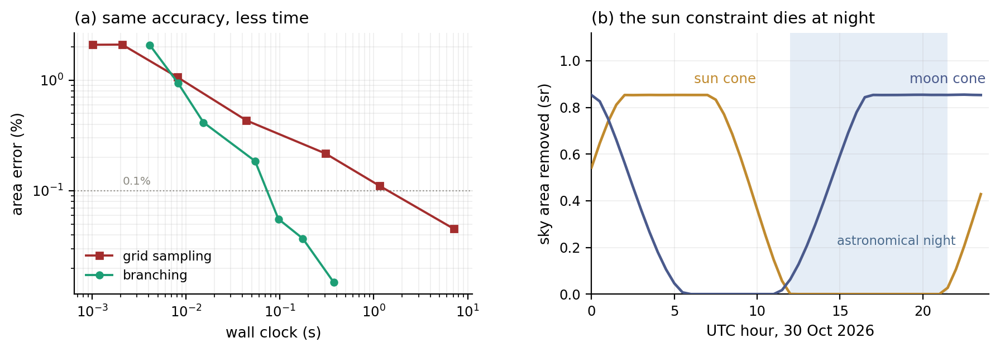

#### 9.9.1 第一个发现：夜间太阳约束是冗余的

9.8.3 写的是“三个约束”，验证下来这句话只在特定传感器上成立。

避开半角 $\beta_\odot$ 的锥与“高度角 $>h_{\min}$”域相交，当且仅当太阳高度 $>h_{\min}-\beta_\odot$。光学天文夜间太阳低于 $-18^\circ$，而 $h_{\min}=30^\circ$、$\beta_\odot=35^\circ$ 时阈值是 $-5^\circ$，太阳早已低于它。于是太阳约束**在整个夜间恒为冗余**，移除面积为 `0.001` → `0.000` sr（图 b 的阴影区）。

反过来，白天射电观测时太阳是强射频干扰源而天空仍可用，太阳锥真实切掉 `0.54`–`0.85` sr（占可见天空 `8.6%`–`13.5%`）。所以“三约束”属于白天可观测的传感器，不属于光学夜间。这句话写进报告，是为了避免把 9.8.3 的约束计数当成普适事实。

#### 9.9.2 第二个发现：可行域恒单连通，且可以证明

9.8.3 曾担心“多连通块被网格采样漏掉”。**实测中这个担忧不成立**：三个案例、10 月的 31 天（含新月，日月角距最小 `6.5°`）、$h_{\min}$ 从 $5^\circ$ 扫到 $75^\circ$，连通块数**恒为 1**。

这不是采样偶然，是结构性的：球面 cap 是测地凸的，凸集减去一个与之相交的凸集，余集仍然连通（除非后者包含前者）。所以“cap 减若干补锥”的可行域至多一个连通块。多连通需要更强的非凸性——要么是环域（场景六的两锥之差），要么是“区域被若干锥的并覆盖”（9.6 的结构）。

这条结论是负面的，但有用：它把这个场景的卖点从“完备性”挪走了，见 9.9.3。


*图：FAST 在 UTC 02:00 的可观测域，天顶等距投影，中心为天顶、外圈为 $5^\circ$ 高度角。绿色可行，两处白洞是太阳与月亮的规避锥。太阳锥的下边缘几乎贴到地平门限，只留下一条 $0.25^\circ$ 宽的可行环带——这条带在图上不可见，但枚举确实给出过它。*

#### 9.9.3 第三个发现：等价精度下快一个数量级，且给严格区间

FAST、UTC 02:00（北京 10:00）、$h_{\min}=5^\circ$、$\beta_\odot=\beta_{\rm M}=30^\circ$，区域面积 `4.3334` sr（基准取分支法 $\varepsilon=0.005^\circ$、`120` 万节点，给出的区间是 $[4.3331,4.3337]$）。网格法不能当基准，因为它的误差**单侧**（格点中心可行即整格计入），即使 `0.02°` 也偏高 `0.043%`，会偏袒任何低于它的估计。

| 方法 | 分辨率 | 面积或区间 (sr) | 相对误差 | 耗时 | 单元数 |
|---|---:|---:|---:|---:|---:|
| 网格 | `0.05°` | 4.3381 | $+0.108\%$ | 1.16 s | `1.30e7` |
| 网格 | `0.02°` | 4.3353 | $+0.043\%$ | 7.17 s | `8.10e7` |
| 分支 | `0.05°` | $[4.3309,\ 4.3362]$ | 半宽 `0.061%` | 0.18 s | `1.42e5` |
| 分支 | `0.02°` | $[4.3318,\ 4.3352]$ | 半宽 `0.039%` | 0.37 s | `2.95e5` |

两个量级不同的优势叠在一起：

- **代价**：要一个 `0.04%` 的半宽，分支需 `0.02°`、`0.37` s；网格要 `0.02°`、`7.17` s 才能给出 `+0.043%` 的单值，相差 `19` 倍。节点数 `2.95e5` 对 `8.10e7`，少 `275` 倍。（初稿在这里写的是 `75` 倍，那是上界少算了一整条带造成的假象：带窄了一半，中点被压低，分支看起来比真值低 `0.03%`。9.12.1 记录了这个 bug 与修法。）
- **可解释性**：分支给的是**严格区间** $[\text{area},\text{area}_{hi}]$，网格给单值且不知道误差方向。这个差别对排程是实质的——把区域面积换算成可观测时间时，区间直接变成时间的误差界，单值不能。

代价律也符合预期：框数由边界长度决定而非面积，实测 $\varepsilon$ 从 `2°` 到 `0.02°`（100 倍）时节点数从 `2884` 到 `294684`（102 倍），即 $O(1/\varepsilon)$ 而非 $O(1/\varepsilon^2)$。

#### 9.9.4 对场景五的判断

价值成立，但**来源与 9.8.3 的预期不同**，要改口：

| 原以为的价值 | 验证后的状态 |
|---|---|
| 三约束、非凸，框架适用 | 光学夜间太阳冗余，只有两约束；射电白天才是三约束 |
| 完备性——不漏窄连通块 | **不成立**：可行域恒单连通，网格也不会漏 |
| 边界精度 | **成立**：同精度快 `19` 倍，且给严格区间 |
| 代价可预测 | **成立**：$O(1/\varepsilon)$ |

即：场景五的收益是**算得更快、且知道误差多大**，不是“别人算不出来”。这比 9.8.3 的说法弱，但它是真的。

还要说清对标对象。开源生态里，这类可用性判定由 astroplan[12] 一类包提供：给定高度角、气团、日月分离等约束，在**离散时刻**上返回布尔值。它与本节不是同一个问题——astroplan 回答“这一秒可不可观测”，本节回答“这一夜里可观测的**总面积**是多少、误差界多宽”。两者可以互相校验（把区间端点代回布尔判定即可），但不能互相替代；9.12 节给出这个校验的结果。

一条边界必须同时写下：星历是低精度解析式，规避角（$30^\circ$、$35^\circ$）是量级假设而非某台望远镜的实测参数，也没有用真实排程日志对标。要把这节变成工程结论，需要一台望远镜的实际观测计划——这是 11.1 节路线里新增的一项。

---

### 9.10 其余五个场景的验证：把载荷假设逐条拿掉

9.9 只验证了场景五。本节对剩下五个重复同一流程：先写出这个场景的"独家性"依赖哪一句假设，再拿一个数去试它。方法与 9.9 有意不同——9.9 把一个场景彻底做完，本节每个场景只做一次判决性检验，验不过就改口，不补做。

结论先给，避免读者把五小节当成五次补充：

| 场景 | 载荷假设 | 检验 | 结果 |
|---|---|---|---|
| 一 联锁 | 问的是"有没有可行指向" | 9.3 自己的判据 | **不成立**：判据是点查询；`0.5°` 目标锥下规避锥只改裕度，不改结论 |
| 二 星敏 | 单参考，绕轴物理缺失 | 星计数 + roll 的 CRLB | **不成立**：典型星敏单帧 20–300 颗星；`N≥2` 时 roll 比轴更准（`0.87×`） |
| 三 限位 | 反例窗口属于大容差 | 尺度扫描 + 随机实例 | **加强**：窗口与容差无关（`13.4%`）；但随机布置命中率随 $\Theta$ 急降，真实限位还是乘积域 |
| 四 遮光罩 | 3-D 非凸存在性 | 解析切换时刻 + 反设计曲线 | **方向错**：问题是 1-D 的，设计边界是相切条件；"采样漏窗"成立且更严重 |
| 六 热控环域 | 环域多重非凸 | 辐射学 + 面组几何 | **一半**：带常见（`35%`），但闭合面组恒无解，非闭合面组恒单连通 |

代码为 `src/rpy_polar_synth/scenario_audit.py` 与 `run_scenario_audit.py`，数据在 `outputs_scenario_audit/`，图见本节末。

#### 9.10.1 场景一：联锁问的不是存在性

场景一的判据写在 9.3 里：

$$
\text{permit}\iff \|\hat a-a_{\text{ref}}\|+k\,\sigma_a\le\Theta .
$$

这是一次点求值。它问"这一帧允不允许出光"，不问"姿态空间里有没有一个可行指向"；后者才是 L3 的对象。所以场景一从一开始就没用 L3，它用的是 L2 的闭式不确定度。这不是文本上的斤斤计较——两种问题的证书不同、成本不同、失败模式也不同。

值得问的是：把联锁推广到"目标锥 + 规避锥"（不照到邻近卫星、不照到人眼安全边界）之后，非凸性会不会把它变成存在性问题。答案在一个恒等式里。半角 $\beta$ 的规避锥把整个半角 $\Theta$ 的目标锥吃掉，当且仅当太阳落在目标轴 $\beta-\Theta$ 以内，这个方向的测度是闭式的：

$$
p(\beta)=\frac{1-\cos(\beta-\Theta)}{2}.
$$

$\Theta=0.5^\circ$ 时，$\beta=30^\circ$ 给出 `6.48%`（20 万次蒙特卡洛：`6.44%`），$\beta=60^\circ$ 给出 `24.6%`，$\beta=85^\circ$ 给出 `45.2%`，闭式与蒙特卡洛在六个 $\beta$ 上差不超过 `6e-4`。也就是说：**规避锥只在 6.5% 的姿态下改变结论，而在这 6.5% 里它是一次闭式比较，不需要分支**。

剩下的可能是 9.6 的困难情形——不可行来自若干锥的**并**覆盖了可行域，没有一个锥单独负责。要让 `0.5°` 的目标锥走到这一步，需要至少两个半角可比的规避锥同时压在上面。`400` 个随机实例（1 个 `0.5°` 目标锥 + 3 个 `5°`–`60°` 规避锥）里，需要"并覆盖"才不可行的：**`0` 个**。每一个不可行实例都能被单个锥解释。

成本一并记下：闭式裕度 `21` μs，分支判定 `113` μs（`5.4` 倍）。两者都远低于任何联锁周期，所以这里不是速度问题，而是**分支换不到任何东西**——在 400 个实例上它与闭式逐例同判，却多出一个分辨率参数。

结论：场景一保留，但它属于 L2 不属于 L3。把它算进"判定器独占"是把一个点查询记成了一类存在性判定。

#### 9.10.2 场景二：星敏不是单星敏感器

9.4 的退化结构是"单参考 → 绕轴零信息"，这一点在数学上无懈可击（定理 2.1）。问题在于它是否对应一台真实的星敏感器。

星计数用标准累积律 $\log_{10}N(<m)=0.6(m-6)+\log_{10}8900$（全天到 6 等 `8900` 颗），视场内星数服从 Poisson，$\lambda=N(<m)\,\Omega/4\pi$：

| 视场 | 极限星等 | $\lambda$ | $P(N<3)$ |
|---|---|---:|---:|
| $\pm10^\circ$ | 6.0 | 67.6 | 低于双精度 |
| $\pm10^\circ$ | 5.0 | 17.0 | `1e-5` |
| $\pm5^\circ$ | 5.0 | 4.25 | `0.203` |
| $\pm5^\circ$ | 4.5 | 2.13 | `0.641` |
| $\pm5^\circ$ | 4.0 | 1.07 | `0.907` |

只有"$\pm5^\circ$ 视场 + 极限星等 $\le4.5$"这一个角角落落会经常只剩一两颗星，而那是太阳敏感器或亮星跟踪器的参数，不是星敏的。`20°×20°` 的星敏单帧 20–300 颗星，"单参考"在它身上发生的概率为零。

更要紧的是第二半：即使只剩一颗星，roll 也不是无穷差。各向同性角噪声 $\sigma$ 下，方向 $i$ 对绕轴转角 $\psi$ 的灵敏度是 $\sin\theta_i$，于是

$$
\sigma_\psi=\frac{\sigma}{\sqrt{\sum_i\sin^2\theta_i}},\qquad
\sigma_\theta=\frac{\sqrt2\,\sigma}{\sqrt N},
$$

对散布在视场里的方向 $E[\sin^2\theta]=2/3$，两式相除得

$$
\frac{\sigma_\psi}{\sigma_\theta}=\frac{\sqrt3}{2}=0.866,
$$

与 $N$ 无关（图 c；数值 Fisher 与闭式相对差 `2.1e-16`）。$N=1$ 时 $\sigma_\psi=\sigma/\sin\theta$，离轴 `5°/10°/30°` 分别为 `11.5σ / 5.76σ / 2.0σ`，即比轴差 `8.1 / 4.1 / 1.4` 倍。

所以"不输出 roll"的真实收益是：在单矢量敏感器上，把一个差 1.4–8 倍的数换成不输出；两颗星以上连这个收益也没有，因为 roll 比轴**更准** `13%`。场景二的标题应当从"星敏感器与太阳敏感器的轴优先定姿"改为"单矢量敏感器（太阳敏感器、磁强计、单合作靶标）的轴优先定姿"——那里绕轴信息是物理缺失的，星敏上不是。

#### 9.10.3 场景三：Helly 失效与容差无关，与"轴对齐"有关

9.5 把反例窗口写成 $\Theta\in(30^\circ,35.26^\circ)$，读起来像"容差大到 30° 才会出事"。这个读法是错的，而且错在对我们不利：把三个锥的几何按 $\Theta$ 等比缩放，取边长 $d=2\Theta(1-\varepsilon)$，逐对检查全部通过（$d\le2\Theta$），三重交集为空当且仅当外接圆半径 $d/\sqrt3>\Theta$，即

$$
\varepsilon<1-\frac{\sqrt3}{2}=0.1340 .
$$

实测在 $\Theta=0.5^\circ$、$1^\circ$、$5^\circ$、$30^\circ$ 四个容差上窗口完全相同：$\varepsilon\in[0,0.125]$（网格 `0.025`），上界与闭式 `0.1340` 相差一个格距（图 d）。**把容差从 $30^\circ$ 缩到 $0.5^\circ$，窗口一分不缩。** 9.5 的 $(30^\circ,35.26^\circ)$ 只是把边长固定在 $60^\circ$ 的那一个切片。

这是对 9.5 的加强，但它同时暴露了另一半：窗口在归一化几何里宽度固定，在**随机实例**里却极难命中。`6000` 个随机三锥实例中，$\Theta=30^\circ$ 有 `232` 个逐对通过、其中 `8` 个是反例（`3.4%`）；$\Theta=20^\circ$ 是 `36` 个通过、`2` 个反例（`5.6%`）；$\Theta\le5^\circ$ 一个逐对通过的都没有。9.5 的 `360` 例实验之所以能测到 `0.83%` 的漏检率，是因为它的几何是按构造摆的。两句话不矛盾：**反例不是大容差现象，是精确摆位现象**。

最后一条与工程有关：真实望远镜/天线的限位是方位与俯仰的区间，在 $(\mathrm{az},\mathrm{el})$ 参数空间里是个矩形，即乘积域，逐轴检查在结构上就精确，不需要任何 Helly 论证。而方位边界的容差是 $90^\circ$（大圆），恰好落在 9.2.4 那条 $\Theta<90^\circ$ 的适用边界之外。所以场景三的独占性只在"限位上再叠加非轴对齐锥"（太阳规避、天顶禁行）时才存在，而那时它已经变成 9.6 的问题。

顺带修掉一个数值缺陷。候选集引理要求枚举两圆交点，原实现写成 $b=x u_1+y u_2\pm z\,(u_1\times u_2)$，其中 $x,y$ 的分母是 $\sin^2 d$；$d$ 小到 $1.5^\circ$ 时系数放大到 $10^5$ 量级，交点角度误差约 `1e-11` rad，而判据容差是 `1e-12` rad，于是**一个真实裕度为 `0.134°` 的可行实例被判成不可行**。改在 $(u_1,e,f)$ 正交基上解 $\cos\phi$ 之后误差回到 `1e-16`，判决恢复正确；9.5 那张 11 点扫描表逐点不变（$28^\circ$–$38^\circ$，每度一点，前后完全一致）。这条要写进来，因为它说明"精确判定"的精确性依赖实现的条件数，不只依赖引理。

#### 9.10.4 场景四：遮光罩问题是 1-D 的，设计边界是相切

9.8.2 把多探头可用性写成三维存在性问题：存在子集 $S$，$|S|\ge k$，使每个 $i\in S$ 满足 $\angle(a_i,s)>\beta_i$。这个写法在给定轨道上是多余的。姿态确定后太阳在体坐标系里随时间走一条曲线，对圆轨道就是一条小圆

$$
s(t)=\cos\gamma\,\hat z+\sin\gamma\,(\cos t\,\hat x+\sin t\,\hat y),
$$

$\gamma$ 是太阳与轨道法线的夹角（传统 beta 角 $=90^\circ-\gamma$）。于是可用条件是时间的一维函数：

$$
a_i\cdot s(t)=A_i\cos t+B_i\sin t,\quad A_i=\sin\gamma\,a_{ix},\ B_i=\sin\gamma\,a_{iy},
$$

而 $\angle(a_i,s(t))=\beta_i$ 的解是 $t=\operatorname{atan2}(B_i,A_i)\pm\arccos(C_i/R_i)$，$C_i=\cos\beta_i-\cos\gamma\,a_{iz}$。切换时刻解析，区间端点因此也是解析的；判定一次是 $O(n)$，**没有分辨率参数**。3-D 分支在这里不是更慢，而是回答另一个问题。

设计的对象因此是一个标量。遮光罩越大挡得越多，所以"全轨道至少 $k$ 个可用"给出的是**上界** $\beta_{\max}(\gamma)$：

| $\gamma$ | $0^\circ$ | $10^\circ$ | $20^\circ$ | $30^\circ$ | $40^\circ$ | $50^\circ$ | $60^\circ$ | $70^\circ$ | $80^\circ$ | $90^\circ$ |
|---|---:|---:|---:|---:|---:|---:|---:|---:|---:|---:|
| $k=2$ | `90.0*` | `90.0*` | `90.0*` | `90.0*` | `85.3` | `75.3` | `73.2` | `78.6` | `84.2` | `90.0*` |
| $k=3$ | `54.7` | `55.3` | `57.1` | `60.0` | `63.8` | `68.2` | `65.9` | `59.6` | `56.0` | `54.7` |

（`*` 表示在 $90^\circ$ 处封顶，即约束不紧。）典型遮光罩 `20°`–`45°`：$k=2$ 时全轨道恒满足，反设计没有任何约束可解；$k=3$ 时上界落到 `54.7°`–`68.2°`，与设计区间只差 `10°`–`20°`，**这时它才是真约束**。所以场景四的反设计有对象，但对象是"三冗余定姿下的遮光罩上限"，不是"任意配置下的可行域"。

"打点扫描 + 插值会抹掉窄窗口"这一条成立，而且比预想的严重。用 $\pm1.5^\circ$ 抖动打散四面体对称性（否则切换点落在 $45^\circ$ 整数倍上，$5^\circ$ 网格靠巧合全部命中），`90` 个刚越过边界的设计：

| 步长 | $5^\circ$ | $2^\circ$ | $1^\circ$ | $0.5^\circ$ | $0.1^\circ$ |
|---|---:|---:|---:|---:|---:|
| 判成"全轨道干净"的比例 | `50%` | `21%` | `13%` | `6%` | `0%` |
| 时长误差 中位 / p95 / max（占轨道） | `0.48 / 1.11 / 1.27%` | `0.17 / 0.42 / 0.53%` | `0.09 / 0.22 / 0.26%` | `0.05 / 0.11 / 0.12%` | `0.01 / 0.02 / 0.03%` |

$5^\circ$ 步长下有一半设计被误判为"全轨道干净"，时长误差最大 `1.27%`——LEO 90 min 轨道上是 `1.1` min。$1^\circ$ 步长仍有 `13%`。$0.1^\circ$ 在这批设计里没漏，但受控实验说明这不是保证：把遮光罩超界 `0.01°`（对应窗口 `0.032°`）时，$5^\circ$、$2^\circ$、$1^\circ$、$0.5^\circ$、$0.1^\circ$ 五档**全部漏检**。区间法没有这个问题，因为它不取网格。

3-D 版本的代价顺手量了：在 $\beta=\beta_{\max}-2^\circ$ 处，可行太阳方向域面积 `10.74`–`12.56` sr（占球面 `85%`–`99.9%`），$0.5^\circ$ 分辨率下 `972`–`14972` 个框、`3`–`18` ms。它既不慢也不难——它只是把"相切"平滑掉了。设计边界 $\beta_{\max}$ 的定义就是**轨道圆与可行域边界相切**，相切是零测度事件，任何有限分辨率的区域枚举或时间网格都定位不到，只有"精确谓词 + 二分"能。

#### 9.10.5 场景六：双侧带要么无解，要么单连通

先把辐射学写对。一个散热面的吸收热流是 $\alpha_s S\max(\cos\theta,0)+q_{\rm int}$——$\max$ 不能省，因为背对太阳的面不收太阳热流，此时冷端约束才是紧的。散热是 $\varepsilon\sigma T^4$，双端限温于是给出

$$
\cos\theta\le\frac{q_{\rm hot}-q_{\rm int}}{\alpha_s S}=c_{\rm hot}\ (\text{热端}),\qquad
\cos\theta\ge\frac{q_{\rm cold}-q_{\rm int}}{\alpha_s S}=c_{\rm cold}\ (\text{冷端}).
$$

在 $\alpha_s=0.2$、$\varepsilon=0.85$、$\Delta T=20$ K 的 `85` 个参数点（$q_{\rm int}$ `0`–`400` W/m$^2$，$T_{op}$ `250`–`330` K）上：双侧带 `30` 个（`35%`）、恒过冷 `16`、恒过热 `14`、只剩冷端 cap `15`、只剩热端 keep-out `10`（图 f）。所以环域**不**罕见——这一条与预期相反，得改口。

但双侧带出现的条件是 $q_{\rm int}<q_{\rm cold}$，即**关掉内热源这个面本来就会过冷**。这正是加热器存在的理由：工程上冷端由加热器接管，剩下仍是单侧约束，也就是 9.6 已覆盖的补锥。环域是"散热面相对内热负荷偏大"的签名，不是一类新的几何。

几何上还有一个更硬的事实。若面组法线满足 $\sum_i n_i=0$（立方体六面、正交三面、对跖的一对散热面、共面 $120^\circ$ 三面、四面体都满足），则任一太阳方向有 $\sum_i\cos\theta_i=0$。而双侧带要求每个 $\theta_i\in[\alpha_{\min},\alpha_{\max}]$ 且 $\alpha_{\max}<90^\circ$，即每个 $\cos\theta_i$ 严格为正——和不可能为零。所以**交集恒空**，不是多连通，是无解。实测 `16` 例（4 个闭合面组 $\times$ 4 个带）全部为空；把第 7 个面（体对角线）加到立方体上也无解，因为六个面已经把和钉死了。

只有非法向闭合的面组才有解。三面角 $(+x,+y,+z)$ 在带 $[20^\circ,60^\circ]$、$[30^\circ,70^\circ]$、$[30^\circ,80^\circ]$ 上面积 `0.042 / 0.326 / 0.659` sr，占球面 `0.33% / 2.6% / 5.2%`，连通块数**恒为 1**。所以"球面环域、比补锥更彻底的非凸、多重连通"三句话里，只有"非凸"对（环带确实不是测地凸的），"多重连通"错。

一个附带的工程含义：环带的判定是对一个标量的区间检查，$O(1)$；求"哪些太阳方向热安全"是一次二维枚举，与 9.9 同构。所以场景六的价值形态与场景五一样——一个可以便宜地调用一万次的点查询/边界枚举，不是一个需要全局搜索的存在性判定。

#### 9.10.6 五个场景合起来改变了什么

三次改口、一次加强、一次方向错：

- 场景一从 L3 退回 L2；场景二从"星敏"缩到"单矢量敏感器"；场景六从"多重非凸"缩到"单连通环带"。
- 场景三的 Helly 失效比原来写的更强（与容差无关），但工程落点更窄（真实限位是乘积域）。
- 场景四的表述方向错了：判定是 1-D 的，设计边界是相切条件；"采样漏窗"成立且比预想严重。

五条合起来指向同一件事，而这件事与 9.8.5 的结论冲突：

> 五个场景里，操作层问的都是**点查询**（这一帧安不安全），设计层问的是**一维标量边界**（$\beta_{\max}(\gamma)$、可观测时长）或**几维参数搜索**。9.8.5 提出的"3-D 全局存在性 oracle"，没有一个是它。

所以"判定器作外层优化的内层 oracle"这个定位仍成立，但规格要改：oracle 需要的是**精确、快、可复现、无分辨率参数**，不是"全局"。全局性只在"姿态空间里有没有解"这个问题上才是卖点，而这个问题在五个场景里出现了零次——9.9 的场景五要的是边界，9.6 的补锥要的是覆盖证书。

L3 因此进一步收窄：它独占的是**零测度事件的精确定位**——相切、单点接触、恰好卡在窗口边上。这类问题网格与采样在原理上答不了（分辨率越低越像答对了），精确谓词 + 二分/分支答得了。这是一个比"非凸 + 全局"窄得多、也具体得多的定位；它也是三个原型里唯一没有被这一轮审计削掉的东西。

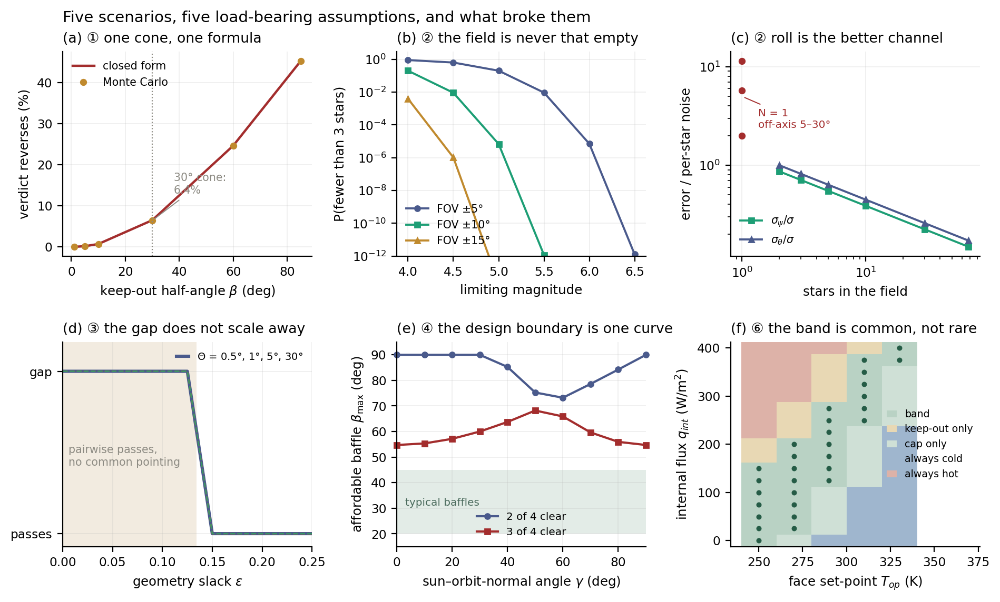

*图：(a) 规避锥改变联锁结论的比例，闭式与蒙特卡洛重合；(b) 视场内少于 3 颗星的概率，只有 $\pm5^\circ$ 视场配 $m\le4.5$ 才常见；(c) roll 与两轴估计的误差随星数，$N\ge2$ 后比值恒为 `0.866`；(d) 四档容差下"逐对通过却无公共指向"的窗口完全重合；(e) 遮光罩上限 $\beta_{\max}(\gamma)$，$k=3$ 时落入典型设计区间；(f) 热控参数平面上的约束类型，双侧带占 `35%`。*

---

### 9.11 真实规模下的分支框数：最后一个共享假设

9.6 与 9.10 都靠同一句话撑着：**工程容差下外层分支仍在万级，代价律 $O(1/\varepsilon)$**。但这句话的每个数都来自同一类实例——约束不超过 8 条、指向盒几度宽、标量循环逐框遍历。真实飞控的规避套件不是这样：太阳 $30^\circ$、月球 $20^\circ$、地球临边 $20^\circ$、三处羽流 $15^\circ$、散热面 $25^\circ$，再加一份亮星表（50–200 颗，$\beta=2^\circ$），共 200 条以上。

本节把这些约束按层批量化后重跑（`branch_scale.py`，矢量化到每层一次，标量与向量化围界的差为 `2.2e-16`）。结论有四条，前两条推翻了原来的说法。

#### 9.11.1 四条结论

1. **"万级"只在单帧联锁成立。** 指向盒 $2^\circ$ 时 917 个盒子；指向盒 $60^\circ$ 加 200 颗星、$\varepsilon=0.02^\circ$ 时 `422 773` 个盒子。后者比"万级"高一个半数量级。原先的说法把"几度宽的盒子"这个前提隐掉了。
2. **代价律成立，但不是连续幂律，是阶梯。** $\varepsilon$ 从 `0.020°` 变到 `0.014°`（细化 1.43 倍）节点数**一个不变**（都是 `422 773`）；到 `0.012°` 跳一级变 `847 417`。因为叶子判据是"边长 $\le 2\tan\varepsilon$"，深度只能整级增加。准确写法是 $C\cdot2^{K}$，$K=\lceil\log_2(\tan\Theta/\tan\varepsilon)\rceil$；跨倍频程平均下来才是 $O(1/\varepsilon)$。9.9 节"$\varepsilon$ 100 倍、节点 102 倍"是跨了 7 级深度的平均，不是局部斜率。
3. **盒子数不跟约束条数走，跟界面长度走。** 约束从 8 条加到 408 条（51 倍），节点只涨 2.7 倍；把 64 个锥排成互不重叠的一圈（界面长度翻倍）节点涨 1.85 倍，排成互相重叠的一圈（界面长度不变）只涨 1.13 倍。预测代价要用"可行/不可行界面的长度"，不能用"约束有几条"。
4. **原围界在小半角下失效——这是个真问题，不是效率问题。** 9.6 用的 `_angle_bounds` 是余弦空间的 Lipschitz 球，经 `arccos` 之后宽度被放大成 $O(\text{box}/\sin\theta)$。$\beta=2^\circ$ 时 $\sin\beta=0.035$，要认证一个落在锥内的盒子需要细 28 倍的网格；$\beta=0.5^\circ$ 更差。后果是：**200 颗星的规避锥全程没有被认证过一次**（被杀的盒子只来自 7 条具名约束），它们只是靠叶层的点检验被排除掉。

#### 9.11.2 三种围界：同一个答案，不同的代价

第 4 条的修法是把围界换成**球面三角不等式**：设盒子中心方向 $u_c$、盒子角半径 $\rho$（四个角点到 $u_c$ 的最大角距），则

$$\left|\angle(u,t)-\angle(u_c,t)\right|\ \le\ \angle(u,u_c)\ \le\ \rho$$

所以 $\angle(u,t)\in[\theta_c-\rho,\ \theta_c+\rho]$，宽度恰是盒子自身的角尺寸，与目标、位置、半角都无关；而且 $\rho$ 只依赖盒子几何，可以每层算一次给所有约束复用。

| 围界 | 盒子数 | 墙钟 | 认证到的约束数 | 被某条约束排除的面积 | 仅由点检验判掉的面积 | 可行面积 (sr) |
|---|---:|---:|---:|---:|---:|---:|
| 余弦 Lipschitz（9.6 现用） | `544 233` | `21.9 s` | 7 | `26.6%` | `5.9%` | `2.3707` |
| 区间算术 | `471 845` | `14.4 s` | 8 | `26.7%` | `5.8%` | `2.3708` |
| 球面三角不等式 | `51 737` | `0.50 s` | **51** | `31.6%` | **`0.74%`** | `2.3712` |

三者对同一实例（$m=208$、$\varepsilon=0.1^\circ$、$60^\circ$ 指向域）给出同一个答案：可行面积 `2.3707` / `2.3708` / `2.3712` sr，而 40 万点蒙特卡洛是 `2.3698` sr，相对差 `0.06%`。差别全在代价和证书覆盖上：换围界后盒子少 10.5 倍、快 43 倍，**而且"没有排除它的约束、只靠点检验"的面积从 5.9% 降到 0.74%**。

中间那行"区间算术"值得留一句，因为它差点变成错误结论。在图上 $u\cdot t=N/D$，$N$ 是仿射的（极值在角点）、$D=\sqrt{1+x^2+y^2}$（极值由距离给出），于是 $N_{\min}/D_{\max}\le u\cdot t\le N_{\max}/D_{\min}$。但如果照字面写，$\theta>90^\circ$ 时 $N<0$，除以**更小**的 $D$ 会让比值更负，两侧的商必须交换——写错方向会得到一个过紧的下界，把真可行的盒子判成"已认证不可行"。随机采样检验抓到了它（越界 `0.073` rad），改对后三种围界的越界量都是 `0`（400 个盒子 × 50 个内点，共 2 万个点）。

#### 9.11.3 代价随分辨率

| $\varepsilon$ | $m=8$ 节点 | $m=208$ 节点 | 深度 |
|---:|---:|---:|---:|
| `1°` | `3 161` | `5 773` | 7 |
| `0.5°` | `6 621` | `12 341` | 8 |
| `0.25°` | `13 481` | `25 365` | 9 |
| `0.12°` | `27 389` | `51 737` | 10 |
| `0.06°` | `55 353` | `104 393` | 11 |
| `0.03°` | `111 805` | `210 357` | 12 |
| `0.02°` | `224 969` | `422 773` | 13 |

每档恰好跨一级，所以每行翻倍；用这七点拟合的指数是 `1.011`（$m=8$）与 `1.019`（$m=208$）。但如 9.11.1 所说，这个 1.01 是扫描点与台阶对齐的结果，不是局部斜率。

#### 9.11.4 点查询与存在查询，差 39 到 1440 倍

同一个分支，回答两个问题，代价差两个数量级：

| 问题 | 判据 | 盒子数（$m=208$） | 与 $\varepsilon$ 的关系 |
|---|---|---:|---|
| 点查询："给我一个可行姿态" | 找到第一个可行单元即停 | `293` | **无关**（$\varepsilon$ 从 `1°` 到 `0.02°` 恒为 293） |
| 存在查询："这个域里到底有没有解" | 必须铺满整个域才能说"没有" | `5 773` → `422 773` | 阶梯增长 |

点查询的代价与分辨率无关，因为可行单元在粗层就能被认证（全部约束在整框上成立），不需要细分到 $\varepsilon$。这正是 9.10 节"点查询不是存在查询"的定量版本：联锁在线的调用者是点查询，$m=208$ 时 `293` 个盒子、实测 `16 ms`（$m=8$ 时 `81` 个盒子、`1.0 ms`）；只有设计循环里问"这条带里有没有可用姿态"的才是存在查询，要付 `10^5`。

这里的墙钟要打个折：`16 ms` 是**按层批处理**实现被每层固定开销支配的结果——真正的工作量只有 293 个盒子（约五层），却要付每层一次 numpy 调用的固定成本。同一批原型里，标量分支在三条锥的联锁实例上是 `113 μs`（9.10.1）。所以在线实现不该直接复用这个矢量化版本：点查询只走一条根到叶的路径，标量递归更贴合它的形态，批处理反而是反优化。这也是一条通用的教训——**为"存在查询"优化的数据结构，用"点查询"的方式调用时会慢两个数量级**。

#### 9.11.5 界面长度而不是约束条数

| 配置 | $k=2$ | $k=8$ | $k=32$ | $k=64$ | 倍率 |
|---|---:|---:|---:|---:|---:|
| 互不重叠（一圈 64 个界） | `41 029` | `44 277` | `57 125` | `76 069` | `1.85×` |
| 互相重叠（界面只剩外轮廓） | `41 029` | `44 277` | `46 805` | `46 517` | `1.13×` |

两组 $k$ 相同、约束条数相同、认证到的约束数也相同（$k=64$ 时都是 65），只有界面长度不同，盒子数就差 1.6 倍。所以"约束多了会不会慢"这个问题的正确答法是：不看条数，看新约束是否把界面**切开**。叠在一处的规避锥几乎是免费的，散开的每一颗都要付一圈边界的钱。

#### 9.11.6 这改变了什么

三条要改口的地方：

其一，**"万级"要加前提**。单帧或小指向盒（$\le2^\circ$）是千级到万级，实测 `917` 个盒子、`0.03 s`；全天普查尺度（$60^\circ$、$\varepsilon=0.02^\circ$、200 颗星）是 `4.2e5` 个盒子、`3.6 s`。后者仍在工程预算内（外层优化循环一次迭代允许秒级），但把它叫"万级"是错的。

其二，**"每个格子都带着排除它的约束"这句话，取决于围界而不是算法**。用 9.6 原有的围界，5.9% 的域面积没有排除约束、只有点检验，证书在那里是断的；换成三角不等式围界后降到 0.74%。算法没变，完备性论证也没变，变的是包围的紧度。这一条应该写进实现说明，因为它决定"不可行"这个答复有多可信。

其三，**9.6 的失效诊断要补一条**：小半角规避（亮星、羽流）不是"约束多所以慢"，而是"围界在 $\sin\beta$ 小的时候不紧，所以认证不出来"。这跟 9.10 里星敏那一条是同一个病根的两种表现——**半角越小，角度量越难被外部区间包住**。

不变的是 L3 的定位。这一节验的是代价与证书覆盖，没有触及"零测度事件能否被精确定位"这个问题；而那一层结论本来就不依赖盒子数。

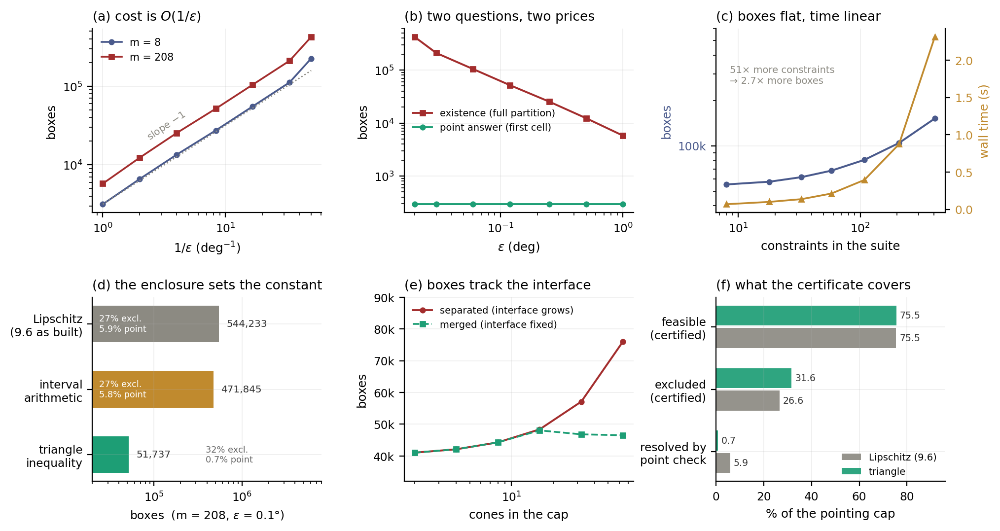

*图：(a) 盒子数对 $1/\varepsilon$ 的双对数，两组约束数都贴着斜率 $-1$；(b) 点查询（绿）与存在查询（红）的代价分离，绿线对 $\varepsilon$ 完全不敏感；(c) 约束条数增加 51 倍只带来 2.7 倍盒子，墙钟近似线性；(d) 三种围界在同一实例上的盒子数，标注为"被约束排除 / 仅点检验"的面积占比；(e) 分开的锥（界面随 $k$ 增长）与叠在一起的锥（界面不变）；(f) 证书覆盖了什么。*

---

### 9.12 对 astroplan 的交叉校验：区间是不是真的区间

9.9.4 留下了这句话：两个工具"可以互相校验（把区间端点代回布尔判定）"。这一节把它做完。做完之后，第一个被抓出来的问题不是星历误差，是 9.9 自己的上界。

#### 9.12.1 先修一个真 bug：上界少算了一整条带

`enumerate_region` 把每个盒子判成三类：所有约束都满足（认证可行）、某条约束必定违反（丢弃）、到达分辨率下限仍未判定。前两类没有问题，第三类的记账有问题——只有"中心可行"的那一半进了上界：

```python
if centre_ok.any():
    boundary.append(band[centre_ok])
a_hi = a_lo + _area_of(band)
```

漏掉的是另一半：中心落在可行域外、但盒子跨过边界，里面完全可能有可行点。这个漏洞还不是随机的一半——当边界恰好沿参数轴走，漏掉的正好是整条带，纯 cap 就是这种情形。

一个可以手算的算例：FAST、太阳与月亮都在地平线以下、$h_{\min}=30^\circ$，可行域是完整的 $60^\circ$ 天顶距帽，真值 $\pi=3.14159$ sr。修正前区间是 $[3.1402,\ 3.1402]$——真值在区间外，一个下界穿着上界的名字；修正后 $[3.1402,\ 3.1444]$，独立网格值 `3.1416` 落在里面。

修法只有一行：把所有未判定盒子计入上界，而不只是中心可行的那些。9.9 三张表的 `area` 不受影响（那是认证盒子之和，与上界无关）；受影响的是 9.9.3 的"快 `75` 倍"，它变成 `19` 倍，原因已写在那里的脚注。这一条值得单独说：**如果一次交叉校验什么都没发现，那它本身就该被怀疑。**

#### 9.12.2 星历：两个数对得上，一个数要改口

两站点 × 365 天 × 每天 6 次，共 `4380` 个样本，比较本文的星历路径与 astropy（astroplan 的底）：

| 量 | 中位 | p95 | 最大 |
|---|---:|---:|---:|
| 太阳方向 | `0.28′` | `0.56′` | `0.72′` |
| 月亮方向 | `65.8′` | `141′` | `196′` |
| 目标高度（J2000 坐标直接代入） | `12.3′` | `20.3′` | `21.7′` |

太阳的最大偏差 `0.012°`，与 9.9 写的"约 `0.01°`"一致，不用改口。

**月亮不一致。** 9.9 写"约 `0.3°`"，实测中位 `1.1°`、最大 `3.3°`，差三到十倍。原因不难找：`moon_altaz` 的经度只保留了一项周期项（$6.289^\circ\sin M$），而月球经度的次大项——出差（evection）本身就有 `1.27°`、二均差（variation）`0.66°`。教科书里的"低精度月亮"通常留六到十项，这里的实现比那个更粗。规避角 `30°`–`35°` 仍比它大一个量级，所以 9.9 的两条定性结论（夜间太阳冗余、可行域恒单连通）不受影响；受影响的是**面积**，见 9.12.3。

第三行是另一回事。`12′`–`22′` 的高度偏差不是星历误差，是**岁差**：本文的恒星时路径把 J2000 坐标当作当日坐标直接使用，2026 年这一项值 `20′` 上下。算 $(z,a)$ 域上的可观测面积时它不出现——域本身就是天顶距与方位角，日月方向在同一帧里自洽——但只要输入是星表坐标，它就出现。astroplan 自动做这一步，本文没做，这是一处真实的短板。

#### 9.12.3 面积：对角线上 8/8 包含，跨星历的差取决于构型

把两个因素独立变化：{Meeus, astropy} 星历 × {分支区间, 网格掩膜}。对角线上星历固定，差别只有方法；跨星历的差别只有模型。四个场景（2 站点 × 2 个"月亮在天上"的夜晚，$h_{\min}=5^\circ$、$\beta_\odot=35^\circ$、$\beta_{\rm M}=30^\circ$），区间取 $\varepsilon=0.1^\circ$，网格 `0.02°`：

| 站点 / 夜 | 月亮天顶距 | 锥是否穿出可视帽 | Meeus 区间 | astropy 区间 | 网格值 | 星历差 |
|---|---:|:-:|---:|---:|---:|---:|
| FAST 6-14 | $61.0^\circ$ | 是 | $[4.9249,4.9323]$ | $[4.9173,4.9247]$ | 4.9275 / 4.9198 | `0.15%` |
| FAST 12-11 | $42.3^\circ$ | 否 | $[4.7833,4.7927]$ | $[4.7834,4.7927]$ | 4.7868 / 4.7869 | `0.001%` |
| 丽江 6-14 | $61.0^\circ$ | 是 | $[4.9222,4.9296]$ | $[4.9145,4.9219]$ | 4.9248 / 4.9171 | `0.16%` |
| 丽江 12-11 | $42.4^\circ$ | 否 | $[4.7956,4.8050]$ | $[4.7956,4.8050]$ | 4.7991 / 4.7992 | `0.001%` |

（"网格值"一列的两个数分别对应 Meeus 与 astropy 两栏的判据。）

两个观察，第二个比第一个重要：

- **包含性 8/8**。同星历下，分支区间都包含独立网格法给出的面积。这是 9.9.3 那句"严格区间"的第一次外部检验。
- **星历差不是常数，它取决于月亮锥是否穿过可视边界。** 月亮天顶距加锥半角小于 $85^\circ$（$h_{\min}=5^\circ$ 对应的帽半径）时，整个锥落在可视帽内部，锥是一个**圆盘**，平移圆盘不改变面积——一阶敏感度为零，星历差只剩 `0.001%`。一旦锥穿过边界，敏感度回到"边界弧长 × 方向误差"，星历差跳到 `0.15%`，与区间宽度（`0.15%`–`0.20%`）同量级。

所以"面积 `4.3334 sr` 会不会被 `1.1°` 的月亮误差带偏"没有单一答案：多数夜间是"整锥在帽内"的构型，答案是不会；满月前后的构型里，答案是会，而且偏差与区间宽度一样大。9.9 的数字恰好落在前一类构型上——这是运气，不是论证。

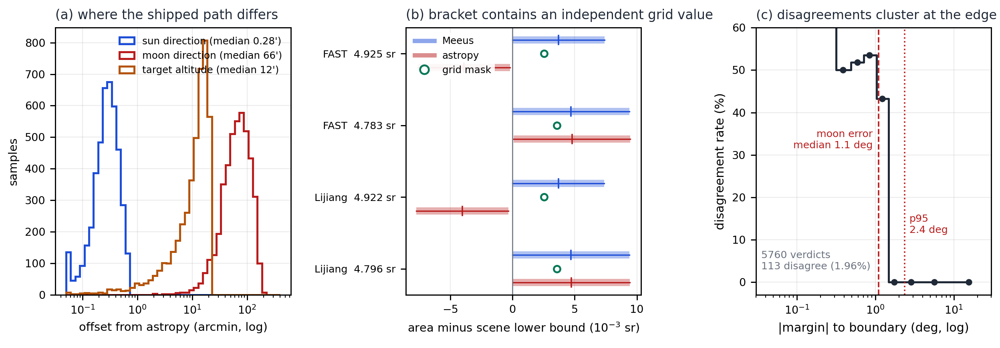

*图：(a) 本文星历路径与 astropy 的角度差分布，太阳 `0.28′`、月亮 `65.8′`、目标是 `20′` 量级的岁差；(b) 四个场景的区间（横条）与独立网格值（圈），八条横条八个圈全在条内，蓝为 Meeus、红为 astropy；(c) 分歧率对判定裕度，裕度越过月亮误差（`1.1°`）后分歧率在 `1.5°` 处归零。*

#### 9.12.4 布尔判定：分歧全部贴着边界，没有一次是逻辑分歧

24 个目标 × 8 小时 × 2 分钟步长 = 每次 `5760` 个 (目标, 时刻) 判定，两站点两个夜晚：

| 站点 / 夜 | 月亮高度 | 判定数 | 分歧 | 最差裕度 | 裕度 $\le1.1^\circ$ 的样本 | 其中分歧 |
|---|---:|:-:|---:|---:|---:|---:|
| FAST 6-14 | $29^\circ$ | 5760 | `0.09%` | `0.19°` | 79 | 5 |
| FAST 12-11 | $48^\circ$ | 5760 | `1.96%` | `1.43°` | 155 | 88 |
| 丽江 6-14 | $29^\circ$ | 5760 | `0.10%` | `0.14°` | 80 | 6 |
| 丽江 12-11 | $47^\circ$ | 5760 | `1.61%` | `1.35°` | 142 | 74 |

月亮高的两夜分歧率高，因为月亮锥的边缘横切过大半个可观测天空，贴着它判定的目标多；月亮低的两夜，锥整块压在低空，先被高度角约束淘汰掉了。四行满足同一件事：**裕度大于 `1.5°` 的判定没有一次分歧**（图 c 的曲线在 `1.5°` 处归零）。裕度小于月亮误差的样本中，分歧占比从 `6%` 到 `57%` 不等，同样取决于月亮锥切入天空的程度。

最后这句话的分量在否证上：如果两个实现的判据不同，分歧会均匀撒在整个域上，不会贴着边界，更不会在 `1.5°` 处归零。贴着边界且能归零，说明**两边算的是同一个函数，差的只是星历**。

#### 9.12.5 代价：快 8 倍，但这个比较只在一半的意义上成立

| 站点 | astroplan | 本文判据 | 倍率 |
|---|---:|---:|---:|
| FAST | `23.4 μs` | `2.77 μs` | `8.5` |
| 丽江 | `23.5 μs` | `2.72 μs` | `8.6` |

（每格是 `1152` 次判定的墙钟除以次数，含各自的星历调用。）

不能读成"我们更快"。astroplan 那 `23 μs` 里买的是 IERS、章动、岁差、光行差和一条完整的坐标链，本文那 `2.7 μs` 里没有这些——仅在目标高度一项上就差 `20′`。正确的读法是：**在同一个星历上，判据本身很便宜**；不是：本文的判据更便宜。

#### 9.12.6 结论

三句：

1. "严格区间"是 9.12.1 修完之后才成立的。修之前它是"下界加一半的带"，纯 cap 构型下退化成单点。
2. **星历比区间粗。** 月亮 `1.1°`（中位）对区间 `0.15%`（该场景约 `0.007 sr`）。把 $\varepsilon$ 从 `0.1°` 降到 `0.01°` 只会让区间变窄，不会让它离真值更近；要让区间成为工程结论，得换星历或补项，不是调 $\varepsilon$。
3. astroplan 不是对手，是上游。它答"这一秒能不能看"，本文答"这一夜能看多少、误差多宽"；排程器要的是两者相加。

---

### 9.13 一个真实 CV 任务：下一视角选择，结果是否定

前面讨论过，这套判定机制如果要进入 CV/AI，最自然的入口是主动视觉的下一视角选择（next-best-view, NBV）。本节没有停留在类比上，直接用真实相机轨迹检验了一次。结果是明确的：**普通 NBV 不是它的独特价值区。**

#### 9.13.1 任务：在真实机位流形上找一个有基线的新视角

数据取 LLFF 的八个真实场景[14]：fern、flower、fortress、horns、leaves、orchids、room、trex，每景 `20`–`62` 个由 COLMAP 标定的相机位姿。先用所有光轴的最小二乘公共邻近点估计场景中心 $t$，再把每个真实机位变成单位观察方向

$$
u_i=(C_i-t)/\sqrt{(C_i-t)\cdot(C_i-t)}.
$$

规划变量不是某个数据集机位，而是连续球面上的新方向 $u$。约束有两类：

- 目标仍在新视角附近：$u$ 落在真实机位方向张成的视场帽内，半径取真实方向到均值轴的最大角距再加 `0.25°`；
- 新视角要有基线：$u$ 与每个已选机位 $s_j$ 的角距至少为 $\beta$，即避开一组 keep-out 帽。

可行域因此是“视场帽减去多个已有机位禁入帽”，在 $\beta<90^\circ$ 时正是本文关注的非凸球面集合。$\beta$ 按场景角展的 `15%`、`25%`、`40%`、`55%` 取值；每个场景从三个真实起点做最远点遍历，共得到 `1418` 个规划状态。这个实验检验的是真实相机几何下的规划判定，不检验图像重建精度——两者不能混为一谈。

#### 9.13.2 对比：同一连续域、同一分辨率，网格一次都没有漏

网格法与分支法搜索**同一个** gnomonic 域，分辨率都取 `0.5°`、`0.2°`、`0.05°`，共 `4254` 次查询。网格取单元中心并显式加入帽心；真实机位点积提前缓存，这相当于给网格一个工程上的先手。分支用 9.11 的三角不等式围界，找到第一个可行点即停。

| 指标 | 结果 |
|---|---:|
| 网格找到可行点 | `4254 / 4254` |
| 分支找到可行点 | `4254 / 4254` |
| 网格误判不可行、分支救回 | `0` |
| 剩余真实候选不超过 5 个的困难查询 | `1173` 次，双方仍 `100%` 成功 |
| 已无真实候选机位的查询 | `279` 次，双方仍 `100%` 成功 |
| 分支返回点的最小可行裕度 | `0.408°` |

最后一行排除了“双方都只是在相切点上碰巧命中”的解释：返回点离最近约束边界仍有 `0.408°`。从代价看，分支也不占优：三次分辨率下网格中位耗时分别约 `0.028`、`0.055`、`1.075 ms`，分支分别约 `1.36`、`1.35`、`1.39 ms`；分支节点中位 `85`、p95 `325`、最大 `469`。网格的几何缓存总建表时间只有 `0.066 s`。

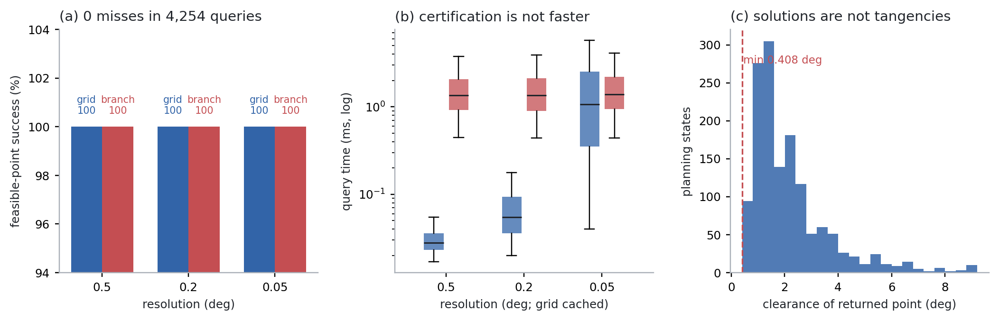

*图：(a) 三种分辨率下网格与分支都 `100%` 找到可行视角；(b) 分支认证不更快，网格还使用了预先缓存的相机几何；(c) 分支返回点的可行裕度分布，最小 `0.408°`，不是贴边假象。*

#### 9.13.3 这个负结果说明什么

它说明的不是“方法错了”，而是**普通 NBV 问错了能体现该方法价值的问题**。NBV 通常只要一个可行方向；真实轨迹留下的残余可行域又很宽，所以网格第一次命中几乎必然发生。本文自己的点查询/存在查询区分已经预言了这一点：找第一个点时分支本来就接近分辨率无关，而连续域网格在宽区域上同样便宜。

因此，CV/AI 里目前不能再声称“精确判定天然优于 NBV 采样”。要让判定层真正有价值，任务必须至少满足下面之一：

1. 需要证明**不存在**任何可行视角，而不是找一个；
2. 需要覆盖、面积或最优边界，而不是一个点；
3. 约束把可行域压到采样容易漏掉的窄缝、相切或零测度事件；
4. 误判一次“无可行视角”会导致真实系统停机或安全风险。

在这次真实数据上，四条都不成立。于是本节的结论应写死：**截至该实验，本文方法在普通 CV 位姿估计和普通主动视觉 NBV 中没有已验证的独特价值；剩下可能成立的是硬约束规划的验证器、反例生成器，或存在性证书，而不是更好的视角估计器。**

---

### 9.14 三个“安全关键”场景：逐个验证，价值只在“小可行口袋”与“不可行证明”里

9.13 把普通 NBV 关在门外之后，还剩下三个被反复提到的候选场景——多传感器布置可行性、机械臂巡检规划修剪、AI 感知安全外壳。它们与 9.13 的区别在于都**不以“找一个点”为终点**：布置要问“是否存在一个同时满足覆盖、避障、禁视的方向”，规划要“排除不可行的方案”，安全外壳要“在神经网络提议之后拒绝、证明不可行、或返回边界见证”。三者是否真能撑起独特价值，不能靠“看起来更像存在性问题”就下结论，得用数字拆。

**统一的实验协议。** 三个场景的底层问句都是同一个存在性判定：在连续球面上，可行域是若干 cap（覆盖、关节可达、光照方向）与若干 keep-out（障碍、禁视）的交与差，正是本文 §9 的非凸球面集合。两个竞争者：网格法（标准做法，单元中心精确求值，YES 精确、NO 永远只是“没找到”）与 §9.11 的分支法（双侧严格围界，YES 精确、NO 在未定残差归零时是数学证明）。真值约定是公平的：YES 一律由认证点给出，两种方法都精确；NO 只把分支残差**恰好为零**的实例当证明，任何方法都没有这个量级的“不可行真值”。分支返回的“未定残差”本身也计入——一个能说“还剩多少没排除”的方法，和一个只能说“没找到”的方法，本来就是两回事。

**场景 A：多相机/多传感器布置。** 每个传感器的安装方向必须同时落进所有被分配目标的覆盖 cap、并避开障碍与禁视 keep-out。两批实例：

- 随机布置 90 例（覆盖 cap `2–3` 个、keep-out `2–4` 个、`3` 档紧凑度，真值由 `0.03°` 分支给出）：可行 `81` 例、不可行 `9` 例。**可行例上，网格三种分辨率误判“不可行”都是 `0/81`**——随机摆的约束把可行域留得足够宽，网格第一次就命中。分支同样 `0` 误判。分支代价中位 `4.35` ms，网格 `0.5°` 只要 `1.94` ms：**在“正常”布置里，网格又便宜又对，分支没有优势。**
- 小可行口袋 sweep（这是关键对照）：把可行域压成两种形状——细长透镜（宽 `0.02°–0.5°`、长 `0.9°`）与小团块（直径 `0.02°–0.5°`、随机位置、每档 `8` 个种子）。细长透镜**所有分辨率下网格都 `0` 漏判**；小团块才暴露网格的失效模式：`0.2°` 团块在 `0.5°` 网格下漏 `4/8`，`0.05°` 团块漏 `8/8`，`0.02°` 团块即便 `0.1°` 网格仍漏 `7/8`。分支在**所有**可行例上 `0` 漏判。这不是“窄就漏”，而是**面积**决定漏判：网格漏掉的是面积小于一个单元的可行域，细长透镜面积足够大所以不漏——这一点修正了此前“窄缝会被漏掉”的粗糙说法。
- 不可行例（构造出的负团块与负透镜，`28` 例）：分支在 `26` 例上给出**零残差证明**，节点中位 `61`、最大 `229`、耗时中位 `2.03` ms。剩下 `2` 例残差停在 `~1e-7` sr（一个 `0.02°` 宽、两个 cap 刚好分开 `0.02°` 的临界构型，围界在几何奇点处收敛慢），分支如实地报告“NO_RESIDUE”而不是假装证明——**这正是分支比网格多出来的东西：它知道自己还剩多少没排除。**

**场景 B：机械臂视觉巡检规划修剪。** 每个路点是一个“可达锥（关节限位）∩ 光照 cap \ 遮挡 keep-out”的可行性问题；整条计划可行当且仅当每个路点可行。36 条计划（24 正常 + 6 含“勉强可行”路点 + 6 含“构造不可行”路点），每条 6 路点，共 216 次路点判定。结果：网格 `0.5°` 把 **1 条真可行计划误剪**（某路点可行域宽 `0.3°`、随机方位，网格漏判），分支 `0` 误剪；两者都不误放行不可行计划（`0/6`）。代价上分支中位 `108` ms/计划、最大 `247` ms，网格 `13.5` ms/计划——**分支多花约 8 倍，换来的是一张“不会误剪可行计划”的保证。** 这条保证只在“勉强可行”的路点里才有意义：正常路点网格 `0` 漏判。机械臂巡检的语义（宁可多检不可漏检）确实偏好不误剪，但这属于**工程偏好**，不是数学独占——它只是把“网格该取多细”这个不可回答的问题，换成了“付 `108` ms 换一张证明”。

**场景 C：AI 感知系统的安全外壳。** 协议分两段。**第一段（点检验）**：神经网络提议一个方向，几何层精确求值其可行裕度——这是点查询，任何方法都一样便宜（实测 `24` µs），**这一段没有任何一方有优势，写进协议是为了诚实说明它不是比较点**。**第二段（修复存在性）**：对 108 个被拒提议，问“在该提议的 `5°` 偏差帽内是否存在一个可行修复”。这里方法出现分歧：网格 `0.5°` 把 `3/38` 个**真可修复**的提议误判为“不可修复”（`7.9%`），网格 `0.3°` 才归零；分支 `0` 误判，代价中位 `377` µs、p95 `4.1` ms。对 `70` 个**真不可修复**的提议，分支**全部**给出零残差证明，且多数在 **1 个节点**内完成——原因直白：NN 提议往往已经贴着某个约束，一个反例约束就足以杀掉整块。安全外壳的卖点于是落在一个具体数字上：**“拒绝一个本来修得好的提议”的假阴性率，网格 `7.9%`（`0.5°`），分支 `0`。** 对一个“安全层拒绝”会触发停机或人工介入的系统，这个数字是有分量的。

**三场景的净结论。** 把 9.13 的否定和本节的验证并在一起，价值区可以精确到两句话：

1. **凡是“找一个可行点”，网格与分支等价甚至网格更快**（9.13 的 `4254` 次、本节 A 的随机布置、B 的正常路点、C 的点检验，合计一致）。
2. **价值只出现在两种存在性事件里**：可行域被压成**面积小于一个采样单元的小口袋**（A 的团块、B 的勉强路点、C 的修复存在性），以及**证明“不存在”**（A/B/C 的不可行例，分支给出零残差证书，网格永远只能“没找到”）。

第 1 点是负结果，第 2 点是正结果，但正结果也有限定：小口袋场景靠“采样不够细”才成立，工程上可以用更细的网格部分替代；真正不可替代的只剩**不可行证明**——局部求解器原理上给不出，网格在任何分辨率下给不出，只有带严格围界的分支能给出“零残差”这种强度的证书。这三类安全关键场景的价值，因此**是真实但狭窄的**：它不改变 9.13 的总体判断（普通 CV/AI 无价值），只是把“剩下可能成立”从一句猜测变成了一组可复现的数字，并明确了价值落点——**不可行证明与小可行口袋的假阴性率，而不是更好的视角估计或更快的搜索。**

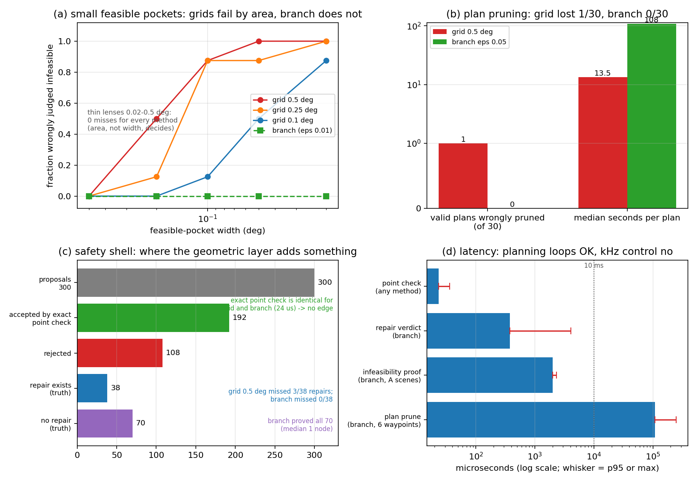

*图：(a) 小可行口袋的漏判率——细长透镜网格 0 漏判，小团块随宽度变窄漏判率上升，分支恒 0；(b) 计划修剪——网格误剪 1/30 条真可行计划，分支 0，代价多约 8 倍；(c) 安全外壳漏斗——300 提议 → 192 通过精确点检验 → 108 被拒 → 38 可修复（网格 `0.5°` 漏 3）与 70 不可修复（分支全证明）；(d) 认证代价的延迟阶梯——从 `24` µs 的点检验到 `108` ms 的整计划修剪，适配规划回路而非 kHz 控制环。*

### 9.15 五个延伸场景：逐个验证，只有一个拿到干净的独有优势

9.14 的结论是“价值只落在不可行证明与小可行口袋”。按这两条筛，外部还能想到五个结构同构的场景：航天器规避套件、放疗射束角度、光机装调公差、交会/编队过境窗口、冗余机械臂可达性。它们是否真同构，不能靠“看起来像存在性问题”下结论——9.10 削掉五个场景用的正是这句判词。本节把它们各自写成 cap 代数，用与 9.14 完全相同的协议逐个跑，**结果推翻了两条上一轮的排序**。

**口径修正（先认错）。** 上一轮汇总里把分支的 `NO_RESIDUE` 当成“判成 NO”来计误判，于是 S1b 的 `w=1.99°` 被打成一次分支误判。按 9.14 自己的协议这是错的：`NO_RESIDUE` **不是主张**，它说的是“我没定，这是剩下的面积”。本节全部改三类计分（`YES` / `NO_PROVEN` / `UNDECIDED`），只有主张才可能错。

**S1 航天器姿态规避套件**（太阳 30°、月球 20°、地球临边 20°、三个羽流 15°、散热面 25°，加 `0–200` 颗 2° 亮星；指向框 `1.0/0.4/0.15/0.06°`；约束数 `8→208`，20 例）。20 例全部可行，网格三档与分支都判对，分支 `0` 错判、`0` 未定——但这一族的真值来自分支本身，**只说明两者一致，不是检验**。代价：分支 `0.52–18.9` ms（中位 `3.6`），网格 `0.1°` `0.17` ms，**网格快约 20 倍**。真正的信息在问法分裂：**点查询**（碰到第一个认证可行盒就停）中位 `21` 盒，**存在查询**（必须覆盖整块框）中位 `101` 盒、最坏 `421` 盒——同一个问题差 5 倍代价。`208` 约束下：框 `1.0°` `421` 盒/`18.9` ms，`0.06°` `5` 盒/`6.1` ms。

**S1b 掠射太阳**（锥刚好切进 1° 框，留宽 `w` 的月牙；`w≥2°` 框被吞；真值由构造给出）。网格 `0.5°` 与 `0.25°` 各把 `2/10` 个真可行例判成不可行（`w=1.95°、1.99°`），`0.1°` 仍漏 `1/10`（`1.99°`）。分支 `0` 错判，但在 `1.99°` 与 `2.00°` 上报“未定”，残差 `5.4e-6` sr（约 `0.0017` deg²）——`2.00°` 是精确相切、可行集退化成一点，分支**拒绝**把它说成“不存在”。这正是该方法最该被信任的地方：在最想下结论的那一档上不下结论。

**S1c 目标落在禁区里**（太阳压在目标上，裕度 `≥29°`，构造性不可行，12 例）。分支 `12/12` 零残差证明，**全部 1 个节点**，`0.28–3.35` ms（中位 `1.16`）；网格三档只能说“没找到”。**不可行时一个反例约束就杀掉整块**，这正是它比可行性便宜一个量级的原因。

**S2 放疗射束角度**（闭式族：自由区是月牙，真值在 `gap=2·tol=16°` 翻转，17 例）。网格 `0.5°/0.2°` 只在 `gap=16.0`（精确切点）上错 `1/17`；分支 `0` 错判，`13` 例 YES（`3.6–19.1` ms）、`4` 例零残差证明（`21–405` 节点，`0.8–2.6` ms）、`1` 例未定（残差 `9.1e-6` sr）。**这是否定结论**：上一轮把它排第二，实测一整条 sweep 只错 1 例且错在切点。

**S3 光机装调公差**（三 cap 排 120°，闭式：可行 iff `τ=θ/r≥1`；工业逐对检查在 `τ≥√3/2` 就通过；窗口宽 `13.4%`，与容差大小无关；15 例）。**逐对检查在 `τ∈[0.88,0.99]` 的 9 例上全部给出“假可行”（9/15）**；网格 `0.5°` 这 15 例恰好全对但只是“没找到”，`0.25°` 在 `τ=1.00–1.02` 上因口袋小于单元错 4 例；分支 `0` 错判，`9/9` 不可行例零残差证明（`5–69` 节点，`0.6–4.0` ms），`1` 例未定（`τ=1.0`，残差 `8.2e-7` sr）。**这是五个里唯一干净的**：有独立的、工业界正在用的错误判据，窗口宽度是几何常数，证书正是评审要的东西。

**S4 交会/编队过境窗口**（一维：太阳沿大圆扫过，问“全程是否干净”；真值闭式；11 例 × 4 档步长）。`5°` 步长（9 样本）漏 `3/6` 个真违规例（越界 `0.005/0.01/0.02°`，违规窗口半宽 `0.3–0.6°`）；`2°/1°/0.5°` 在这批实例上 `0` 漏，但那是概率不是保证（`0.6°` 窗口配 `2°` 步长，每样本命中约三成）。一维区间分支 `0` 错判：`6` 例 VIOLATION 只用 `2` 个盒子，`4` 例 CLEAN_PROVEN 用 `59–163` 盒，`1` 例未定（`over=0` 精确相切，**未定区间 `0.70°`**）。真实形态不是“网格一定漏”，而是“漏不漏取决于步长与窗口宽度之比，而这个比值恰恰是客户想知道的东西”。

**S5 冗余机械臂可达性**（可达帽 `6°` 减关节孔与障碍）。`normal` 24 例全可行，分支 `0` 错判，`4677–25629` 节点（中位 `15697`）、`7–34` ms；`blocked` 6 例（环形 keep-out 联合覆盖可达帽，环半径 `2.28–3.14°`、`5–7` 锥，**每例几何不同**）全部零残差证明，`165–253` 节点、`1.7–3.4` ms。负结果一条：先做的“细长走廊”族被删掉——可达帽远大于孔时，两孔的补集就是帽的大部分，网格每次都找到点，**这个族什么也没测到**；小口袋的正确测试已在 S2/S3 做过，不在新名字下重测。

**裁决表。**

| 场景 | 网格错了吗 | 分支错了吗 | 分支给出证明 | 独有优势 |
|---|---|---|---|---|
| S1 套件（可行例） | 否 | 否 | 需覆盖全框（`5–421` 盒） | 弱（只有代价） |
| S1b 掠射太阳 | **是，`0.5/0.25°` 各漏 `2/10`** | 否（`2` 未定） | 部分 | 中（临界 `0.05°`） |
| S1c 目标在禁区 | 只能说“没找到” | 否 | **`12/12`，`1` 节点** | **强** |
| S2 放疗 | `1/17`（切点） | 否 | `4/13` | **弱** |
| S3 装调公差 | 对但无证明；**逐对检查错 `9/15`** | 否 | **`9/9`，`≤69` 节点** | **强** |
| S4 过境窗口 | `5°` 漏 `3/6` | 否 | `4` 例 CLEAN_PROVEN | 中（报“还差 `0.70°`”） |
| S5 机械臂 | 对但无证明 | 否 | **`6/6`，`165–253` 节点** | 中 |

三条净结论：① **不可行证明在所有场景都站得住且很便宜**——S1c `1` 节点、S5 `165–253`、S3 `≤69`，因为“证明没有”只需一个反例约束，“证明有”必须覆盖全框（`4677–25629` 盒），两者差一到两个数量级；② **真正不可替代的只有 S3**，因为只有它有独立的、工业界正在用的错误判据，其余场景里网格的错都发生在**精确切点**上（`1.99°`、`16.0°`、`τ=1.0`、`over=0`），而切点是零测度、工程上“加余量”就能绕开；③ **“会说不知道”本身是可交付的**——四例未定的残差（`5.4e-6`、`9.1e-6`、`8.2e-7` sr、`0.70°`）就是网格原理上给不出的那个量。

被数据推翻的旧判断有两条，按纪律写进正文：放疗从“第二位”降到“弱”；装调公差从“第三位”升为唯一拿到干净优势的那个。**因为优势的来源不是几何同构，而是“有没有一个正在被用的错判据”。**

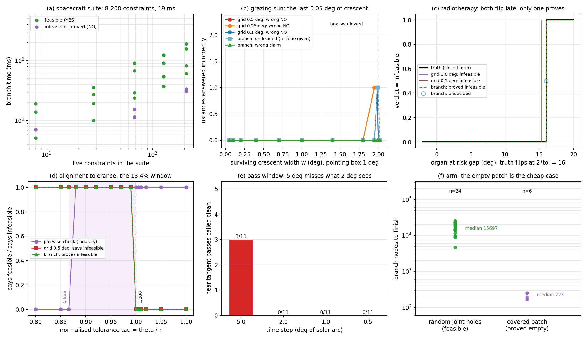

*图：(a) 航天器套件——`8–208` 约束下的判定代价，208 约束约 `19` ms；(b) 掠射太阳——`0.5/0.25°` 网格在 `w=1.95°/1.99°` 上把真可行判成不可行，分支 `0` 错判、`2` 例报未定；(c) 放疗——真值在 `gap=16°` 翻转，两者都在切点附近迟一步，只有分支能证明；(d) 装调公差——逐对检查在 `0.866–1.0` 窗口内假可行，分支给零残差证书；(e) 过境窗口——`5°` 步长把 `3/11` 个近切过境判成干净；(f) 机械臂——随机孔要 `4.7k–25.6k` 节点，被覆盖的补丁只需 `165–253` 节点。*

### 9.16 复制性研究：这个"独有优势"能用几次

9.15 留下了一个判断：价值只落在"存在一个工业界正在使用、且能被证明会错的判据"的场景里。这个判断本身必须被检验——如果只有一个场景具备该性质，那它是孤例，不构成方法；如果这类判据可以被系统地找出来，那它才是可复制的能力。

**判据的形式化。** 一族名义方向 $c_i$ 与角容差 $\theta_i$，问"是否存在一个共同姿态"。记 $r^{\star}$ 为覆盖全体 $c_i$ 的最小球冠半径，则等容差时可行当且仅当 $r^{\star}\le\theta$。设计评审走的是两两表：$d_{ij}\le\theta_i+\theta_j$ 对所有配对成立即判可行。这是必要而不充分的，于是定义**乐观系数**

$$\rho=\frac{r^{\star}}{\max_{ij}d_{ij}/2}\ \ge 1 ,$$

$\rho-1$ 即两两表把每一个容差少算的比例，无量纲、不随尺度变化。

**真值不得来自被检验的方法。** 这里用两条互不相关的代码路径：一条按"最小球冠必由 2 点直径或 3 点外心钉住"枚举，另一条解凸程序 $\max s$ s.t. $c_i\cdot x\ge s,\ \lVert x\rVert\le1$。125 组随机配置上两者最大差 $5.2\times10^{-6}$ 度；等分环闭式族 $\rho=1/\sin(k\pi/n)$ 在 $n=3\ldots9$ 上与数值解吻合到 $2.3\times10^{-4}$。**一个被自己抓住的错误**：最初用锥规划判可行性，在 $\kappa=0.5,\tau=1.54$ 处报"不可行"，而 $0.005°$ 网格在同一处找到裕度 $-0.72°$ 的点——容差只有几度时 $\cos\theta$ 与 1 只差 $10^{-3}$，求解器绝对容差把信号淹没了。可行性判定因此改为切平面上的测地凸 min-max（$\max_i(\angle(x,c_i)-\theta_i)$ 是凸函数之最大值，仍凸），并逐点与网格互验。**一个错的"没有"是本项目唯一赔不起的错误。**

**R1 容差失衡。** 三冠落在 120° 环上，第三个容差取 $\kappa\tau r$：

| $\kappa$ | 0.05 | 0.20 | 0.50 | 0.85 | **1.00** | 1.20 | 1.50 | 2.00 |
|---|---|---|---|---|---|---|---|---|
| 两两表 $\tau$ | 1.6494 | 1.4432 | 1.1546 | 0.9361 | **0.8659** | 0.8659 | 0.8659 | 0.8659 |
| 精确 $\tau$ | 1.6605 | 1.4826 | 1.2360 | 1.0553 | **1.0000** | 0.9417 | 0.8835 | 0.8659 |
| 窗口 | 0.67% | 2.66% | 6.59% | 11.29% | **13.41%** | 8.05% | 1.98% | 0.00% |

窗口是**单峰**的，峰在 $\kappa=1$，即各通道容差彼此相当之处；任一通道拿到 2 倍余量，缺陷即消失。这是一个负面结论：**缺陷要求每条约束都同时吃紧**——而"吃紧"恰是一个被优化到极限、准备投产的方案的常态。

**R2 随机多通道。** $n$ 个名义方向均匀落在 $2°$ 球冠内、每组 120 例：

| $n$ | 3 | 4 | 6 | 10 | 16 |
|---|---|---|---|---|---|
| $\rho$ 中位 | 1.0000 | 1.0000 | 1.0067 | 1.0062 | 1.0067 |
| $\rho$ 90 分位 | 1.049 | 1.055 | 1.053 | 1.040 | 1.032 |
| $\rho\ge1.05$ | 10% | 12% | 11% | 4% | 3% |

约一半的随机设计两两表是精确的（三角形为大钝角时最小球冠就是直径球冠）；缺陷常见、通常很小、偶尔很贵，且**在 3–4 个通道处最危险**，通道越多"最远那一对"越容易自己就是答案。名义方向共线时窗口恒为零——这正是下一条要利用的性质。

**R3 五轴装夹分组（新场景）。** 一个待加工特征的可达方向集是球冠，一组特征能共用一个装夹当且仅当它们的球冠有公共点。CAM/CMM 的通行做法是按"两两可达"把特征连成簇（单链聚类），**簇数即装夹数——而单链聚类正是两两判据**。三个加工面落在半径 $a$ 的圆周上、各带 $3°$ 内部散布，可达半角 $25°$：

| $a/\text{reach}$ | 0.90 | 0.96 | 1.00 | 1.12 | 1.24 | 1.28 | 1.32 |
|---|---|---|---|---|---|---|---|
| 计划装夹 | 1 | 1 | 1 | 1 | 1 | 2 | 3 |
| 实际装夹 | 1 | 2 | 2 | 3 | 3 | 3 | 3 |
| 少算 | 0 | 1 | 1 | 2 | 2 | 1 | 0 |

**幻影窗口 $a/\text{reach}\in[0.96,1.28]$，宽约 33%，最坏少算 2 个装夹。** 80 个随机 4 面零件上，**75% 至少含一个幻影簇**，平均少算 $0.84$ 个、最多 $2$ 个。按 $2$ 小时/装夹、年产 500 件计，单个车间约 $\yen 19$ 万/年。

**R4 三传感器支架。** 相机/激光雷达/毫米波雷达共用一个安装面，名义构成边长 $0.866°$ 的正三角，各 $\pm0.45°$：两两表要求 $0.433°$，精确要求 $0.500°$（外心，三点钉住），$\rho=1.1547$，**表说可行、实际差 $0.050°$**，不可行子集是全部三个。三条修复路径：收紧到 $0.500°$；相机内移 $0.177°$；认账并逐台标定 $0.050°$。

**四道门。** 把 §9.14、§9.15 与本节的场景放到同一张表上，四条全中才算强：C1 存在既有判据、C2 错在正测度集上、C3 窗口与尺度无关、C4 有人为这个答案付钱。

| 场景 | C1 | C2 | C3 | C4 | 判定 |
|---|---|---|---|---|---|
| 装调公差（9.15 S3） | 两两表 | 13.4% | 无量纲 | 设计评审 | **强** |
| 五轴装夹分组（9.16 R3） | 单链聚类 | 33% | 是 | 工时 | **强** |
| 整车三传感器（R4） | 两两表 | 是 | 是 | 可被标定吸收 | 中 |
| 随机多通道（R2） | 是 | 中位仅 0.4% | 是 | 弱 | 中偏弱 |
| 航天器套件（S1） | 无 | 是 | — | 是 | 弱 |
| 放疗射束（S2） | 无 | 只在切点 | — | 是 | 弱 |
| 机械臂可达（S5） | 无 | 是 | — | 弱 | 弱 |
| 过境窗口（S4） | 采样 | 时间维 | 是 | 是 | 中 |

八个场景只有两个过四关，且它们共用同一条判据来源：**把必要条件当作充分条件使用**（两两表、单链聚类都是这个毛病）。所以可复制性不在"几何同构"，而在能否找到一个**正在被当作充分条件使用的必要条件**。这条反过来也是筛子：见到"逐对检查""逐步合并""相邻可行"，先问它是不是必要条件当充分条件用。

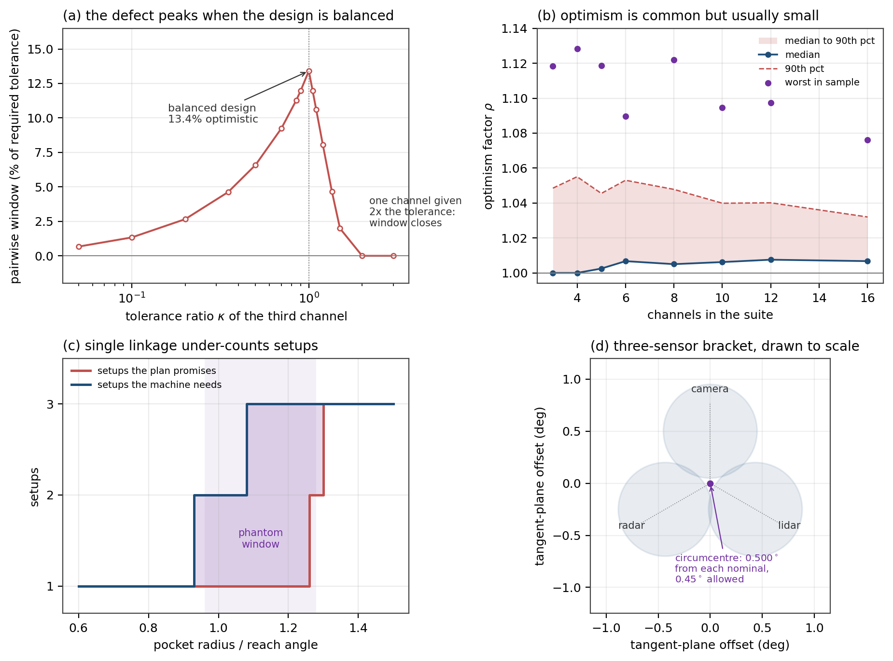

*图：(a) 容差失衡下的窗口宽度，$\kappa=1$ 处 $13.41\%$ 为峰，$\kappa\ge2$ 归零；(b) 随机多通道设计的乐观系数随通道数变化，中位贴近 1、90 分位 $1.03$–$1.055$；(c) 单链聚类承诺的装夹数与机器实际所需装夹数，阴影为幻影窗口 $a/\text{reach}\in[0.96,1.28]$；(d) 三传感器支架按比例画在切平面上，三个 $\pm0.45°$ 的圆两两相交，中心留出一个 $0.05°$ 的洞。*

### 9.17 P3 回放：一套真实的十通道载荷公差表

9.15 与 9.16 用的数字都是本文自己选的。9.16 结尾留下的唯一待办是 P3：**拿一套真实载荷的公差表跑一遍，看真实世界是否真的踩到这个坑。** 本节做这件事，输入是 NASA 月球勘测轨道器（LRO）的指向与对准规范 `431-SPEC-000113` Rev A [15]——公开文件，逐台仪器给出"对准到航天器基准"的角分配，单位角秒、每轴、半锥：

| 通道 | 分配（″） | 条款 | 通道 | 分配（″） | 条款 |
|---|---|---|---|---|---|
| LROC-NAC-L / R | 300 | §9.4.1 | Diviner | 500 | §5.4.1 |
| LROC-WAC | 300 | §10.4.1 | CRaTER | 500 | §4.4.1 |
| LOLA | 300 | §8.4.1 | LEND | 500 | §7.4.1 |
| LAMP | 300 | §6.4.1 | Mini-RF | 750 | §11.3.1 |
| 激光测距望远镜 | 36 | Table 12-1 | | | |

十个通道、一个公共基准、每行都有出处。规范是逐台写的：每台有自己的对准立方镜，各自调。更便宜的机械方案是**一个共用安装面**——垫一次，全体一起动。一次垫片提供一个向量 $x$，第 $i$ 台装订后残留是 $d_i-x$，于是问题变成平面圆盘交：

$$\exists\,x:\ \lVert x-d_i\rVert\le A_i\quad\forall i ,$$

$300″=0.083°$，切平面近似的相对误差 $10^{-6}$ 量级；仍与 9.16 的球面求解器在 300 组随机四通道上互验，**分歧 0 组**。三个判据的强弱是本节的关键：逐台检查（$\lVert d_i\rVert\le A_i$）是充分条件，$x=0$ 即可；两两判据（$\lVert d_i-d_j\rVert\le A_i+A_j$）是必要条件；圆盘有公共点是充要条件。**注意三角不等式：只要逐台检查全过，两两判据就自动成立。也就是说两两判据在设计盒内恒真，它没有独立的分辨力**——它唯一能说"不"的场合，是某台已经超了自己的分配、而垫片还想去救。

**C1 两处可核对的条款。** Table 9-3 两相机对的分配合计 $102″$、要求 $103″$（$500\ \mu\mathrm{rad}$），余量 $1″$；此时两通道，最小包围圆即直径圆，**两两判据恰好是精确判据**，工具独立复现 $1″$、$\rho=1.000$。这正是缺陷能长期潜伏的原因：**文档里唯一一处真正做"和"的算术，恰好是两通道。** §8.4.2 要求 LOLA 视场落在某 NAC 视场内 $1.4°=5040″$，Table 8-3 的共对准分配是 $1636″$，而一个 NAC 的半视场是 $5157″$——几何余量只有 $117″$，分配却是它的 14 倍。若 $1.4°$ 指装订后的上限，条款被顶出视场 $1519″$；若指名义摆放上限，则条款成立且有余量。文档没写清，工具输出 **UNDECIDED** 并给出两种读法的差额 $1519″$——**一个要签字放行的条款，不允许"看你怎么读"。** 第三处：把十条一起交给一次垫片时，若九台甲板仪器散布 $220″$，甲板本身可行（余量 $140″$），计入 $36″$ 的激光测距望远镜即不可行（缺口 $34″$），不可行子集是 **{LAMP, 激光测距望远镜}**，需放宽 $0.96″$；而文档 §12.0 写着该望远镜装在 HGA 支架上、本就不在仪器甲板——**工具从十个数字里推出来的分区，与文档的机械分区是同一个。**

**C2 一次装夹的救援容量。** 把装订散布 $T$ 作为唯一参数（盒内均匀，最坏口径），九台仪器、真实分配：

| $T/A$ | 0.6 | 0.8 | 1.00 | 1.05 | 1.10 | 1.15 | 1.25 | 1.40 | 1.60 | 2.00 |
|---|---|---|---|---|---|---|---|---|---|---|
| 两两判据 | 1.000 | 1.000 | 1.000 | 0.982 | 0.926 | 0.837 | 0.602 | 0.370 | 0.144 | 0.014 |
| 精确 | 1.000 | 1.000 | 1.000 | 0.976 | 0.915 | 0.815 | 0.569 | 0.338 | 0.126 | 0.011 |
| 表看不见的 | 0 | 0 | 0 | 0.6% | 1.1% | 2.2% | **3.3%** | 3.2% | 1.8% | 0.2% |

$T/A\le1$ 时两条线重合且都是 $1$：垫片根本不需要。$T/A\in[1.05,1.6]$ 是一条窄带，分歧在此取峰 $3.3\%$；带外两侧都一致——左边两边都说行，右边两边都说不行。盲带的绝对宽度按真实分配换算：$300″\to80.4″$（$519.6$–$600$），$500″\to134″$，$750″\to201″$。

**C3 $3\sigma$ 生产视角。** 规范自己声明分配是 $3\sigma$。按高斯装订误差、九台仪器：

| $A/\sigma$ | 1.2 | 1.6 | 2.0 | 2.4 | **3.0** |
|---|---|---|---|---|---|
| 两两判据 | 0.169 | 0.574 | 0.869 | 0.976 | **0.998** |
| 精确 | 0.158 | 0.558 | 0.860 | 0.975 | **0.998** |
| 表看不见的 | 1.2% | 1.6% | 0.9% | 0.08% | **0.0000** |

**在文档自己的约定上，两条判据给出同一个答案，1200 次抽样里 0 次分歧。** 缺陷只活在 $A/\sigma\lesssim2$ 的区间，也就是分配被压到 $2\sigma$ 甚至更低、每条都吃紧的设计里——与 R1 的"$\kappa=1$ 取峰、任一通道拿到余量即闭合"完全一致。

**为什么没有反向，以及 13.41% 的正确读法。** 三条结构性原因：其一，唯一做"和"的条款是两通道，而两通道时两两判据精确；其二，分配是 $3\sigma$、散布是 $1\sigma$ 量级，中间隔着一个 3 倍；其三，十个通道分配跨 $36″$–$750″$，宽的那几条替窄的吃了散布。三条都不是这张表特有，而是航天指向规范这一类文档的通用写法——**它们用逐台立方镜，本来就不打算共用一个姿态。** 由此得到本节最该写清楚的一句：**$13.41\%$ 是"容差值的百分比"，不是"设计的百分比"。** 一条机械公差带随工艺摆动就是成倍的，落进一条 $13.41\%$ 宽的缝里的概率远小于 $13.41\%$；真实表上这个概率在 $3\sigma$ 约定下是零，最坏口径下上限 $3.3\%$。

**P3 的裁决：门没过。** 退出判据要求"与实际装配结果一致，且与当时的两两表结论相反"。本节只核到文档自己的算术（$1″$ 余量）与机械分区（望远镜在 HGA 支架），"相反"在真实表上是 0 次。缺的不是公差表——公开的这张够用——缺的是公开文件永远不会有的两列：**每台仪器的实测装订偏差，以及评审当时用的判据**。所以 P3 的下一步不是再找一张表，而是拿一列实测数。

**对产品的含义是收缩目标客户，不是收缩功能。** 从"任何多通道载荷"收缩到 $A/\sigma\le2$、通道数 3–4、各通道分配彼此相当（$\kappa\in[0.7,1.4]$）的设计，即被成本压到极限的那一类。三条五分钟筛子可直接在客户表上跑：分配是否 $\ge2.5\sigma$（是则问题不存在）；通道数是否 $\ge5$ 或分配是否跨 2 倍（是则 $\rho\to1$）；是否存在"一个安装面、一次垫片"的机械约束（否则问题不成立）。反过来，真实表上工具仍然值钱的是另外两张卡——**不可行子集**（谁不能和谁共板）与**口径裁决**（UNDECIDED 加差额），这两张不依赖 $13.41\%$，在 LRO 这张表上都能交付，且都是评审要签字的东西。

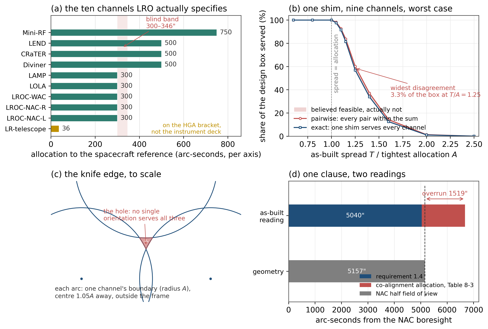

*图：(a) 文档实际给出的十条分配，盲带 $300$–$346″$ 阴影，最右一条 $36″$ 的望远镜在 HGA 支架上；(b) 九台仪器一次装夹的救援率随装订散布变化，两两判据与精确判定在 $T/A\in[1.05,1.6]$ 之间张开、峰 $3.3\%$；(c) $T=1.05A$ 时三条边界弧在中心留出的洞，按比例画出；(d) LOLA 入 NAC 视场条款：要求 $5040″$ 加分配 $1636″$ 超出半视场 $5157″$，只能判 UNDECIDED。*

---

## 10. 价值评估：这些原型上的价值有多大，能否成为产品

本节回答两个问题，不给模糊结论。先说判断，再给依据，最后给可执行的止损条件。

### 10.1 价值是不对称的：估计层接近零，判定层有条件地大

把三个原型的证据按“层”摊开：

| 层 | 在原型上观察到的 | 价值量级 | 可替代性 |
|---|---|---|---|
| 估计精度 | 轴误差与三自由度/UV 完全相同（A2：`0.047°` 对 `0.047°`；9.4：`0.167°` 对闭式 `0.163°`） | **接近零** | 完全可替代，任何最小二乘都能达到 |
| 适定性（不给假数） | 不输出 roll，因此不可能给出 `180°` 量级的假 `sigma`；条件数从 `3.0e5` 到 `5.3` | **中等** | 可用“约定 + 文档”部分替代，但替代品不是数学保证 |
| 判定（可行/不可行/未定） | 逐对检查漏掉的 `0.83%` 被压到 `0`；`0.5°` 网格漏判 `3` 例被证书纠正；`360` 例规模实验中危险方向 `0` | **在特定条件下大** | 不可替代：局部求解器原理上给不出不可行证明 |
| 可用率定价 | `k = 2` 把误放行压到 `0/2400`，代价是 `13.7%` 可用率（`2` 倍噪声） | **可量化** | 可用“固定大裕度”替代，但无法给出曲线 |

三条判断：

1. **作为估计器，价值为零。** 这不是保守说法，而是被 A1、A2 与 9.4 三组数据各证一次：同样的自由度、同样的优化器、同样的数据，轴精度没有差别。任何以“更准”为卖点的定位都会在第一次公平对照中崩掉。
2. **作为接口，价值是“减少一个错误数字”。** 它的货币化形式是集成工时与验收争议的减少，不是性能溢价。这类价值真实但天花板低：客户不会为“少一个参数”付很多钱，只会为“少一次返工”付一点钱。
3. **作为判定器，价值取决于一个前提：余量是否已经吃掉了可用率。** 如果客户的现状是“保守放 3 倍余量，反正够用”，证书一文不值；如果现状是“余量已经把可用率吃到不可接受”，证书立刻值钱，因为它把“凭经验留余量”换成“算出来的最小余量 + 可举证的边界”。9.3 节的交换曲线正是这个前提的定量形式。

由此得到一个可判定的价值判据：**只有当客户能说出“我们因为保守余量损失了多少可用率/多少过境窗口”时，这个方法才有商业价值。** 说不出来，就是没有需求。

9.10 节把上表第三行再压了一次，方向出人意料。五个场景审下来，“判定”在四个场景里退化成点查询（这一帧安不安全），在剩下那个（遮光罩）里退化成一维标量边界（遮光罩上限随 beta 角的曲线）；真正需要“姿态空间里有没有解”的存在性问句出现零次。所以第三行的“不可替代”要加一个限定：**不可替代的不是“全局搜索”，而是“零测度事件的精确定位”**——相切、单点接触、恰好卡在窗口边上。这类问题网格与采样在原理上答不了（分辨率越低越像答对了），而精确谓词加二分答得了，且答得比任何求解器都快。这个限定把价值从“一个更完备的求解器”挪到“一个更可信的边界计算器”，后者反而是可以独立成产品的东西：客户拿到的不是“没有解”这个结论，而是“你的遮光罩最多只能到 `73.2°`，再多就有一个 `0.03°` 宽的时间窗掉到两个探头以下”。

9.13 又把最像 CV 的入口——真实 LLFF 机位上的下一视角选择——压了一次，结果仍是否定：`4254` 次普通 NBV 查询里，网格与分支都 `100%` 找到可行点，分支没有救回任何一次，而且更慢。这给上面的限定补上了真实数据证据：**只要问题仍是“找一个有基线的新视角”，它就不属于本方法的价值区；不能把普通主动视觉当作产品化出口。**

9.14 把三个“安全关键”候选场景（多传感器布置、机械臂巡检规划、AI 安全外壳）逐个压完，把 9.13 的否定精确成了两句：凡是“找一个可行点”，网格与分支等价甚至网格更快；价值只落在**小可行口袋的假阴性率**（`0.05°` 宽团块在 `0.5°` 网格漏 `8/8`，安全外壳修复存在性网格 `0.5°` 假阴性 `7.9%`，分支均 `0`）与**不可行证明**（分支零残差证书，网格在任何分辨率下都只能“没找到”）。因此 CV/AI 方向可保留的出口进一步收窄为“证明型组件”——不可行证明、边界证书、反例生成，而这三类安全外壳正是它的落地载体。

9.15 又往外推了五个场景，结论比 9.14 更窄也更清楚：**不可行证明在五个场景里都站得住，而且便宜一到两个数量级**（不可行时一个反例约束就杀掉整块，可行时必须覆盖全框）；但**真正的独有优势只有一个场景拿到**——光机装调公差，因为它有一个工业界正在用、且在 `13.4%` 宽的窗口内系统性给出“假可行”的判据（逐对检查 `9/15` 例错），其余场景里网格的错都发生在精确切点上，工程上加余量就能绕开。这条把 9.14 的“证明型组件”又收了一步：**证明能力只是必要条件，能不能卖出去还取决于“是否存在一个正在被使用的错判据”。**

### 10.2 三种可能的产品形态及其门槛

| 形态 | 交付物 | 客户 | 技术 | 认证 | 渠&nbsp;道 | 顺&nbsp;序 |
|---|---|---|---|---|---|---|
| **A. 指向包络校验工具**（离线） | 输入限位表与容差，输出“该构型是否处处可行 + 反例见证 + 最小余量” | 天文台、卫星总装测试（AIT）、终端厂商验证组 | 低（本文代码即雏形） | 无（不在线、不承担保护功能） | 中 | **第一** |
| **B. 星敏/太敏地面定姿验证** | 定姿精度评估报告 + “哪些工况下 roll 不可信”的判据 | 星敏厂商、卫星总体、测试设备商 | 低—中 | 低（测试设备） | 中高 | 第二 |
| **C. 出光联锁组件**（在线） | 实时三值判定 + 证据日志，接入终端控制系统 | 激光通信终端厂商、系统总体 | 中 | **很高**（功能安全/适航/航天qualification） | 很高 | 第三，或 IP 授权 |

**A 是最短路径**，理由不是技术，而是**责任边界**：离线工具不参与实时保护，出错不会被追责为安全事故，因此不需要功能安全认证。它卖的是“设计阶段就能算出来的可行性”，交付形态可以是一份报告加一个脚本。

**C 的价值最高但最难**：客户是少数整机厂与研究所，采购周期以年计，且需要与既有的与门逻辑、故障树、硬件表决共存。对一个没有航天履历的团队，现实路径是被集成而不是去集成——把判定内核授权给终端厂商，而不是自己卖联锁盒。

**B 的位置被低估**：它的卖点不是精度，而是“在什么工况下你不该相信自己的 roll 数字”。对星敏厂商，这是一个可用于说明书与投标的差异化条款；对总体单位，这是一个可用于验收的判据。它的交付成本最低，因为它只需要分析和报告，不需要实时软件。

### 10.3 为什么现在可能有机会

三条外部变化，都是结构性的：

1. **终端数量从个位数变成上千。** 星间激光链路进入星座化部署后，指向相关的验收从“专家评审几台样机”变成“流水线测试上千台”。流水线需要可自动化、可复现、可与实现无关的判据——“不同实现给出不同 roll”在这种规模下是不可接受的。
2. **接口标准化。** 光通信终端出现跨厂商互操作规范后，指向性能必须能用共同口径比较。一个与实现无关的判定口径（可行/不可行 + 证据）比“某家的 `sigma`”更适合写进规范。
3. **可用率开始有价格。** 地面站过境窗口只有数百秒，误拒一次等于丢一次过境；望远镜可用夜数有限。当可用率直接对应收入时，“保守留余量”就从免费变成有成本。

这三条都指向同一件事：**需求不在“更准”，而在“可举证”**。这与本文的数学结论一致，也是唯一自洽的商业逻辑。

### 10.4 从原型到产品的距离

| 阶段 | 内容 | 工作量（人月） | 关键风险 |
|---|---|---|---|
| P0（已完成） | 合成数据原型 + 三场景实验 | — | 无真实数据支撑 |
| P1 工具化 | 接口、配置、报告生成、单元测试、`n` 与退化情形的完备覆盖 | `4–6` | 需求方说不出验收口径 |
| P2 真实数据 | 接入 `2–3` 家真实器件数据（星敏星表、编码器、终端质心） | `6–10` | 数据拿不到，或噪声模型与假设不符 |
| P3 在线组件 | 实时实现（C/C++）、时限分析、故障注入、证据日志 | `12–18` | 实时性与认证成本 |
| P4 认证 | 按目标领域做功能安全/环境试验 | `24+` | 认证费用远超算法开发 |

合计：到 P2（有真实数据背书、可对外演示）约 `6–9` 个月、`2–3` 人；到 P3 可交付的在线组件再加一年；到 P4 是另一个量级的投入。**算法的开发成本在整条链上占比不到 10%**，这一点必须提前认清。

### 10.5 最大的风险不是技术，而是“需求不存在”

按重要性排序：

1. **客户已经用“逐条检查 + 保守余量”满足了安全要求，且不觉得需要证明。** 这是最可能杀死项目的原因：`0.83%` 的错误率在多数工程里被余量吸收，客户会说“我们知道有洞，但我们的余量比洞大”。破解方式只有一个——用客户自己的数据算出“你的余量有多大、损失了多少可用率”，让洞与余量的相对大小变成可讨论的数。**9.17 已经把这个数算了一半**：在 LRO 的真实十通道表上，洞占设计盒的上限是 `3.3%`，在该规范自己声明的 $3\sigma$ 约定下是 `0`。这条既是风险也是筛子——它把“需求是否存在”变成了一个能在客户表上五分钟回答的问题（分配是否 $\ge2.5\sigma$、通道数是否 $\ge5$、是否存在“一个安装面、一次垫片”的约束）。
2. **真实噪声不是各向同性高斯。** 背景光、饱和、畸变、外点会让闭式 `sigma` 偏乐观，进而让 `k = 2` 的判据失效。这是技术上最实质的风险，必须在 P2 阶段用真实数据重估，而不是继续用合成数据。
3. **认证成本超过团队承受能力。** 如果目标是形态 C，认证费用与周期会淘汰小团队；此时应退到形态 A/B 或 IP 授权。
4. **被“更简单的工程做法”绕过。** 例如把容差直接缩小一半、或者在锥交集上用通用非线性规划多起点求解。后者给不出证明，但在实践中“多起点 + 网格”常常够用——这正是本文认为“完备性”是唯一护城河、也是最容易被忽视的地方。

**止损判据（建议写进项目章程）：** `6` 个月内拿不到 `2` 家以上真实器件数据、且拿不到 `1` 份明确表达“愿意为可举证性付费”的意向，则停止产品化，把成果收敛为论文、开源工具与咨询交付。

### 10.6 结论

**价值大吗？** 分三层，答案不同，不能合并成一句：

- 作为**估计器**：不大，接近零。三组独立对照都显示轴精度与常规最小二乘无差别，任何“更准”的主张都不成立。
- 作为**接口**：中等。它消除的是“必须给一个数据回答不了的问题编一个答案”这件事，价值体现为集成与验收成本的下降，天花板不高但真实。
- 作为**判定器**：在“多约束同时满足”与“必须证明无解”这两类问题上**很大**，且不可替代；在单约束或客户已有充足余量的场合，价值为零。9.5 节的 `0.83%` 与 `Theta in (30°, 35.26°)` 窗口是它唯一站得住的证据。**9.17 把这条证据收窄了一步**：真实表上判定器只在 $A/\sigma\le2$ 的设计里与两两判据分道扬镳，$3\sigma$ 约定下两者给出同一答案（1200 次抽样 0 次分歧）——所以目标客户是“吃紧的设计”，不是“任何多通道载荷”。

**能转化为产品吗？** 能，但产品不是“一个更好的姿态估计算法”，而是**指向可行性的证据生成器**：离线校验工具（形态 A）最先可交付，星敏定姿验证（B）次之，出光联锁（C）价值最高但应走 IP 授权而非自建产品线。

一句话：**这个方法不足以支撑一家公司，足以支撑一个产品模块和一个差异化条款；它的定价权来自“可举证”，不来自“更准”。** 若要在两者之间选一个投入方向，选判定层——那里有证明，也有唯一不可替代的东西。

---

## 11. 工程转化路线与证伪条件

### 11.1 建议路线

1. **理论实现对齐**：为局部 Hessian、SOC 可行性和 UV—polar 局部等价增加解析单元测试；
2. **初始化模块产品化**：保持最终联合 BA 不变，只将 polar-staged 作为可插拔前端；
3. **真实数据验证**：覆盖鱼眼、全景、内窥镜、星敏感器、UAV 斜视和自由空间光指向；
4. **公平计算预算**：比较多随机种子下的成功率、时间、内存和最终精度，而不只比较收敛标志；
5. **失败边界扫描**：系统改变初始倾角、平移、结构噪声、视场、近轴点比例、遮挡和外点；
6. **门控与鲁棒性分析**：将近轴协方差正则化和经验门控分开消融；
7. **全局方向求解原型**：在角锥容差任务中实现 SOCP，并验证多图归一化与不可行证书；
8. **学术查新**：系统比较球面 BA、旋转平均、商空间姿态估计、分阶段初始化和锥规划相关工作；
9. **可观测域的真实排程对标**：9.12 已完成其一半——用 astroplan（独立实现、独立星历）交叉校验了面积区间与布尔判定，包含性 8/8、分歧全部落在 `1.5°` 的边界带内。剩下一半没做：那仍是模型对模型，不是模型对观测。真正的对标要用一台望远镜的实际排程日志，比对可行窗口的起止时刻，并且必须先把本文的岁差缺口补上（9.12.2）。
10. **边界求解器的接口化**：把 9.10.4 的 $\beta_{\max}(\gamma)$ 与 9.10.1 的闭式裕度做成同一个接口（输入设计参数、输出标量边界及其敏感度），并在真实构型上验证"相切定位"能否在毫秒内给到 `1e-6` 的相对精度——这是 9.10 之后唯一还像产品的部分。
11. **乘积域限位的合成接口**：真实望远镜/天线限位是 $(\mathrm{az},\mathrm{el})$ 矩形（乘积域，逐轴精确）叠加太阳规避/天顶禁行锥，两者不在同一几何层。把这一组合写进判定器的输入模型，比继续扩大锥数更有工程价值。
12. **CV/AI 只保留验证器路线**：9.13 的真实 LLFF 下一视角实验已经否定普通 NBV 出口（网格与分支同为 `100%` 成功，分支没有更快）。9.14 又把三个“安全关键”场景逐个压了一遍，结论更精确：凡“找一个可行点”网格与分支等价甚至网格更快（A 随机布置、B 正常路点、C 点检验合计一致）；价值只落在“小可行口袋的假阴性率”（A 团块 `0.05°` 宽时网格 `0.5°` 漏 `8/8`、C 修复存在性网格 `0.5°` 假阴性 `7.9%`、分支均 `0`）与“不可行证明”（分支零残差证书，网格任何分辨率给不出）。后续若继续面向 CV/AI，只做硬约束规划的不可行证明、边界证书与反例生成，并把这三种安全外壳当作“证明型组件”的落地场景，而不是追求更好的视角估计或更快的搜索。9.15 再往外推五个场景后，这条路线要补一个前提：**证明能力只是必要条件**——不可行证明在五个场景里都便宜且可靠，但只有光机装调公差那一个同时具备“工业界正在用的错判据”（逐对检查在 `13.4%` 窗口内 `9/15` 例假可行），其余场景网格的错都在零测度切点上，加余量即可绕开。因此“证明型组件”的第一顺位客户，是**已经有判据、但判据会错**的评审环节。9.16 把这条判据本身检了一遍：按“既有判据、正测度错、尺度无关、有人付钱”四道门重扫，八个场景只有两个通过（装调公差 `13.4%`、五轴装夹分组的单链聚类 `33%`），且两者共用一个错误来源——**把必要条件当作充分条件使用**。所以可复制性不来自几何同构，而来自能否找到“正在被当作充分条件使用的必要条件”。

### 11.2 哪些结果会削弱或证伪项目主张

- 在相同计算预算和公平调参下，直接 UV 与 polar-staged 的成功率无显著差异；
- 优势只在特定随机种子、固定初值或特定鲁棒核下出现；
- 加入简单 yaw 多启动或边缘化即可获得相同成功率且成本更低；
- 真实数据中结构冻结导致偏差无法被最终联合 BA 消除；
- 近轴门控是主要性能来源，而不是几何分层；
- SOC 方向模型在噪声、外点和多半球条件下无法提供可靠证书或实用精度；
- 在更多真实 CV/AI 规划任务上，普通网格/采样与精确判定仍无一例分歧——9.13 的 LLFF 结果已出现一次，若继续复现，应视为对“CV 独特价值”主张的持续证伪。9.14 给出了这一主张还能站住的条件：分歧只在“可行域面积小于采样单元”与“需要不可行证明”时出现；若在这些构造场景之外仍测不到分歧，则连“验证器”路线也应放弃。

这些证伪条件应成为后续实验设计的一部分，而不是只收集支持性结果。

---

## 12. 结论

本项目最重要的数学发现不是“把 UV 变成 polar 后问题自动变凸”，而是以下三层结构：

1. **精确的商空间解耦**：`theta` 只估计二维光轴方向，`phi` 再恢复一维绕轴旋转；
2. **有条件的局部良态性**：在小残差、满秩和正规角度图下，`roll-pitch` 子问题局部强凸；
3. **不同问题表述的可计算性差异**：角锥约束可表示为凸二阶锥，因此“是否存在满足全部容差的指向”是可判定的，而局部非凸求解器原理上给不出不可行证明。

第 8.3 节的三个消融把这三层压得更紧，其中两条是对本项目自身叙事的否证：

- 在 BA 循环内，**换坐标不加权是负收益**（`14.85°` 对 `1.72°`），而白化之后极坐标与 UV 的成败边界相同；全部增益由近轴门控承担，且该门控在 UV 中可直接复现。因此极坐标在 BA 内的角色是**推导工具**，不是性能来源。
- 在指向问题内，二维与三维的**轴精度完全相同**（`0.047°` 对 `0.047°`），差异只在条件数（`3.0e5` 对 `5.3`）、规范依赖（报告的 `yaw` 跨 `180°`）与伪逆的虚假置信（对不可观方向仍报 `18.3°`）。

第 8.4 节把上面第一条从经验提升为定理，同时也给它划了边界，这一条值得单独写：

- **能证的**：等角权重的渐近协方差不可能优于逐点白化，膨胀因子 $R(\alpha)\ge1$，等号仅在 $\alpha=1$ 成立。这是 Gauss–Markov 的直接推论，不需要实验，也不需要场景假设，只要求噪声各向同性。
- **不能证的**：$R$ 不能预测实际误差比。固定几何、只改权重指数 $\alpha$，$R$ 下降 `15` 倍而实测比几乎不动；实测呈阈值跳变，$R$ 呈幂律下降，两者形状不同。机制是近轴切向的**杠杆**（一阶，由 $\max\theta^{\alpha-1}$ 决定），不是**方差**（二阶，由 $\sum\theta^{2\alpha-2}$ 决定）。
- **操作后果**：靠调权重救不了等角极坐标，只能靠门控或换参数化；而门控与坐标系无关，所以在像素残差里同样有效。这与 A1 的 2×2 结果互为印证。

据此，本文最终保留的价值主张只有两层，且都不涉及“更准”：

1. **适定性**：商掉绕轴自由度后，问题不再要求实现者替数据回答一个数据无法回答的问题，因此同一测量只有一个答案、只有一种不确定度；
2. **可判定性**：指向容差与限位可以写成锥约束的可行性问题，可行给点、不可行给见证、拿不到给“未定”，三者都可靠。9.5 节的反例显示，行业常见的“逐条检查限位”在三个锥的容差落在临界窗口内时会放行物理上不存在的指向；9.10.3 节把这个窗口从“容差在 `30°` 附近”改写为“归一化几何下宽度 `13.4%`，与容差大小无关”——缩到 `0.5°` 它一分不缩，只是随机摆位很难命中，而真实望远镜的方位/俯仰限位是乘积域，本身不受这一失效影响。

第 9 节的三套原型说明这两层可以落地：出光联锁在 `k = 2` 时把误放行压到 `0/2400` 并给出可用率代价（`2` 倍噪声下 `13.7%`）；星敏/太敏的轴误差与闭式 `sqrt(2) sigma_theta` 吻合到 `2.4%`；限位校验在 `400` 个随机实例上给出带见证的确定答复，`360` 例规模实验中危险方向的错误为 `0`，且完备性由候选集引理保证对任意锥数成立。这些都是合成数据结果，真实器件验证仍是下一步（11.1 节第 3 项）。

第 9.10 节对另外五个候选场景做了判决性检验，又收窄一次，并且收窄的方向与直觉相反：

- **四个场景的“判定”其实是点查询。** 联锁问“这一帧允不允许出光”，热控问“这个太阳方向热不热”，星敏问“这颗星能不能用”，都不是存在性问题；把点查询的收益记在“全局判定”名下会把账算错。
- **第五个场景是 1-D 的。** 遮光罩可用性沿轨道是时间的一维函数，切换时刻解析可解，判定 $O(n)$ 且没有分辨率参数；真正的设计边界“轨道圆与可行域相切”是零测度事件，网格与采样在原理上定位不到。
- **剩下的独占性只剩一条：零测度事件的精确定位。** 相切、单点接触、恰好卡在窗口边上——这类问题只能靠精确谓词加二分/分支，且分辨率越低越像答对了，所以“看起来对”的错觉正好出现在最该怀疑的地方。

这条限定把 L3 从“非凸 + 全局”挪到“精确 + 无分辨率参数”，范围小了，但它正是这一轮六个场景里唯一没有被任何一次审计削掉的东西。

第 10 节把价值判断收得更紧，因为它必须回答“值不值得做”：

- **作为估计器，价值接近零。** 三组独立对照（A1、A2、9.4）都显示轴精度与常规最小二乘无差别，任何“更准”的定位都会在公平对照中崩掉。
- **作为接口，价值中等。** 它消除的是“替数据回答一个数据回答不了的问题”，货币化形式是集成与验收成本的下降。
- **作为判定器，价值有条件地大。** 只在“多约束同时满足”与“必须证明无解”两类问题上不可替代；若客户已有充足保守余量，价值为零。
- **产品形态**：不是算法授权，而是“指向可行性的证据生成器”。离线校验工具最先可交付（不承担在线保护、无需功能安全认证），星敏定姿验证次之，出光联锁价值最高但应走 IP 授权而非自建产品线。算法开发成本在整条产品链上占比不到 `10%`，认证与真实数据才是主要成本。

一句话定位：本方法不是更好的估计器，而是**唯一把“指向”当作一等公民、并使其可判定的表述**。它的评价尺度应从“精度与收敛率”换成“可复现性、可判定性与尾部风险”；它的商业出口不是替代 BA，而是**指向类设备的验收与安全联锁模块**。

---

## 参考文献

本文引用的外部方法均在正文处以方括号编号标注。凡本文与这些工作重合之处，已在第 6 节与第 9 节逐条划界；编号越靠前的条目，与本文“沿用的既有结论”关系越直接。

[1] Longuet-Higgins H C, Prazdny K. The interpretation of a moving retinal image. *Proceedings of the Royal Society of London B*, 1980, 208(1173): 385–397. DOI: 10.1098/rspb.1980.0057.

[2] Triggs B, McLauchlan P F, Hartley R I, Fitzgibbon A W. Bundle adjustment — a modern synthesis. In: *Vision Algorithms: Theory and Practice*, LNCS 1883. Springer, 2000: 298–372. DOI: 10.1007/3-540-44480-7_21.

[3] Lourakis M I A, Argyros A A. SBA: a software package for generic sparse bundle adjustment. *ACM Transactions on Mathematical Software*, 2009, 36(1): Article 2. DOI: 10.1145/1486525.1486527.

[4] Hartley R, Trumpf J, Dai Y, Li H. Rotation averaging. *International Journal of Computer Vision*, 2013, 103(3): 267–305. DOI: 10.1007/s11263-012-0601-0.

[5] Wahba G. Problem 65-1: a least squares estimate of satellite attitude. *SIAM Review*, 1965, 7(3): 409.

[6] Shuster M D, Oh S D. Three-axis attitude determination from vector observations. *Journal of Guidance and Control*, 1981, 4(1): 70–77. DOI: 10.2514/3.19717.

[7] Liebe C C. Accuracy performance of star trackers — a tutorial. *IEEE Transactions on Aerospace and Electronic Systems*, 2002, 38(2): 587–599. DOI: 10.1109/TAES.2002.1008988.

[8] Helly E. Über Mengen konvexer Körper mit gemeinschaftlichen Punkten. *Jahresbericht der Deutschen Mathematiker-Vereinigung*, 1923, 32: 175–176.

[9] Danzer L, Grünbaum B, Klee V. Helly's theorem and its relatives. In: *Convexity*, Proceedings of Symposia in Pure Mathematics VII. American Mathematical Society, 1963: 101–179.

[10] Lobo M S, Vandenberghe L, Boyd S, Lebret H. Applications of second-order cone programming. *Linear Algebra and its Applications*, 1998, 284(1–3): 193–228. DOI: 10.1016/S0024-3795(98)10073-3.

[11] Boyd S, Vandenberghe L. *Convex Optimization*. Cambridge University Press, 2004. ISBN 978-0-521-83378-3.

[12] Morris B M, Tollerud E, Sipőcz B, et al. astroplan: an open source observation planning package in Python. *The Astronomical Journal*, 2018, 155(3): 128. DOI: 10.3847/1538-3881/aaa47e.

[13] Meeus J. *Astronomical Algorithms*, 2nd ed. Richmond, VA: Willmann-Bell, 1998. ISBN 0-943396-61-1.

[14] Mildenhall B, Srinivasan P P, Ortiz-Cayon R, Khademi Kalantari N, Ramamoorthi R, Ng R, Kar A. Local light field fusion: practical view synthesis with prescriptive sampling guidelines. *ACM Transactions on Graphics*, 2019, 38(4): Article 29, 1–14. DOI: 10.1145/3306346.3322980.

[15] NASA Goddard Space Flight Center. Lunar Reconnaissance Orbiter Project Pointing and Alignment Specification, 431-SPEC-000113, Revision A, effective 6 April 2007. Public LRO project document. 本节引用的全部分配、要求与条款号均出自该文件；原始十通道表复制在 `analysis/data/lro_alignment_allocations.csv`，每行带条款号与原文引文。

两点说明。其一，Helly 定理的发表年份常被误记为 1913（那是他 1913 年的讲座），印在纸面的是 1923 年《Jahresbericht der DMV》32 卷 175–176 页；本文按 1923 引。其二，本文没有引用任何"球面 Helly 数"的专题文献，因为本文用到的只是经典 Helly 定理在 $\mathbb{R}^3$ 中的 $n+1=4$ 这一特例，而该特例已在 [8][9] 之内；把它称为"球面上的 Helly 数"是本文的用法，不是文献里的现成术语。

## 交互演示（`demo/index.html`）

该演示为单文件、无外部依赖的静态页面，直接双击即可在浏览器打开，用于把本文的数学结论变成可操作的检验，而不是动画化的宣传。五个面板与本文的对应关系是：

| 面板 | 交互内容 | 对应结论 |
|---|---|---|
| 实时解耦实验 | 拖动 `roll/pitch/yaw`，同屏对比 polar 图与 UV 图 | 2.1 的恒等式；`theta` 不随 yaw 变化，UV 整体旋转 |
| 商空间与应用 | 切换五类应用，说明固定-yaw UV 的困难与边界 | 2.2、7.1 的适用条件与不可宣称之处 |
| 实验证据 | 切换 Exp1—Exp5、柱状/折线，标注样本量与判据 | 第 8 节，含 Exp1 的反证性对照 |
| 凸性与奇异性 | 拖动 `theta`、`FOV`，观察 `sigma_phi` 发散与视场截断 | 3.3、4.2、4.4，明确区分局部强凸与 SOC 表示 |
| 工程路线 | 路线图与证伪条件清单 | 第 11 节 |

该演示对应的是第 2—4 章与第 8 章的既有结论，未包含第 7.3、8.3、9 节新增的消融与原型；后者的可视化在 `analysis/figures/abl_*.png` 与 `pointing_*.png`，数据在 `analysis/data/`。

页面中的所有数值均由脚本实时计算或来自仓库 CSV 的聚合，未手工填入结论性数字。

---

## 数据与复现入口

- 单视图：`outputs/monte_carlo_results.csv`
- 逆深度 BA：`outputs_ba/ba_monte_carlo_results.csv`
- 三视图 BA：`outputs_exp3/exp3_monte_carlo_results.csv`
- 自由 XYZ：`outputs_exp4/exp4_local_results.csv`、`outputs_exp4/exp4_global_results.csv`
- UAV 斜视条带：`outputs_exp5/exp5_uav_oblique_results.csv`
- 通道诊断（Jacobian）：`outputs_exp16/exp16_conditioning_diagnostics.csv`
- 位姿盆地（exp16/exp17）：`outputs_exp16/exp16_pose_stage_basin_results.csv`、`outputs_exp17/exp17_staged_init_basin_results.csv`、`outputs_exp17/exp17_staged_init_summary.csv`
- 消融 A1（坐标 × 门控）：`outputs_abl/abl_a1_records.csv`、`outputs_abl/abl_a1_summary.csv`
- 消融 A2/A3（可辨识性与实现重复性）：`outputs_abl/abl_a2_summary.csv`、`outputs_abl/abl_a3_summary.csv`
- 指向原型（三场景）：`outputs_pointing/pointing_apt_records.csv`、`pointing_sun_records.csv`、`pointing_limits_records.csv`、`pointing_limits_sweep.csv`
- 补锥与可观测域：`outputs_keepout/keepout_sweep.csv`、`keepout_witness.csv`、`keepout_interior.csv`；`outputs_observability/accuracy_vs_cost.csv`、`diurnal_sweep.csv`、`night_comparison.csv`
- 五场景审计（9.10）：`outputs_scenario_audit/audit1_interlock.csv`、`audit1_summary.csv`、`audit2_stars.csv`、`audit2_roll.csv`、`audit3_scale.csv`、`audit3_random.csv`、`audit3_window.csv`、`audit4_design.csv`、`audit4_sampling.csv`、`audit4_detect.csv`、`audit4_region.csv`、`audit5_thermal.csv`、`audit5_geom.csv`
- 真实规模分支（9.11）：`outputs_branch_scale/bs_checks.csv`、`bs_bounds.csv`、`bs_resolution_0stars.csv`、`bs_resolution_200stars.csv`、`bs_extent.csv`、`bs_constraints.csv`、`bs_separated.csv`、`bs_merged.csv`
- astroplan 交叉校验（9.12）：`outputs_astro_crosscheck/ac_ephemeris.csv`、`ac_area.csv`、`ac_verdicts.csv`、`ac_timing.csv`、`ac_margins_fast.csv`、`ac_margins_lijiang.csv`
- 真实 LLFF 下一视角（9.13）：`analysis/data/llff_*/poses_bounds.npy`、`outputs_cv_nbv/cv_nbv_results.csv`、`outputs_cv_nbv/cv_nbv_scenes.csv`
- 三安全场景验证（9.14）：`outputs_safety/safety_a_random.csv`、`safety_a_lens.csv`、`safety_b_plans.csv`、`safety_b_waypoints.csv`、`safety_c_shell.csv`、`safety_c_summary.json`；图 `analysis/figures/safety_scenarios.png`
- 五延伸场景验证（9.15）：`outputs_next/next_s1_spacecraft.csv`、`next_s1b_spacecraft_grazing.csv`、`next_s1c_spacecraft_infeasible.csv`、`next_s2_radiotherapy.csv`、`next_s3_tolerance.csv`、`next_s4_window_sample.csv`、`next_s4_window_branch.csv`、`next_s5_arm.csv`、`summary.json`；图 `analysis/figures/next_scenarios.png`
- 权重错配的相图尝试：`outputs_phase/phase_alpha_scan.csv`、`phase_init_scan.csv`、`phase_gn_forecast.csv`、`phase_regimes.csv`
- 复制性研究（9.16）：`outputs_replication/r1_tolerance_imbalance.csv`、`r2_random_suites.csv`、`r2_by_n.csv`、`r3_setup_grouping.csv`、`r3_summary.csv`、`r0_ring_closed_form.csv`、`timing.csv`、`summary.json`、`product_demo.json`；图 `analysis/figures/replication.png`
- P3 真实表回放（9.17）：`analysis/data/lro_alignment_allocations.csv`、`outputs_p3/lro_channels.csv`、`rescue_curve.csv`、`production_view.csv`、`summary.json`；图 `analysis/figures/p3_replay.png`
- 复现脚本：`run_replication.py`、`plot_replication.py`、`run_p3_replay.py`、`plot_p3_replay.py`、`demo_boresight.py`、`run_ablations.py`、`run_pointing_prototype.py`、`run_phase.py`、`run_keepout.py`、`run_observability.py`、`run_scenario_audit.py`、`run_branch_scale.py`、`run_astro_crosscheck.py`、`run_cv_nbv.py`、`run_safety_scenarios.py`、`run_next_scenarios.py`、`plot_ablations.py`、`plot_phase.py`、`plot_keepout.py`、`plot_observability.py`、`plot_scenario_audit.py`、`plot_branch_scale.py`、`plot_astro_crosscheck.py`、`plot_cv_nbv.py`、`plot_safety_scenarios.py`、`plot_next_scenarios.py`
- 交互演示：`demo/index.html`

9.12 需要 `astropy` 与 `astroplan`（本次用 `astropy 7.2.3` + `astroplan 0.10.1`，`numpy` 保持 `1.26.4`）；包本身不依赖它们，缺这两个包时其余脚本照常运行。

说明：本工作树快照只包含 Exp1—Exp5 的产物；Exp16/17 的 CSV 与原始图位于主仓库 `E:/zuo/projects/RPYPolarSynthetic` 对应目录下，本报告引用的 5 张既有图已复制到 `analysis/figures/`，报告正文与 `demo/index.html` 均直接引用这份副本，未重绘。第 8.3 与第 9 节的图由新增脚本生成，原始产物在主仓库 `outputs_abl/`、`outputs_pointing/`，副本在 `analysis/figures/` 与 `analysis/data/`。
