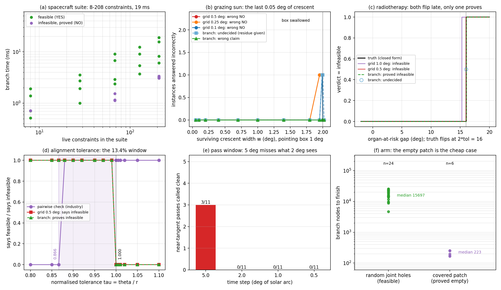

# v0.9.15 五个候选场景：逐一验证（含两个否定结论）

本文回答上一轮留下的问题：§9.14 之后，按“存在性 + 不可行必须举证 + 可行域可被压到采样单元以下”筛出来的五个新场景，是否真的具备独有优势。做法不是论证同构，而是把每个场景写成球面 cap 代数，用与 §9.14 **完全相同**的协议跑数字。结论事先不知道，跑完才知道：**五个里只有一个（装调公差）拿到了干净的独有优势，两个（放疗、过境窗口）比我上一轮的排序要弱，两个（航天器套件、机械臂）的“优势”只落在“不可行证明”和“代价”上，不落在正确率上。**

---

## 1. 先说清“网格 vs 分支”是什么

这两个词在本项目里不是两种“算法风格”，而是两种**回答强度**。二者面对的是同一个问句：

> 在球面上一块区域里，**存不存在**一个同时满足全部覆盖/避障约束的方向？

**网格**：在区域里打一张规则点阵，逐点精确求值。
- 只要有一个点合格，回答“存在”——这个答案**是对的**，因为点是真的。
- 如果一个点都不合格，回答“不存在”——这个答案**只是“我没找到”**。可行域可能是一条比点距还窄的缝，正好从格子中间穿过去。网格无法区分“真没有”和“太窄”。

**分支**：把区域切成盒子，对每个盒子算一个**严格上下界**（本项目用三角不等式围界，见 §9.11）。
- 如果某个盒子的上界证明“这里面全是合格点”，回答“存在”——同样精确。
- 如果某个盒子的下界证明“这里面全是违规点”，就把这个盒子整个删掉，**不需要在里面采样**。
- 如果所有盒子都被删光，回答“不存在”——这是一份**证明**：区域被一个不漏地分割过，每一块都被严格界排除。
- 如果盒子已经切到最小尺寸（比如 `0.05°`）还有剩的、且界不足以判定，回答“**没定**”（`NO_RESIDUE`），并把剩下的面积**报出来**。

所以差别只有两句话：

| | 网格 | 分支 |
|---|---|---|
| 说“有” | 精确 | 精确 |
| 说“没有” | 永远只是“没找到” | 残差归零时是**证明** |
| 说“不知道” | **不会说** | 会说，并给出还剩多少面积 |

第三行才是关键。一个方法不会说“不知道”，它的“没有”就永远带着一个无法量化的问号；能说“不知道”的方法，才可能说出“确实没有”。

**这次的口径修正（重要）。** 上一轮我在汇总表里把 `NO_RESIDUE` 当成“判成了 NO”来计误判，于是 S1b 的 `w=1.99°` 被打成一次“分支误判”。这是错的，按 §9.14 自己的协议：**`NO_RESIDUE` 不是主张，它没有说“不可行”，它说的是“我没定，这是剩下的面积”**。只有 `YES` 和 `NO_PROVEN` 是主张，只有主张才可能错。本文全部改成分三类计分：`YES` / `NO_PROVEN` / `UNDECIDED`，`branch_wrong` 只统计前两类与真值相反的情形，`branch_undecided` 单列。下面的表中“分支 0 错判”是这个口径下的 0。

---

## 2. 协议与真值

- 底层：`ScaleScene`（cap 交 + keep-out 差），与 §9 同一套球面集合运算；判定与分支复用 `safety_scenarios.grid_verdict` / `branch_verdict`，分支为 `bound="tri"`、`early_exit=False`（存在性必须覆盖整块区域，不能像点查询那样提前退出）。
- 网格：`0.5° / 0.25° / 0.2° / 0.1° / 0.05°` 若干档，均为单元中心求值。
- 分支：`eps = 0.01–0.05°`（按场景），节点上限 `4e6`。
- **真值**：能用闭式就用闭式（S2、S3、S4），用构造就用构造（S1b、S1c、S5 的 blocked）；只有 S1、S5 的随机族没有独立真值，用 `0.01°` 分支给真值，**这种族的“准确率”是自洽性，不是检验**——下文会逐处标出哪些数字是自洽、哪些是真检验。
- 代码：`src/rpy_polar_synth/next_scenarios.py`；运行 `run_next_scenarios.py`；表在 `outputs_next/`；图 `analysis/figures/next_scenarios.png`。

---

## 3. S1 航天器姿态规避套件

**问句。** 太阳 30°、月球 20°、地球临边 20°、三个羽流 15°、散热面 25°，再加 `0–200` 颗亮星（每颗 2° keep-out），指向框 `1.0° / 0.4° / 0.15° / 0.06°`——**框里存不存在一个合法姿态**。共 20 例，约束数 `8 → 208`。

**结果（自洽性 + 代价，不是准确率检验）。**

- 20 例全部可行；网格三档与分支都判对，分支 `0` 错判、`0` 未定——但真值本身来自分支，所以这一行**只说明两者一致，不说明谁对**。
- 代价：分支 `0.52–18.9` ms（中位 `3.6` ms）；网格 `0.1°` `0.17` ms。**网格快 20 倍左右，且在这批实例上没有错。**
- 点查询 vs 存在查询的分裂（这是本节真正的信息）：**点查询**（碰到第一个认证可行盒就停）中位 `21` 个盒子、`5–21` 个盒子；**存在查询**（必须覆盖整块指向框）中位 `101` 个盒子、最坏 `421` 个。**同一个问题，两种问法差 5 倍代价。** 工程上“给我一个能指的方向”和“这个框里一定存在方向”是两件事，后者贵在必须覆盖全框。
- 208 约束时的实测：框 `1.0°` → `421` 盒 / `18.9` ms；`0.4°` → `181` 盒 / `15.7` ms；`0.15°` → `21` 盒 / `8.2` ms；`0.06°` → `5` 盒 / `6.1` ms。框越小越便宜，因为根盒子更快被界判定。

**判断。** S1 的正向问题（找得到）**没有独有优势**：网格又快又对。它的价值在下面两小节——临界几何与不可行证明。

### 3.1 S1b 掠射太阳：唯一会出事的几何

**问句。** 让太阳锥刚好切进指向框，把框切出一个宽 `w` 的月牙；`w < 2°` 可行，`w ≥ 2°` 框被吞掉，不可行。真值由构造给出（框 1°，`w = 2` 是切点），这是**独立真值**。

| `w` (°) | 真值 | 网格 `0.5°` | 网格 `0.25°` | 网格 `0.1°` | 分支 |
|---|---|---|---|---|---|
| 0.05 – 1.8 | YES | 对 | 对 | 对 | YES |
| 1.95 | YES | **错（说没有）** | **错** | 对 | YES |
| 1.99 | YES | **错** | **错** | **错** | 未定（残差 `5.4e-6` sr） |
| 2.00 | NO | 对 | 对 | 对 | 未定（同一残差） |
| 2.02 | NO | 对 | 对 | 对 | **证明 NO** |

- 网格 `0.5°` 与 `0.25°` 各漏 `2/10` 个真可行例，`0.1°` 漏 `1/10`。
- 分支 `0` 错判。它在 `1.99°` 与 `2.00°` 上说“未定”，残差 `5.4e-6` sr ≈ `0.0017` deg²——**这就是它没排除的面积**，一个可以拿去和容差比较的数，而不是一句“没找到”。
- `2.00°` 的真值是 NO，分支**没有**证明它：那是精确相切，可行集退化成**一个点**，任何有限分辨率都杀不掉。分支诚实地说“未定”，而不是把“没找到”包装成“不存在”。**这条恰好是这套方法最该被信任的地方：它在最想下结论的那一档上拒绝下结论。**

### 3.2 S1c 目标落在禁区里：不可行证明有多便宜

**问句。** 太阳（30°）正好压在目标方向上——这是拒绝一次机动的**最常见**理由，不是数值巧合，裕度有 `29°` 以上。真值由构造成立：`12` 例（4 档框 × 3 档星数，`8–208` 约束）。

- 分支 `12/12` 给出**零残差证明**，且**全部在 1 个节点内**完成（根盒子的下界就把它杀了）：`0.28–3.35` ms，中位 `1.16` ms。
- 网格 `0.5° / 0.1° / 0.05°` 全部只能说“没找到”——它们当然对，但给出的东西和一个证明不是一回事。

**判断。** 这里的分支优势是**真实且廉价**的：一个反例约束就杀掉整块区域，成本比“覆盖全框找可行点”低一个量级（`1` 节点 vs `5–421` 节点）。**S1 的价值落点是“拒绝要举证”**，不是“找点更快”。

---

## 4. S2 放疗射束角度

**问句。** 靶区覆盖 cap ∩ 机架/床限位带 \ 危及器官锥。构造一个闭式族：自由区是一弯月牙，**面积随 gap 线性消失，真值在 `gap = 2·tol = 16°` 处翻转**。17 个 gap（`-2 … 20°`）。

- 真值闭式，**独立**。
- 网格 `0.5°` 与 `0.2°`：只在 `gap = 16.0`（精确切点）上错 `1/17`——那里可行集退化成一点，网格说“没有”。
- 分支：`0` 错判；`13` 例 YES（节点 `1285–14037`，`3.6–19.1` ms，中位 `11.2` ms）；`4` 例零残差证明 NO（`21–405` 节点，`0.8–2.6` ms）；`1` 例未定（`gap = 16.0`，残差 `9.1e-6` sr）。
- 代价：分支 YES 例中位 `11.2` ms，网格 `0.3–0.6` ms。

**判断（否定）。** 这个场景**比我上一轮排的弱**。上一轮我说它“与限位校验几乎一一对应、离落地最近”，实测却是：**网格在一整条 sweep 上只错 1 例，而且错在精确切点上**。要把它变成真优势，必须论证“临床上确实会问到切点附近”——那是临床问题，不是几何问题，本项目没有资格替它回答。**S2 记为“能证明，但正确率上没赢”。**

---

## 5. S3 光机装调 / 装配公差：五个里唯一干净的优势

**问句。** 三个等半径 cap 排成 120° 环，问“这组公差下是否存在同时满足三个约束的姿态”。闭式：**可行 iff `τ = θ/r ≥ 1`**，而工业界现用的**逐对检查**在 `τ ≥ √3/2 = 0.866` 就通过。中间这条缝宽 `1 − √3/2 = 13.4%`，**与容差绝对大小无关**（几何常数）。

15 个 `τ`（`0.80 … 1.10`）：

| `τ` 区间 | 真值 | 逐对检查（工业） | 网格 `0.5°` | 网格 `0.25°` | 分支 |
|---|---|---|---|---|---|
| `0.80 – 0.866` | NO | 说 NO（对） | 说没有（对，但无证明） | 同 | **零残差证明** |
| `0.88 – 0.99` | **NO** | **说可行（错，9/15）** | 说没有（对，无证明） | 同 | **零残差证明** |
| `1.00` | YES（退化一点） | 说可行（对） | 说没有（**错**） | 说没有（**错**） | 未定（残差 `8.2e-7` sr） |
| `1.005 – 1.02` | YES | 对 | 对（`0.5°`） | **错**（`0.25°`） | YES |
| `1.05 – 1.10` | YES | 对 | 对 | 对 | YES |

- **逐对检查在 13.4% 窗口内系统性给出“假可行”，9/15 例。** 这是本项目的目标形态：**工业界正在用的判据，在一个可精确刻画的窗口里是错的**。
- 网格在这 15 例上恰好全对（`0.25°` 在 `τ = 1.00–1.02` 上错 4 例，因为口袋小于单元）——但网格说不出“这是证明”。对装调评审而言，“我采样没找到”不是驳回依据。
- 分支 `0` 错判，`9/9` 不可行例给出**零残差证明**，节点 `5–69`、耗时 `0.6–4.0` ms（中位 `1.5` ms）；`1` 例未定（`τ = 1.0`，可行集退化成一点）。

**判断（肯定）。** 五个场景里唯一同时满足三条的：① 存在**独立的、工业界正在用的错误判据**（逐对检查）；② 窗口宽度是**几何常数**，不随容差漂移，因此可以写进设计规范；③ 分支给出的是**零残差证书**，而评审场景恰恰要证书。代价 `≤4` ms、`≤69` 节点，可以直接挂在 CAD 公差分析后面。

---

## 6. S4 交会 / 编队的过境窗口

**问句。** 太阳沿大圆扫过，问“**整个过境是否干净**”（全程不进入 keep-out）。这是一维问题，边界是**相切**（零测度）。11 个“越界量” `over`（`-0.2 … +0.2°`），4 档时间步长。

- 真值闭式：`over > 0` 即不干净。
- 采样：`5°` 步长（9 个样本）漏 `3/6` 个真违规例（`over = 0.005 / 0.01 / 0.02`，违规窗口半宽 `0.3–0.6°`）；`2° / 1° / 0.5°` 在这批实例上 `0` 漏——**但这是概率，不是保证**：`0.6°` 窗口配 `2°` 步长，命中率约三成/样本，9 个样本漏 3 个完全符合预期。
- 一维区间分支：`0` 错判；`6` 例 VIOLATION 只用 `2` 个盒子（端点下界直接判违反）；`4` 例 CLEAN_PROVEN 用 `59–163` 盒；`1` 例未定（`over = 0` 精确相切，**未定区间 `0.70°`**）。

**判断（部分否定）。** 这个场景的真实形态不是“网格一定漏”，而是“**网格漏不漏取决于步长与窗口宽度的比值，而这个比值恰恰是客户想知道的东西**”。分支把“还剩 `0.70°` 没定”直接报出来，这是采样永远给不出的量。但要把它变成卖点，必须承认：**只要步长足够细，采样也能不漏**——优势在“知道还差多少”，不在“能不能发现”。

---

## 7. S5 冗余机械臂 / 手术机器人的可达性

**问句。** 可达帽（`6°`）减去关节限位孔与障碍，问“**这个进刀方向集合里存不存在可行方向**”，以及“**某块补丁能不能被证明是空的**”。

- `normal` 24 例（随机 2–4 个孔）：全部可行，分支 `0` 错判，节点 `4677–25629`（中位 `15697`）、`7–34` ms。
- `blocked` 6 例（环形 keep-out 联合覆盖可达帽，环半径 `2.28–3.14°`、`5–7` 个锥，**每例几何不同**）：分支 `6/6` 零残差证明，节点 `165–253`、`1.7–3.4` ms；网格三档都说“没有”（对，但无证明）。
- **被删掉的族（负结果）**：先做了“细长走廊”族（两个孔留一条 `0.02–0.5°` 宽的缝），跑完发现**它什么也没测到**——可达帽远大于孔时，两个孔的补集就是帽的大部分，网格每次都找到点。小口袋的正确测试形态已经在 S2/S3 做过，**不在这里换个名字重测**。这条写进代码注释，防止下一轮又把同一件事当新证据。

**判断。** 与 S1 同构：**找到可行方向没有优势，证明“这块是空的”有优势，而且很便宜**（`157–253` 节点 vs `4677–25629`，差两个数量级）。差别在语义：手术/冗余臂的“宁可多检不可漏检”比工业巡检更愿意为一张证明付钱，但**这仍然只是工程偏好，不是数学独占**。

---

## 8. 净结论

### 8.1 五个场景的裁决

| 场景 | 问句 | 网格错了吗 | 分支错了吗 | 分支给出证明 | 独有优势 |
|---|---|---|---|---|---|
| S1 航天器套件（可行例） | 存在性 | 否 | 否 | 需覆盖全框（`5–421` 盒） | **弱**（只有代价信息） |
| S1b 掠射太阳 | 临界存在性 | **是，`0.5°/0.25°` 各漏 `2/10`** | 否（`2` 未定） | 部分（`2.02°` 证明 NO） | **中**（临界 `0.05°` 带上） |
| S1c 目标在禁区内 | 不可行证明 | 只能说“没找到” | 否 | **`12/12`，`1` 节点** | **强**（且极廉价） |
| S2 放疗射束 | 临界存在性 | **`1/17`**（切点） | 否 | `4/13` | **弱** |
| S3 装调公差 | 不可行证明 + 工业判据失效 | 对，但无证明；**逐对检查错 `9/15`** | 否 | **`9/9`，`≤69` 节点** | **强** |
| S4 过境窗口 | 全过境是否干净 | `5°` 漏 `3/6`；`2°` 漏 `0` | 否 | `4` 例 CLEAN_PROVEN | **中**（报“还差 `0.70°`”） |
| S5 机械臂可达 | 补丁是否为空 | 对，但无证明 | 否 | **`6/6`，`165–253` 节点** | **中** |

### 8.2 三条可以拿出去说的

1. **不可行证明是唯一在任何场景都站得住的落点，而且它很便宜。** S1c `1` 节点、`1.16` ms；S5 blocked `165–253` 节点；S3 `≤69` 节点。原因一致：**不可行时往往一个约束就杀掉整块区域**，而可行性必须覆盖全框（S1 的 `5–421` 盒、S5 的 `4677–25629` 盒）。**“证明没有”比“证明有”便宜一到两个数量级**——这条是五个场景里最稳的共性。
2. **真正不可替代的只有一个场景：S3。** 因为它有**独立的、工业界正在用的错误判据**（逐对检查在 `13.4%` 窗口内假可行，`9/15`），窗口宽度是几何常数，且评审要证书。其余场景的“网格会错”都发生在**精确切点**上（S1b `1.99°`、S2 `16.0°`、S3 `τ=1.0`、S4 `over=0`），而切点是零测度——工程上可以用“加一点余量”绕开，这个绕法廉价且常见，会吃掉大部分卖点。
3. **“会说不知道”这件事本身是可交付的。** 四例未定的残差都报了出来：`5.4e-6` sr（S1b）、`9.1e-6` sr（S2）、`8.2e-7` sr（S3）、`0.70°`（S4，一维）。客户拿到的不是“没找到”，而是“还剩这么多没排除”。**这是网格在原理上给不出的唯一信息**，也是 §9.14 那句“它知道自己还剩多少没排除”的实测版本。

### 8.3 被这次数据推翻的两条旧判断

- 上一轮我把 S2（放疗）排在“最值得押注”的第二位，理由是“与限位校验一一对应”。**实测只有 `1/17`**，且错在切点。它应该降级。
- 上一轮我把 S3（装调公差）排在第三，理由是“Helly 失效窗口可直接用”。**它其实是唯一拿到干净优势的**：因为它有工业界现成的错误判据，其余场景没有。

这两条按项目纪律写进正文，不藏在附录。

### 8.4 还没做的

- S1、S5 的随机族真值来自分支本身（自洽性而非检验）。要变成检验，需要为这两个族造一个独立真值（例如把孔改成构造性可覆盖/构造性留缝），目前只有 S1b/S1c/S5-blocked 是构造真值。
- 全部实例的约束规模在 `8–208`；`10³` 量级的套件（真实星表 `10²–10³` 颗）没有测，`208` 约束下的 `19` ms 不能直接外推。
- 五场景都是几何层，没有接任何真实 ICD、真实星表、真实器官轮廓。**这一层没做，任何“可落地”的说法都还只是“几何上可落地”。**

---

## 9. 复现

```bash
PYTHONPATH=src "E:/zuo/Program Files/Python311/python.exe" run_next_scenarios.py
"E:/zuo/Program Files/Python311/python.exe" plot_next_scenarios.py
```

输出：`outputs_next/next_s{1,1b,1c,2,3,4,5}*.csv`、`outputs_next/summary.json`、`analysis/figures/next_scenarios.png`。



*图：(a) 航天器套件——`8–208` 约束下的判定代价，可行与不可行两族，208 约束约 `19` ms；(b) 掠射太阳——网格 `0.5°/0.25°/0.1°` 在 `w=1.95°/1.99°` 上把真可行判成不可行，分支 `0` 错判、`2` 例报未定；(c) 放疗——真值在 `gap=16°` 翻转，网格与分支都在切点附近迟一步，只有分支能证明；(d) 装调公差——逐对检查在 `0.866–1.0` 窗口内假可行，网格能说“没有”但说不出是证明，分支给零残差证书；(e) 过境窗口——`5°` 步长把 `3/11` 个近切过境判成干净，`2°` 以下在这批实例上不漏；(f) 机械臂——随机孔的可达判定要 `4.7k–25.6k` 节点，被覆盖的补丁只需 `165–253` 节点。*
