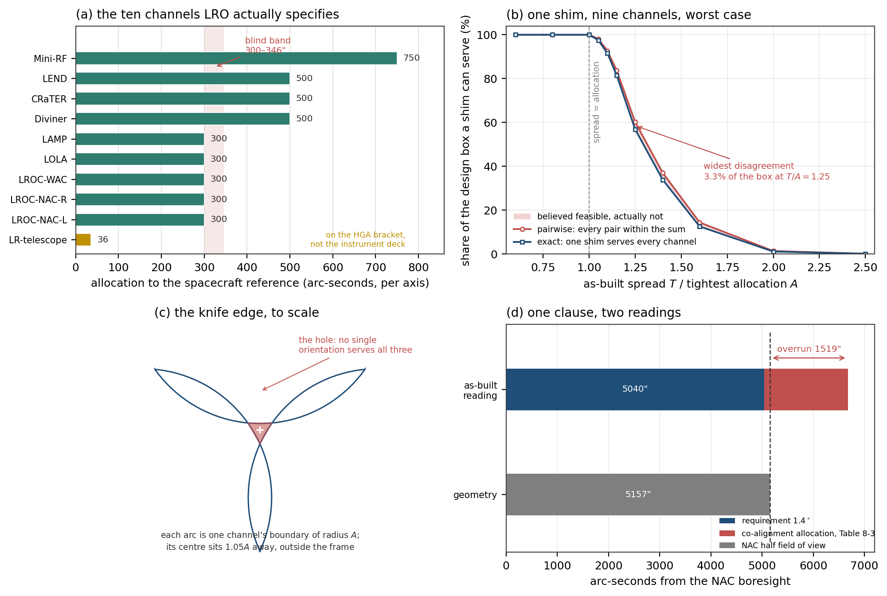

# 9.17 P3 回放：拿一套真实的十通道载荷公差表跑一遍

**结论先行**

1. **公开数据里找不到"两两表说是、实际不是"的反向证据，而且原因是结构性的，不是运气。** 真实表上，一次装夹（单共同姿态）的可行性判定与两两判据在 **3σ 约定下 1200 次抽样里 0 次分歧**；最坏情形下分歧也只占设计盒的 **3.3%**（在 $T/A=1.25$ 处取峰）。
2. **13.41% 是"容差值的百分比"，不是"设计的百分比"。** 这一点在前几节容易被读错，本节给出换算：对 300″ 的分配，盲带宽度是 **80.4″**（519.6″–600″），而一条机械公差带本身随工艺摆动就是成倍的——落进 13.41% 宽的一条缝里的概率，远小于 13.41%。
3. **真实表里唯一能核对的两处，工具都给出了正确结果**：Table 9-3 的两相机对预算 **102″ vs 103″，余量 1″**，工具独立复现 1″（$\rho=1.000$，两通道时两两判据本身就是精确判据）；Table 8-3 的 LOLA-入-NAC 视场条款，工具判 **UNDECIDED** 并指出两种读法相差 **1519″**。
4. **工具在真实表上真正多给的，不是那 13.41%，而是"分组"与"口径"两件事**：把激光测距望远镜（36″）计入仪器甲板时，不可行子集是 **{LAMP, 激光测距望远镜}**，而文档自己把这台望远镜装在 HGA 支架上、不在仪器甲板上——工具把文档的机械分区重新推了出来。
5. **P3 的门没有过。** 缺的不是一张公差表（公开的这张够用），缺的是那一列公开文件永远不会有的东西：**每台仪器的实测装订偏差**，以及**当时评审给出的结论**。没有这两列，"与实测一致且与两两表相反"这句话在公开数据上不可判定。
6. **对产品的直接含义**：目标客户从"任何多通道载荷"收缩到 **$A/\sigma\le2$ 且通道数 3–4** 的设计——也就是被成本压到极限、每条分配都吃紧的那一类。这个筛子五分钟就能在客户自己的表上跑完。

---

## 1. 数据：这套表是什么

输入是 NASA 月球勘测轨道器（LRO）的指向与对准规范，`431-SPEC-000113` Rev A，公开文件。它按仪器逐条给出"对准到航天器基准"的角分配，单位角秒、每轴、半锥（文档 §1.3 明写"half cone or +/- budgets"、"3 sigma or worst case"）：

| 通道 | 分配（″） | 条款 |
|---|---|---|
| LROC-NAC-L / NAC-R | 300 | §9.4.1 |
| LROC-WAC | 300 | §10.4.1 |
| LOLA | 300 | §8.4.1 |
| LAMP | 300 | §6.4.1 |
| Diviner | 500 | §5.4.1 |
| CRaTER | 500 | §4.4.1 |
| LEND | 500 | §7.4.1 |
| Mini-RF | 750 | §11.3.1 |
| 激光测距望远镜 | 36 | Table 12-1 |

十个通道、一个公共基准、每一行都有出处。原始 CSV 在 `analysis/data/lro_alignment_allocations.csv`，带 `section` 与原文引文两列。

**关于"脱敏"。** 公开文件不需要脱敏——真正需要脱敏的是合作方的实测记录，而那一列恰恰是公开文件没有的。所以本节不是"用合成数据冒充真实案例"，而是**用真实的前三列（名义、分配、基准）去跑，把缺的第四列（实测装订）当成参数扫出来**，而不是拍一个数填进去。这是本节唯一诚实的做法。

## 2. 模型：一次装夹等于一个平移向量

规范是逐台写的：每台仪器有自己的对准立方镜，各自调。更便宜的机械方案是**一个共用安装面**——垫一次，全体一起动。问：这一次垫片能不能把十台都送进各自的分配？

一次垫片提供一个向量 $x$；第 $i$ 台装订后残留是 $d_i-x$，$d_i$ 是实测装订偏差。于是问题变成平面上的圆盘交：

$$\exists\,x:\ \lVert x-d_i\rVert\le A_i\quad\forall i$$

300″ 是 0.083°，切平面近似的相对误差 $10^{-6}$ 量级。仍然做了两路互验：平面枚举（候选点 = 各圆心 ∪ 两圆交点）对 §9.16 的球面求解器，300 组随机、4 通道、$\sigma=160″$，**分歧 0 组**。

三个判据，强弱分明：

| 判据 | 形式 | 性质 |
|---|---|---|
| 逐台（文档字面） | $\lVert d_i\rVert\le A_i$ | 充分——$x=0$ 即可，此时垫片根本不需要 |
| 两两（"和"的算术） | $\lVert d_i-d_j\rVert\le A_i+A_j$ | 必要 |
| 精确（一次装夹） | 圆盘有公共点 | 充分必要 |

**一个必须点明的结构事实**：只要 $\lVert d_i\rVert\le A_i$ 对所有 $i$ 成立，三角不等式就保证 $\lVert d_i-d_j\rVert\le A_i+A_j$ 自动成立。也就是说，**两两判据在设计盒内是恒真的，它没有独立的分辨力**——它只是把逐台检查换了个写法。它唯一能说"不"的场合，是某台已经超了自己的分配、而垫片还想去救。

## 3. 回放 C1：文档里能核对的两处

### 3.1 两相机对：余量 1″，工具复现

Table 9-3：NAC-L 与 NAC-R 互相对齐的分配合计 **102″**，要求 **103″**（500 μrad），余量 **1″**。

两通道时最小包围圆就是直径圆，**两两判据在这里是精确判据**，所以这张表的方法本身没错。工具独立算出的容量也是 102″，余量 1.0″，$\rho=1.000$。

这正是缺陷能长期潜伏的原因：**文档里唯一一处真正做"和"的算术，恰好是两通道，恰好是精确的。** 换到三通道，同一个算法就会多算 13.41%，而文档里没有三通道的"和"。

### 3.2 LOLA 入 NAC 视场：一个口径值 1519″

§8.4.2 要求 LOLA 的视场落在某个 NAC 视场内 **1.4°（5040″）**，Table 8-3 给的共对准分配合计 **1636″**。而一个 NAC 的半视场是 $0.05\,\mathrm{rad}/2=1.4324°$，即 **5157″**。

几何余量只有 **117″**，分配却是 **1636″**——大 14 倍。两种读法：

- 读法甲：1.4° 是**名义摆放**的上限，误差分配在其内部花掉 → 可行，且还有余量；
- 读法乙：1.4° 是**装订后**的上限 → 分配会把 LOLA 顶出视场 **1519″**，条款不可满足。

文档没有写清是哪一种。工具的答案是 **UNDECIDED**，并把两种读法的差额算出来：**1519″**。这不是挑错，是三分法的用途——**一个要靠签字放行的条款，不允许"看你怎么读"**。

### 3.3 分组：工具把文档的机械分区推了出来

拿一次装订散布 $T=220″$ 的九台仪器：**甲板本身可行**（余量 140″）。把激光测距望远镜（36″）算进同一组，立刻不可行（缺口 34″），不可行子集是 **{LAMP, 激光测距望远镜}**，需放宽 **0.96″**。

文档 §12.0 写着："The Laser Ranging optic is mounted on the HGA bracket."——它本来就不在仪器甲板上。**工具从十个数字里推出的分区，和文档的机械分区是同一个。**

## 4. 回放 C2：一次装夹的救援容量

把装订散布 $T$ 作为唯一参数（盒内均匀，最坏情形口径），九台仪器、真实分配：

| $T/A$ | 0.6 | 0.8 | 1.00 | 1.05 | 1.10 | 1.15 | 1.25 | 1.40 | 1.60 | 2.00 |
|---|---|---|---|---|---|---|---|---|---|---|
| 两两判据 | 1.000 | 1.000 | 1.000 | 0.982 | 0.926 | 0.837 | 0.602 | 0.370 | 0.144 | 0.014 |
| 精确 | 1.000 | 1.000 | 1.000 | 0.976 | 0.915 | 0.815 | 0.569 | 0.338 | 0.126 | 0.011 |
| 表看不见的 | 0 | 0 | 0 | **0.6%** | 1.1% | 2.2% | **3.3%** | 3.2% | 1.8% | 0.2% |

三件事：

- $T/A\le1$ 时两条线重合且都是 1：**垫片不需要**，逐台检查本身就是答案。
- $T/A\in[1.05,1.6]$ 是一条窄带，分歧在这里取峰 **3.3%**。带外两侧都一致：左边两边都说行，右边两边都说不行。
- **分歧不是"13.41% 的设计"，而是"最多 3.3% 的设计盒"。** 前者是容差值的百分比，后者才是设计的百分比。这是本节最需要写清楚的一句。

盲带的绝对宽度按真实分配换算：300″ → **80.4″**（519.6–600）；500″ → 134″（866–1000）；750″ → 201″（1299–1500）。

## 5. 回放 C3：3σ 生产视角

文档自己声明分配是 3σ。按高斯装订误差、九台仪器：

| $A/\sigma$ | 1.2 | 1.6 | 2.0 | 2.4 | **3.0** |
|---|---|---|---|---|---|
| 两两判据 | 0.169 | 0.574 | 0.869 | 0.976 | **0.998** |
| 精确 | 0.158 | 0.558 | 0.860 | 0.975 | **0.998** |
| 表看不见的 | 1.2% | 1.6% | 0.9% | 0.08% | **0.0000** |

**在文档自己的约定（$A=3\sigma$）上，两条判据给出同一个答案，1200 次抽样里 0 次分歧。** 缺陷只活在 $A/\sigma\lesssim2$ 的区间——也就是分配被压到 2σ 甚至更低、每条都吃紧的设计里。

这与 §9.16 R1 的结论对得上：窗口在 $\kappa=1$（各通道容差彼此相当）取峰，任一通道拿到 2 倍余量就闭合。**"吃紧"是缺陷的必要条件，而 3σ 约定恰好是"不吃紧"。**

## 6. 为什么没有反向：三条结构性原因

1. **通道数。** 文档里唯一做"和"的地方是两通道（NAC 对），两通道时两两判据精确。缺陷要求 $n\ge3$ 且无对径对——真实表的通道要么成对（NAC、LR–RF）、要么按单目标写（LOLA 入 NAC），很少出现三台共用一个姿态的写法。
2. **共享 3σ 约定。** 分配是 3σ，装订散布是 1σ 量级，中间隔着一个 3 倍。缺陷要在"分配≈散布"处才发作。
3. **异构分配。** 十个通道的分配跨 36″–750″，宽的那几条（500、750）替窄的那几条吃了散布。R1 已经证明：任一通道拿到余量，窗口就闭合。

**这三条都不是这张表特有的，是航天指向规范这一类文档的通用写法。** 所以这不是"运气不好抽到一张干净的表"，而是"这类文档在设计上就绕开了这个缺陷"——它们用逐台立方镜，本来就不打算共用一个姿态。

## 7. P3 判据的裁决

§11 P3 的退出判据是：**至少一个案例上，工具结论与实际装配结果一致，且与当时的两两表结论相反。**

| 分句 | 本节能给的 | 裁决 |
|---|---|---|
| 与实测一致 | 只核到文档自己的算术（1″ 余量）与机械分区（LR 在 HGA 支架上） | **部分** |
| 与两两表相反 | 真实表上 0 次反向；最坏情形 3.3% | **未成立** |

**门没过。** 缺的是一列数据和一个记录：每台仪器的实测装订偏差、以及评审当时用的判据。公开文件里没有，合作方手里有。所以 P3 的下一步不是再找一张表，而是**拿到一列实测数**——这也是本节最该转达的一句话。

## 8. 对产品的含义

**收缩目标客户，不是收缩功能。**

- 从"任何多通道载荷"收缩到 **$A/\sigma\le2$**、通道数 **3–4**、各通道分配彼此相当（$\kappa\in[0.7,1.4]$）的设计。这是被成本压到极限的那一类，也正是 §9.16 说"缺陷最严重的地方正是真实设计所在的地方"所指向的那一类——但"真实设计"要加限定词：**吃紧的真实设计**。
- 三条五分钟筛子，可以在客户自己的表上直接跑：
  1. **$A/\sigma$**：分配是否 ≥2.5σ？是 → 一次装夹的耦合问题不存在，别卖。
  2. **通道数与分配离散度**：$n\ge5$ 或分配跨 2 倍以上 → $\rho\to1$，别卖。
  3. **是否存在"一个安装面、一次垫片"的机械约束**：没有 → 问题不成立。
- 反过来说，**真实表上工具仍然值钱的地方是另外两张卡**：不可行子集（谁不能和谁共板）与口径裁决（UNDECIDED + 差额）。这两张卡不依赖 13.41%，在 LRO 这张表上都能交付，而且都是评审要签字的东西。

## 9. 复现

```
PYTHONPATH=src python run_p3_replay.py     # -> outputs_p3/
python plot_p3_replay.py                   # -> analysis/figures/p3_replay.png
```

数据：`analysis/data/lro_alignment_allocations.csv`（十通道，带条款与原文）。
代码：`src/rpy_polar_synth/p3_replay.py`（平面枚举 + 两路互验 + 救援容量 + 口径裁决）。
输出：`lro_channels.csv`、`rescue_curve.csv`、`production_view.csv`、`summary.json`。



*图：(a) 文档实际给出的十条分配，盲带 300–346″ 阴影，最右一条 36″ 的望远镜在 HGA 支架上；(b) 九台仪器一次装夹的救援率随装订散布变化，两两判据与精确判定在 $T/A\in[1.05,1.6]$ 之间张开，峰 3.3%；(c) $T=1.05A$ 时三条边界弧在中心留出的洞，按比例画出；(d) LOLA 入 NAC 视场条款：要求 5040″ 加分配 1636″ 超出半视场 5157″，超额 1519″，只能判 UNDECIDED。*
